# 模电

## 第三章 双极型晶体管及其放大电路基础 · 3.1—3.9

**修订说明｜2026-10-21。** 本版在 3.1—3.9 现有框架内补回手写内容，保留旧版知识、推导、例题和六幅图。18 张手写图片均已逐页检查；手写文字、原有留白和删改另有完整影印附录。可辨认文字转写到对应知识位置；图形与被划去的字以影印为准，不声称文字转写替代了原图。

**阅读方式。** 深蓝原稿先读，后面紧接本次核对或修正；已有教材知识、AI 解释继续保留。在相应原位置折叠进阶讨论，只改变阅读层级，不重新安排章节。PDF 展开所有补充。旧版个人摘录作为历史整理保留，与本次逐图转写并列，避免丢失曾有的表述。

**资料层级。** “教材知识·归纳结论”是对提供教材基础内容的整理，并非教材逐字引文；含额外模型假设、数值复算和逻辑桥梁的内容标 AI。“AI 旧版转述”保留旧版句子，但不算你的逐字表达。主教材书名、版次仍待确认；这不影响按图中页码定位。

**资料差异记录。** 华成英辅导书印刷页 9 采用开启压降作工程工作区判据，原稿在图 11 用它解释“正偏”；结偏置的极性定义与明显导通的工程近似必须分层使用，不能把教材近似反过来改写为极性定义。静态模型中的固定压降与小信号模型的斜率也保留为两层描述。主教材例题的 $I_C\approx1.39\,\mathrm{mA}$、$U_{CEQ}\approx5.31\,\mathrm V$ 与旧版保留加载复算的 $1.242\,\mathrm{mA}$、$6.00\,\mathrm V$ 同时保留，差别来自近似和取值步骤。若课程考试要求指定近似口径，仍待你确认，本文不擅自删去另一口径。

**编辑顺序说明。** 同一张手写图跨越现有知识节时，按图中段落顺序分为上、下半，分别放回对应主题，原整页保留。图 7 的系数推理放在图 6 的连接方式之后，保留原稿这条思考顺序；旧版较早出现的电流关系仍在原处，属于并列查阅，不代替你的原推导。

**本章主线：器件为什么能放大 → 怎样搭出放大电路 → 先定静态，再算动态 → 比较三种组态。**

3.1 保留手写的四个大板块：**定义与结构、工作特点与原理、伏安特性曲线、晶体管等效模型**；主要参数、温度和选型归入相关板块。3.2—3.4 按手写部分 2 的“模型与参数 → 组成与工作 → 分析 → 稳定 Q 点”展开；3.5—3.9 按课本目录展开。本次到 3.9 为止，3.10 多级放大电路留在后续章节。

**来源标记（本次修订）。** 深蓝：按图转写的原始记录以及明确标注的上一版个人摘录；深灰：教材基础知识的整理；青绿：AI 推导、解释、旧版转述与新增例子；橙红：修正、边界与待核对。颜色表示来源和用途，不表示正确与否。“原稿整理”出自上一版 AI 的归并，现改标“AI 旧版转述”，不能冒充逐字原话。原始记录优先保留其论证顺序；正确计算式在后面的知识块提供。

**统一符号与条件（AI 补充）。** 以硅 NPN 管、室温、正常正向放大为主。电位用 $V_B,V_C,V_E$，电压统一取 $u_{XY}=v_X-v_Y$；NPN 的基极、集电极电流取流入管子，发射极电流取流出管子。$I_{CQ},U_{CEQ}$ 等为静态量；$i_c,u_{ce}$ 为相对于 Q 点的交流增量；$i_C=I_{CQ}+i_c$ 为总瞬时量；$\dot U,\dot I$ 为同一频率的相量，$U_m$ 为峰值。电流、电压的大小、瞬时值、有效值与峰峰值不混用。

直流电流放大系数用 $\bar\beta,\bar\alpha$，低频小信号系数用 $\beta,\alpha$；只有题目允许时才取 $\beta\approx\bar\beta$。$r_{be}$ 是晶体管输入小信号电阻，$r_{ce}$ 是模型的输出电阻，$R_i,R_o$ 是整个放大电路的端口电阻；$r_{bb'}$ 是基区体电阻。$R_1\parallel R_2=R_1R_2/(R_1+R_2)$。相量增益可含相位；本章的正负号主要用于中频同相、反相关系。

**查阅入口。** [3.1 器件](#chapter-3-1) · [3.2 指标](#chapter-3-2) · [3.3 组成与通路](#chapter-3-3) · [3.4 静态分析](#chapter-3-4) · [3.5 动态分析](#chapter-3-5) · [3.6 一般步骤](#chapter-3-6) · [3.7 共集](#chapter-3-7) · [3.8 共基](#chapter-3-8) · [3.9 比较](#chapter-3-9)。材料对应、修正清单和待确认项见 [整理依据](#source-register)。

### 3.1 双极型晶体管

本节前三大板块以手写部分 1 的图 1—11 为主；第四板块承接图 12—13，补全原稿尚未写出的模型。原图可在文末的材料表回看。

#### 一、定义与结构

**我的原始理解与记录｜手写部分 1 · 图 1｜定义与结构**

第 3 章 双极型晶体管及其放大电路基础。3.1 双极型晶体管。

定义与结构：

是什么：简称晶体管，是由三层杂质半导体材料（PN 结）组成的有源器件。（又称三极管 / BJT）

基本结构：一个晶体管的结构如下图所示。共有 2 种结构：NPN 与 PNP。

以 NPN 为例：由三个区域、两个 PN 结、三个电极组成。

三个区域为：发射区 E、基区 B、集电区 C。对应的 3 个电极为：发射极 E、基极 B、集电极 C。

3 个区域会形成 2 个 PN 结：E—B 为发射结，B—C 为集电结。PNP 结构也是同理。

2 者的电路符号为：[NPN、PNP 符号与区域示意图见原图]。箭头为发射极的电流方向。

[核对手写影印页](#facsimile-hand1-1) · [回到本节知识](#bjt-structure)

**核对判断：表述需要澄清，不否定原有结构框架。**

**需要修正的地方：** “三层杂质半导体材料（PN 结）”中的括号易把“区域”和“结”当成同一物体。

**为什么需要修正：** 半导体区是材料区域，PN 结是相邻 P、N 区的接合处；三个区形成两个结。依据李会方 BJT 课件的结构图。

**修正后的理解：** BJT 有三个半导体区、两个相互关联的 PN 结、三个电极。箭头所指是发射极的常规电流方向，电子运动方向与之相反。

**我的原始理解与记录｜手写部分 1 · 图 2 上半｜结构特点**

① 发射区相对基区掺杂浓度很大，以便有足够的载流子供“发射”。

② 基区很薄，掺杂浓度低于发射区，为减少载流子在基区的复合机会。

③ 集电区掺杂浓度低，且结面积大，为吸纳收集发射过来的载流子。

掺杂浓度：发射区 > 集电区 > 基区。

由此观之，BJT（双极型晶体管）的内部结构是非对称的，这也是其拥有放大作用的内部条件。

[核对手写影印页](#facsimile-hand1-2) · [回到本节知识](#bjt-structure)

**核对判断：正确的直观理解；掺杂排序需要条件。**

**需要修正的地方：** 保留“非对称”作为理解主线；三级掺杂排序不作为所有 BJT 的定义。

**为什么需要修正：** 器件结构和工艺会影响各区的具体浓度。发射效率与基区输运首先依赖发射区相对基区重掺杂、基区薄等条件。李会方课件与主教材在本章使用常见结构示意，并非给出所有工艺的统一排序。

**修正后的理解：** 在常见用于放大的 BJT 中，E、C 不对称，不能随意互换。原稿的结构性直观保留；三级排序只随具体教材示意或器件条件使用。

##### 三个区、两个结、三个极构成 BJT（3.1.1）

**教材知识·归纳结论。** 双极型晶体管 BJT 是具有 NPN 或 PNP 三个半导体区、两个相互关联的 PN 结和三个引出电极的有源器件。发射区 E、基区 B、集电区 C 分别引出发射极 e、基极 b、集电极 c；E—B 之间是发射结，C—B 之间是集电结。两个独立二极管简单拼接不能代替 BJT。

**AI 旧版转述（非逐字原稿）·理解。** 先把“区、结、极”分开：区是内部材料，结是相邻区域之间的 PN 结，极是接到外部电路的端子。符号上的箭头标在发射极，表示发射结正向导通时的**常规电流方向**：NPN 向外，PNP 向内；电子运动方向与常规电流相反。

**教材知识·归纳结论。** 常见用于放大的 BJT，发射区相对基区重掺杂，基区很薄且轻掺杂，集电区通常比发射区轻掺杂，并采用适合承受反偏、收集载流子和散热的结构。E、C 的结构与功能不对称，不能随意互换。

**AI 旧版转述（非逐字原稿）·理解。** 发射区负责提供载流子；薄而轻掺杂的基区让大多数注入载流子来得及穿过；集电区接收它们并承受较大电压。这是放大作用的内部基础。

**我的理解·上一版摘录（逐字以本次转写为准）（图 2）。**

> 由此观之，BJT（双极型晶体管）的内部结构是非对称的，这也是其拥有放大作用的内部条件。

**AI 补充边界。** 原图写有“掺杂浓度：发射区 > 集电区 > 基区”。本章保留真正影响机理的比较：发射区比基区重掺杂、基区薄、集电区比发射区轻掺杂。不同工艺的集电区与基区掺杂排序可能不同，不能把这条三级排序当作所有 BJT 的定义。

#### 二、工作特点与原理

**我的原始理解与记录｜手写部分 1 · 图 2 下半｜工作特点与原理**

BJT 最主要的特点就是放大作用。

准确来说，是一种控制作用：输入较小量却可输出较大量。以小的输入控制大的输出，如同“放大”。

在输入端用一个小的变化量去控制能源使输出一个大于输入的相应的变化量。

拥有放大作用的内外部条件：内部：满足对应的物理结构。外部：发射结正偏、集电结反偏。

[核对手写影印页](#facsimile-hand1-2) · [回到本节知识](#bjt-active)

**我的原始理解与记录｜手写部分 1 · 图 3｜不同工作状态**

BJT 的不同工作状态：

① 发射结正偏、集电结反偏时，处于放大状态，对 NPN 来说，$U_C>U_B>U_E$。

② 发射结正偏、集电结正偏时，处于饱和状态。

③ 发射结反偏、集电结反偏时，处于截止状态。

④ 发射结反偏、集电结正偏时，处于倒置放大状态。

双极型晶体管在不同的外部条件下表现出不同的特点，其中放大是 BJT 最主要的外部条件。

放大的内部工作原理：[原图保留 NPN 三个区、载流子箭头、$I_{EN},I_{EP},I_{CN},I_{BN},I_{CB0}$、$R_B,R_C,U_{BB},U_{CC}$ 的连接。空心点为空穴，实心点为电子。]

[核对手写影印页](#facsimile-hand1-3) · [回到本节知识](#bjt-active)

**核对判断：措辞与近似范围需要澄清。**

**需要修正的地方：** “放大是最主要的外部条件”中的“放大”实际指工作状态；截止的“两结反偏”是典型情形，不是所有近似截止的唯一判据。

**为什么需要修正：** 外部条件是结偏置，放大／截止是由器件与偏置共同决定的状态。华成英辅导书印刷页 9 用开启电压近似判工作区，和理想结偏置定义的层级不同。

**修正后的理解：** 两结偏置表保留；本章主要研究正向放大。工程上没有明显发射注入即可近似截止，勿把正向微小电压自动等同明显导通。

##### 正向放大要求发射结正偏、集电结反偏（3.1.3）

**教材知识·归纳结论。** 正常正向放大需要相应的内部结构，并使发射结正偏、集电结反偏，同时避免击穿。在具有明显导通电流的硅 NPN 管中，通常有 $V_C>V_B>V_E$。仅有电位排序还不能指定电流大小，仍须结合器件特性与外电路。

**我的理解·上一版摘录（逐字以本次转写为准）（图 2）。**

> 准确来说，是一种控制作用：输入较小量却可输出较大量。以小的输入控制大的输出，如同“放大”。
>
> 在输入端用一个小的变化量去控制能源，使输出一个大于输入的相应的变化量。

**AI 补充理解。** 信号决定输出怎样变化，直流电源提供主要能量。谈“电流放大”“电压放大”时必须指明输入、输出量；晶体管的电流分配关系与整个电路的电压增益是两层问题。

##### 两个结的偏置决定四种工作状态

**教材知识·归纳结论。** 未击穿时，按两个结的偏置，BJT 可分为下列四种状态。表中的正、反偏是 PN 结两侧电位的比较；近似截止还包括发射结正向电流小到可忽略的情形。

| 状态 | 发射结 | 集电结 | NPN 的结电压关系 | 本章的用途 |
| --- | --- | --- | --- | --- |
| 正向放大 | 正偏 | 反偏 | $u_{BE}>0,\ u_{BC}<0$，且有合适的电流 | 线性放大 |
| 饱和 | 正偏 | 正偏 | $u_{BE}>0,\ u_{BC}>0$ | 开关导通或放大失真 |
| 截止 | 无明显正向注入，典型为反偏 | 通常反偏 | 典型为 $u_{BE}\le0,\ u_{BC}<0$ | 开关关断或放大失真 |
| 反向放大 | 反偏 | 正偏 | $u_{BE}<0,\ u_{BC}>0$ | E、C 作用倒置，性能通常较差 |

**AI 补充推理。** NPN 的发射结是 P 基区对 N 发射区；$V_B>V_E$ 为正偏。集电结是 P 基区对 N 集电区；$V_C>V_B$ 为反偏。PNP 时电位次序反转，正向放大为 $V_E>V_B>V_C$。

> **原稿修正。** 图 11 最后把“正偏”改成了“超过开启电压才算正偏”。应分开：**正偏是偏置极性的定义；明显导通是电流大小的近似判断**。正向 $0.1\,\mathrm V$ 仍是正偏，只是常温硅管的电流可能很小。$0.7\,\mathrm V$ 是常用导通压降估值，没有绝对突变的开启门槛。

**我的原始理解与记录｜手写部分 1 · 图 4｜发射、扩散复合、收集**

① 发射区向基区发射粒子——电子。

由于发射结是正偏的，在 $PN^+$ 区域中，多子的扩散占主导，则有电子从 $N^+\to P$，有空穴从 $P\to N^+$，前者形成 $I_{EN}$，后者形成 $I_{EP}$，电流方向从 P 指向 $N^+$。

但由于基区掺杂浓度远小于发射结浓度，$I_{EP}\ll I_{EN}$，近似认为发射极电流 $I_E=I_{EN}$。

② 电子到达基区后边扩散边复合。

由于发射极中 $e^-$ 的注入，P 区内靠近 $N^+$ 区的 $e^-$ 浓度大，靠近 N 区的 $e^-$ 浓度小，故 $e^-$ 会发生扩散，在扩散途中 $e^-$ 也会不断与 $h^+$ 复合。为了补充损失的 $h^+$，外接电源会向 B 极输送 $h^+$，形成电流 $I_{BN}$，方向为从基极 B 流入晶体管。

由于基区掺杂浓度低且薄，所以大部分 $e^-$ 都穿过基区流向集电区，少部分被复合，故 $I_{BN}$ 很小。

③ 集电区收集扩散过来的电子。

对于集电结而言，PN 是反偏的，漂移加强，即电子从 $P\to N$，空穴从 $N\to P$，前者形成 $I_{CN}$，后者形成 $I_{CB0}$，电流方向从 N 指向 P。

由于电子数目多且 $I_{CB0}$ 是由本征激发的少子 $h^+$ 形成的反向饱和电流，所以 $I_{CN}\gg I_{CB0}$，集电极电流近似为 $I_C=I_{CN}$（但 $I_{CB0}$ 受温度影响大）。

综上，不难发现，晶体管内部有 2 种载流子共同参与导电，但主导该过程的是由发射极发出、经过基区、由集电区接收的自由电子，其为主过程，其余为次。

[蓝笔补记] 故称为“双极型晶体管”。[“发射极”旁另有“区”的改字，保留见影印。]

[核对手写影印页](#facsimile-hand1-4) · [回到本节知识](#carrier-process)

**核对判断：主体推理正确；漏电分量有实质性遗漏。**

**需要修正的地方：** “发射结浓度”应指发射区掺杂浓度；把整个反向漏电流只归给少子空穴并不完整。

**为什么需要修正：** 发射、基区扩散复合、集电结收集的三步解释是有效主干。反偏 PN 结的少数载流子电流包含两侧贡献，不只有空穴；原稿中的注入电子收集电流也不能与本底漏电混为一项。依据李会方 BJT 课件的载流子过程。

**修正后的理解：** NPN 主要由注入电子形成集电极电流，同时保留小的反向漏电。$I_E\approx I_{EN}$、$I_C\approx I_{CN}$ 都是在相应小分量可忽略时的近似；PNP 的载流子角色相反。

##### 发射、扩散与复合、收集共同形成三极电流

**教材知识·归纳结论。** 对正向放大的 NPN 管，发射区向基区注入的电子，大多数穿过基区后被集电结电场收集，少数在基区复合；基极电流主要补充复合所需的空穴，并含基区向发射区的空穴注入等分量。因此通常 $I_C$ 与 $I_E$ 接近，而 $I_B$ 较小。

**AI 旧版转述（非逐字原稿）·理解。** 保留原稿的三步：

1. **发射区向基区发射电子。** 发射结正偏，电子从 N 发射区向 P 基区注入，同时也有空穴向发射区注入；重掺杂发射区使电子注入占主要部分。
2. **电子在基区扩散，少部分复合。** 发射结一侧的过剩电子浓度高，集电结一侧低，浓度梯度推动扩散。基区薄而轻掺杂，复合比例小；外电路通过基极补入空穴。
3. **集电区收集到达集电结的电子。** 集电结反偏，空间电荷区中的电场将到达边缘的电子扫入集电区。集电结仍有本身的反向漏电流，但在常用工作电流下通常较小。

**我的理解·上一版摘录（逐字以本次转写为准）（图 4）。**

> 晶体管内部有 2 种载流子共同参与导电，但主导该过程的是由发射极发出、经过基区、由集电区接收的自由电子，其为主过程，其余为次。

**AI 补充说明。** 这段原话针对 NPN 管；PNP 中主导载流子换为空穴。两结通过同一个很薄的基区相互影响，正是两个独立二极管不能替代 BJT 的原因。

##### 电流守恒是严格约束，放大系数关系带有模型条件

**教材知识·归纳结论。** 按本章 NPN 方向约定，总电流恒满足 KCL：$I_E=I_B+I_C$。在正向放大、给定工作范围内，采用含漏电流的简化模型，可写

$$
\begin{aligned}
I_C&=\bar\alpha I_E+I_{CBO},\\
I_C&=\bar\beta I_B+(1+\bar\beta)I_{CBO},\\
\bar\beta&=\frac{\bar\alpha}{1-\bar\alpha},\qquad
\bar\alpha=\frac{\bar\beta}{1+\bar\beta}.
\end{aligned}
$$

**适用条件与符号。** $I_{CBO}$ 是**发射极开路**时集电结的反向漏电流。只有漏电流相对工作电流可忽略时，才用 $I_C\approx\bar\beta I_B$、$I_C\approx\bar\alpha I_E$；这些式子不适用于饱和状态。

**AI 旧版转述（非逐字原稿）·理解。** 原稿把“分配关系／放大关系”放在同一处很有价值：$\bar\alpha$ 接近 1，说明发射极注入的电流大多到达集电极；$\bar\beta$ 较大，说明剩余的基极电流很小。不是从基极输入的一小股电流被凭空复制出能量。

**AI 旧版转述（非逐字原稿）·载流子分量。** 沿用图 5 的电流分量大小记法，$I_{EN}$ 是发射结电子注入分量，$I_{EP}$ 是空穴反向注入分量，$I_{CN}$ 是被收集的注入电子形成的分量，$I_{BN}$ 是基区复合所需分量，则

$$
\begin{aligned}
I_E&=I_{EN}+I_{EP}\approx I_{EN},\\
I_C&=I_{CN}+I_{CBO}\approx I_{CN},\\
I_B&=I_{BN}+I_{EP}-I_{CBO}.
\end{aligned}
$$

**AI 补充推理。** 把 $I_E=I_B+I_C$ 代入 $I_C=\bar\alpha I_E+I_{CBO}$，移项得 $(1-\bar\alpha)I_C=\bar\alpha I_B+I_{CBO}$，于是得到含漏电流的共射式。原稿用 $I_{CN}/I_{BN}$ 直观解释 $\bar\beta$ 时，已隐含忽略空穴反向注入等分量；严格计算应采用端口电流和规定的漏电修正。

**AI 补充例子。** $\bar\beta=99$ 时，$\bar\alpha=0.99$。忽略漏电，若 $I_B=10\,\mu\mathrm A$，则 $I_C=0.99\,\mathrm{mA}$，$I_E=1.00\,\mathrm{mA}$。

**我的原始理解与记录｜手写部分 1 · 图 5｜电流关系与控制关系的思考**

电流关系：

$$
\begin{aligned}
I_B&=I_{BN}-I_{CB0}+I_{EP}\quad\text{（方向：从 B 极流入晶体管）},\\
I_C&=I_{CN}+I_{CB0}\approx I_{CN}\quad\text{（方向：从 C 极流入晶体管）},\\
I_E&=I_{EN}+I_{EP}\approx I_{EN}\quad\text{（方向：从 E 极流出晶体管）}.
\end{aligned}
$$

且由 KCL 可得：$I_E=I_B+I_C$。

简画一个基本的 BJT 电路图：[见图 5]。在使用 BJT 时，一般将 $i_B$ 作为输入，$i_C$ 作为输出，认为由 $i_B$ 对 $i_C$ 进行放大控制。

但这个是一种人为规定的便于使用的关系，接下来进行解释：

由图可知，该图可以看作由 2 个网孔构成：$U_{BB}\to R_B\to B-E$ 与 $U_{CC}\to R_C\to C-E$，B 网孔的网孔电流为 $i_B$，C 的为 $i_C$，而 $i_E=i_B+i_C$（2 者交汇处）。整个电路外接了 2 个重要电源：$U_{BB}$ 与 $U_{CC}$。

其中，$U_{BB}$ 为正偏电压，其大小决定了主过程电子的多少，影响 $i_B,i_C,i_E$ 的大小；而 $U_{CC}$ 为反偏电压，其大小几乎不会影响 3 个电流的大小，其负责提供能量。

故而不难看出，B 回路可显著影响 C 回路，C 回路却无法显著影响 B 回路，故自然而然地看作 B 控制 C。当然，实际上是由 $U_{BB}$ 控制 $i_B,i_C$ 与 $i_E$，$i_B$ 与 $i_C,i_E$ 是一个整体，本身无控制关系，但由于内部结构规律，$i_B$ 与 $i_C$ 有固定关系，即 $i_C=\beta i_B$（$\beta$ 为放大倍数）。

为了方便，用 $i_B$ 控制 $i_C$ 来代替 B 回路控制 C 回路，B 回路为输入回路，$i_B$ 为～；C 回路为输出回路，$i_C$ 为～。

[核对手写影印页](#facsimile-hand1-5) · [回到本节知识](#control-view)

**核对判断：有价值的模型思考；“固定关系”需补条件。**

**需要修正的地方：** 不能把“人为规定”理解成物理关系任意；$U_{CC}$ 与三电流近似无关、$i_C=\beta i_B$ 都受模型与工作区约束。

**为什么需要修正：** 两个回路通过同一器件耦合，这是原稿抓住的重点。输入端口的选择是人为的，器件的注入、复合、输运过程是物理约束。输出供电不足会使器件饱和，输出特性的有限斜率也带来影响。

**修正后的理解：** 在正向放大且忽略反向影响、漏电和参数变化时，可用 $I_C\approx\bar\beta I_B$；也可用结电压描述注入。把“用哪一种模型描述控制”与“是否存在器件约束”分开，保留两回路的原始思考链。

##### 输入回路与输出回路通过器件特性相互联系

**AI 补充·模型结论。** 在正向放大、忽略 Early 效应与反向传输的简化模型中，给定基极电流可用 $I_C\approx\bar\beta I_B$ 确定集电极电流；输出回路的电源与电阻还必须允许这股电流流通。输出条件不满足时，管子会离开放大区。

**我的理解·上一版摘录（逐字以本次转写为准）（图 5）。**

> 但这个是一种人为规定的便于使用的关系，接下来进行解释。
>
> B 回路可显著影响 C 回路，C 回路却无法显著影响 B 回路，故自然而然地看作 B 控制 C。

**AI 补充理解。** 你的重点是：输入和输出的选取服务于电路分析，$I_B,I_C,I_E$ 是同一器件的整体行为。这里保留“便于使用的描述关系”，同时补足物理层面：正向注入由结电压决定，常用近似为 $I_C\approx I_S e^{U_{BE}/V_T}$；$I_C\approx\bar\beta I_B$ 是另一种常用端口描述。两种模型可以配合使用。

> **原稿修正。** 图 5 的“$U_{CC}$ 的大小几乎不会影响三个电流”只在放大区、输出特性近似平坦且不触及电源限制时成立。图 6 的“只有一个独立电流变量”同样只指采用固定 $\bar\beta$、忽略漏电后的三电流关系；不能据此说三端器件只有一个独立电学变量。$U_{CE}$ 仍是器件和外电路共同确定的量。

**我的原始理解与记录｜手写部分 1 · 图 6｜独立变量与三种连接**

这个电路看似是有 2 个独立网孔、2 个独立电流，但 $i_C$ 与 $i_B$ 有关联，$i_C=\beta i_B$，故这个电路实际上只有 1 个独立电流变量。

此处插入 BJT 配在电路中的 3 种连接方式：

① 共发射极连接：（CE）基极输入，集电极输出，发射极为公共端。即：$I_B\to I_C$，$I_C=\beta I_B$。

即我们上述所说的那些，基础都是 CE（共发射极）。当然，基本思想与工作结构是通的，只是输入、输出以及输入与输出的关系变了。

② 共基极连接：（CB）发射极输入，集电极输出，基极为公共端。即：$I_E\to I_C$，$I_C=\alpha I_E$。

③ 共集电极连接：（CC）基极输入，发射极输出，集电极为公共端。即：$I_B\to I_E$，$I_E=(1+\beta)I_B$。

综上，可把放大电路看作一个二端口网络，有一个输出端口、一个输入端口。

[核对手写影印页](#facsimile-hand1-6) · [回到本节知识](#three-connections)

**核对判断：简化模型下成立的计数；不是完整端口自由度结论。**

**需要修正的地方：** “一个独立电流变量”须限定为固定 $\beta$、忽略漏电后的三电流关系。

**为什么需要修正：** KCL 加上所选模型能把三电流用一个电流表示，但 $U_{CE}$ 仍参与器件与外电路的约束。三个电流相关不表示三端器件只有一个独立电学量。

**修正后的理解：** 保留电流变量计数用于简化电路计算；判断工作点时仍需输入、输出回路与工作区校验。

**我的原始理解与记录｜手写部分 1 · 图 7｜分配关系／放大关系系数**

一个输入回路，一个输出回路。根据输入输出所接极不同，分为以上 3 种连接方式。这 3 种都为放大电路，只是放大的侧重对象（$i,u,p$）不同。

分配关系 / 放大关系系数：

① 共发射极直流电流放大系数 $\bar\beta$。即在共发射极下，输出电流与输入～的关系：

$$
\bar\beta=\frac{I_{CN}}{I_{BN}}\approx\frac{I_C-I_{CB0}}{I_B+I_{CB0}}
$$

（一般在 20～200 之间）。[蓝笔] 描述了基区中非平衡少子的扩散和复合的比例。

$$
I_C=\beta I_B+(1+\beta)I_{CB0},\qquad
I_E=I_B+I_C=(1+\beta)(I_B+I_{CB0}).
$$

② 共基极直流电流放大系数 $\bar\alpha$。此时发射极输入，集电极输出。

$$
\bar\alpha=\frac{I_{CN}}{I_{EN}}\approx\frac{I_C-I_{CB0}}{I_E};\qquad
I_C=\bar\alpha I_E+I_{CB0},\quad
I_B=(1-\bar\alpha)I_E-I_{CB0},\quad I_E=I_B+I_C.
$$

[原稿另写“一般在……之间”，该范围末两位字迹为【原文待核对】；不替换成教材常见值。]

且 $\bar\beta=\bar\alpha/(1-\bar\alpha)$，$\bar\alpha=\bar\beta/(1+\bar\beta)$。

$\bar\alpha,\bar\beta$ 均与 BJT 的基区宽度、掺杂浓度、发射区的掺杂浓度等有关。换言之，$\bar\alpha,\bar\beta$ 是晶体管本身的特性，由 BJT 的内部物理组成与结构决定。

[核对手写影印页](#facsimile-hand1-7) · [回到本节知识](#three-connections)

**核对判断：近似结论与符号层级需要说明。**

**需要修正的地方：** 由注入／复合分量定义的比值，与端口直流放大系数之间用了近似；原稿推式中的 $\beta$ 有时未加横线。

**为什么需要修正：** 忽略 $I_{EP}$ 等小分量后，分量比才可直接连接到此处的端口式。不同教材也可能直接用 $I_C/I_B$ 定义工程直流比值。此处不把包含漏电修正的定义与未修正比值强行当成同一定义。

**修正后的理解：** 原稿记法照录。规范计算中以教材所给定义和条件为准：忽略漏电时 $\bar\beta\approx I_C/I_B$、$\bar\alpha\approx I_C/I_E$；小信号系数另用 $\beta,\alpha$。数值范围只是常见范围，不是定义。

##### 输入端、输出端与公共端确定三种连接（3.1.2）

**教材知识·归纳结论。** 常见单管放大器按输入、输出共用的电极分为 CE、CB、CC。这里的“公共”主要指**信号的公共参考端**，不要求直流电位为零。

| 连接 | 输入电极 | 输出电极 | 公共电极 | 忽略漏电的器件电流关系 |
| --- | --- | --- | --- | --- |
| 共发射极 CE | B | C | E | $I_C\approx\bar\beta I_B$ |
| 共基极 CB | E | C | B | $I_C\approx\bar\alpha I_E$ |
| 共集电极 CC | B | E | C | $I_E\approx(1+\bar\beta)I_B$ |

**我的理解·上一版摘录（逐字以本次转写为准）（图 7）。**

> 可把放大电路看作一个二端口网络，有一个输出端口、一个输入端口。根据输入输出所接极不同，分为以上 3 种连接方式。这 3 种都为放大电路，只是放大的侧重对象（$i,u,p$）不同。

**AI 补充边界。** 表中比较的是晶体管电极电流，整个电路的输入电流还可能分流到偏置电阻，负载电流也不一定等于电极电流。放大倍数须按实际端口重新计算。

**我的原始理解与记录｜手写部分 1 · 图 8｜电压放大作用**

对于一个共射极放大电路：[见原图上半]。

如图，如果在输入回路中加入微小的输入信号 $\Delta u$，此时接在发射结两端的正偏电压 $U_{BE}$ 改变，$U_{BE}=E_{BB}+\Delta u-i_BR_b$。

则 $U_{BE}$ 增大，根据 PN 结正偏的伏安特性曲线可知，$u$ 对 $i$ 有很强的控制作用，$U_{BE}$ 增大，会引起 $i_E$ 变化较大 → $\Delta i_E$，引起 $\Delta i_B$，进而引起 $i_C$ 的较大变化 $\Delta i_C=\beta\Delta i_B$。集电极上的负载电阻 $R_C$ 把 $\Delta i_C$ 转换为较大的输出电压变化量 $\Delta i_CR_C$。

$$
\Delta u\to\Delta U_{BE}\to\Delta i_B
\xrightarrow{\beta}\Delta i_C
\xrightarrow{R_C}\Delta U_{\mathrm{out}}=\Delta i_CR_C.
$$

由 $\Delta u\to\Delta U_{\mathrm{out}}$，实现了电压的放大。可知：共射极电路既有电流放大能力，也有电压放大能力。

准确来说，$U_{BE}$ 增大，载流子 $e^-$ 增多，进而引起 $i_B,i_C,i_E$ 同步增大。

对于一个共集极电路：[原稿此处确写“共集极”；电路图见下半，保留原题注，不在引文中改名。]

也是同理。$\Delta u\to\Delta U_{BE}\to\Delta i_E\xrightarrow{\alpha}\Delta i_C\xrightarrow{R_C}\Delta U_{\mathrm{out}}$。从 $\Delta u\to\Delta U_{\mathrm{out}}$，实现了电压放大。

[核对手写影印页](#facsimile-hand1-8) · [回到本节知识](#voltage-original)

**核对判断：电压转换直观正确；标题与带符号增量需修正。**

**需要修正的地方：** 下半页标题“共集极”与电路不一致；上半页 $\Delta U_{out}=\Delta i_CR_C$ 没有标清幅度或符号。

**为什么需要修正：** 下半页基极是公共端，发射极输入、集电极输出，且用 $\alpha$ 把 $i_E$ 连到 $i_C$，符合 CB；这与李会方共基／共集课件的端口定义一致。CE 中电源固定时 $u_C=U_{CC}-i_CR_C$。

**修正后的理解：** 下半页按共基极理解，原题注保留作修正记录。CE 输出对地的带符号增量为 $\Delta u_o=-R_C\Delta i_C$；若只说幅度，应写 $|\Delta u_o|=R_C|\Delta i_C|$。不改掉“电流变化经电阻变成电压变化”的理解。

##### 电流变化经负载电阻变成电压变化

**教材知识·归纳结论。** 对发射极交流接地、集电极经 $R_C$ 接理想电源的 CE 电路，若无交流负载且保持放大，$u_{ce}=-i_cR_C$；有交流负载时改为 $u_o=-i_c(R_C\parallel R_L)$。因此电压能否放大还取决于电路电阻与输入阻抗，不能只看 $\beta$。

**AI 旧版转述（非逐字原稿）·理解与推理（图 8）。** 保留原稿的变化链，并明确反相：

$$
\Delta u_i\ \longrightarrow\ \Delta u_{BE}
\ \longrightarrow\ \Delta i_B
\ \xrightarrow{\ \beta\ }\ \Delta i_C
\ \xrightarrow{\ -R_C\ }\ \Delta u_{CE}.
$$

无负载时由 $u_{CE}=U_{CC}-i_CR_C$ 得到负号。输入增大，电流增大，$R_C$ 压降增大，集电极电位反而降低。CB 也可将电流变化转换为电压变化，但输入定义不同，结果同相；CC 的电压增益通常小于 1，却可放大电流和功率。

> **原稿修正。** 图 8 写 $\Delta U_{out}=\Delta i_CR_C$ 时表达的是变化幅度；若表示带符号的集电极电压增量，应有负号。后文所有增益统一区分幅值与符号。

#### 三、伏安特性曲线

**我的原始理解与记录｜手写部分 1 · 图 9｜输入特性曲线**

伏安特性曲线。晶体管有 3 个极，为了描述其电学特性，我们用 2 个伏安特性，输入伏安特性与输出伏安特性来描述。

普通的二端器件，有 2 个参数：$u$ 与 $i$。对于三极管，则有 4 个：$U_{BE},U_{CE},i_B,i_C$。

① 输入特性曲线。描述在 $U_{CE}$ 一定的情况下，$i_B$ 与 $U_{BE}$ 的关系。即 $i_B=f(U_{BE})|_{U_{CE}=\text{常数}}$。

1）$U_{CE}=0\,\mathrm V$。此时集电极与发射极短路，集电结不收集 $e^-$，整个 BJT 类似于一个 PN 结：$U_{BE}<U_{BE(\mathrm{on})}$ 时，截止，$i_B=0$；$U_{BE}>U_{BE(\mathrm{on})}$ 时，$U_{BE}$ 与 $i_B$ 关系近似于 PN 结。

2）$0<U_{CE}<m$ 时。来说明一下此时 $U_{CE}$ 的影响，在该区间内，$U_{CE}\uparrow$，会使基区变窄，集电区变宽（基调效应），进而使在基区的复合概率下降，使得在 $U_{BE}$ 相同的情况下 $i_B$ 略变小，$i_C$ 略变大（也就是影响了分配关系 $\beta$）。

3）$U_{CE}>m$ 时。当 $U_{CE}$ 大于一定电压值时，基区大部分 $e^-$ 都进入了集电区，$U_{CE}$ 的改变不再对 $i_B,i_C$ 有明显的影响。

[保留原图：横轴 $U_{BE}/\mathrm V$，纵轴 $i_B$ 的单位字迹【原文待核对】；三条曲线标 $U_{CE}=0\,\mathrm V$、$0.5\,\mathrm V$、$\ge1\,\mathrm V$。]

[核对手写影印页](#facsimile-hand1-9) · [回到本节知识](#input-characteristic)

**核对判断：曲线思路正确；器件区域与近似需要澄清。**

**需要修正的地方：** “集电区变宽”不应理解成准中性集电区整体变宽；$U_{CE}=0$ 时不等于两个结中仅剩一个结。

**为什么需要修正：** 反偏增大使集电结耗尽层扩展并压缩有效基区。$C,E$ 外部短接时，B 对两个同类型外区形成两个结的端口组合，输入特性呈二极管样并不等于内部只剩一个 PN 结。

**修正后的理解：** 保持“固定一个量看另两个量”的读图法。$m$ 没有在原稿中确定，不填猜测值；进入常用放大范围后，输入曲线差异常可近似忽略，但并非严格为零。

##### 输入曲线在固定输出电压下描述输入电流（3.1.4）

**教材知识·归纳结论。** 共射输入特性是保持 $u_{CE}$ 不变时，$i_B$ 随 $u_{BE}$ 的关系，写作 $i_B=f(u_{BE})\big|_{u_{CE}=\mathrm{const}}$。在正常工作范围，形状类似正向 PN 结特性：$u_{BE}$ 增加，$i_B$ 非线性上升。它不是一个固定电阻。

**AI 旧版转述（非逐字原稿）·理解。** 两端器件的一条 $u$—$i$ 曲线可描述端口关系；共射 BJT 有输入、输出两组量 $u_{BE},i_B,u_{CE},i_C$，所以画一组曲线时，要固定另一个输出条件。

**AI 旧版转述（非逐字原稿）·$u_{CE}$ 的影响（图 9—10）。** $u_{CE}=0$ 与正常放大时的输入曲线不同。$u_{CE}$ 增大、集电结反偏增强后，基区有效宽度会改变，复合与电流分配也可能改变；进入正常放大工作范围后，不同 $u_{CE}$ 的输入曲线通常已很接近，手算常忽略该影响。

> **原稿修正。** 原稿用未定数值 $m$ 划分“$u_{CE}\ge m$ 后完全无影响”。没有适用于所有晶体管的统一 $m$，也不存在普遍的“完全无影响”。本文保留趋势与近似条件，不为原稿中的 $m$ 猜一个数值。

**我的原始理解与记录｜手写部分 1 · 图 10｜由输入曲线到输出曲线**

综上，若 $U_{CE}$ 固定，$U_{BE}$ 与 $i_B$ 的关系有类似 PN 结的特性，即：$U_{BE}<U_{BE(\mathrm{on})}$ 时，截断；$U_{BE}>U_{BE(\mathrm{on})}$ 时，$i_B$ 随 $U_{BE}$ 增大呈指数增长关系。

而 $U_{CE}$ 对 $i_B,i_C$ 的影响：$0<U_{CE}<m$（某一值）时，随着 $U_{CE}\uparrow$，$\beta$ 略有 ↑；$U_{CE}\ge m$ 时，对 $i_B,i_C$ 无影响。

② 输出特性曲线。描述的是 $i_B$ 为常量时，$i_C$ 与 $U_{CE}$ 间的关系。即 $i_C=f(U_{CE})|_{i_B=\text{常数}}$。

对于每个 $i_B$ 都有一个对应的特性曲线 $i_C$，故而输出特性是一簇曲线。

而对每一条曲线而言：当 $U_{CE}$ 从 0 逐渐增大时，$i_C$ 随之增大；到 $U_{CE}$ 达到一定值后，$i_C$ 不受 $U_{CE}$ 影响；当 $U_{CE}$ 过大时，会引起集电结反向击穿，$i_C$ 剧增。

接下来阐述放大、饱和、截止 3 大工作状态。[图中的放大区、饱和区、截止区、击穿区与曲线族均保留在影印页。]

[核对手写影印页](#facsimile-hand1-10) · [回到本节知识](#output-characteristic)

**核对判断：需要补充近似条件。**

**需要修正的地方：** “达到某电压后无影响”不能理解成严格不变。

**为什么需要修正：** 图上曲线近似水平是简化模型，而真实器件存在有限输出斜率。图 9 的“没有明显影响”比本页“无影响”更接近工程近似。

**修正后的理解：** 固定 $i_B$ 时，常用放大区内 $i_C$ 对 $U_{CE}$ 的依赖较弱，可按题意忽略；接近饱和或击穿时不能沿用。保留两页原来的措辞差别。

##### 输出曲线在固定基极电流下区分放大、饱和与截止

**教材知识·归纳结论。** 共射输出特性是 $i_C=f(u_{CE})\big|_{i_B=\mathrm{const}}$；不同 $i_B$ 对应不同曲线，合起来是一族曲线。保持正向放大时，每条曲线通常较平坦；小 $u_{CE}$ 时进入饱和区；无明显发射注入时接近截止；超过耐压可能击穿。

**AI 图示｜沿用上一版。**

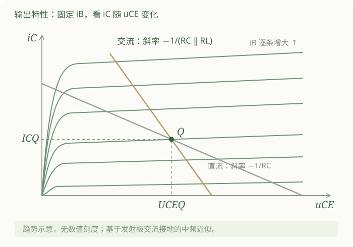

**AI 旧版转述（非逐字原稿）·理解。** 查曲线要先看“固定了谁”：固定 $i_B$ 沿一条曲线移动，才是在看 $u_{CE}$ 的影响；改变 $i_B$ 则切换到另一条曲线。放大区内“近似水平”意味着可近似用受控电流源描述，不能解释成 $i_C$ 不受输入影响。

**我的原始理解与记录｜手写部分 1 · 图 11｜三大工作区与自己的补注**

1）放大区。条件：此时发射结正偏（$U_{BE}>U_{BE(\mathrm{on})}$），集电结反偏（$U_{CE}>U_{BE}$）。特征：此区域内，$i_C$ 几乎只受 $i_B$ 影响，对于给定的 $i_B$，$i_C-U_{CE}$ 特性曲线在放大区内趋于水平。

2）饱和区。将各条输出特性曲线的上升区域称为饱和区。

条件：发射结正偏（$U_{BE}>U_{BE(\mathrm{on})}$），集电结也正偏（$U_{CE}<U_{BE}$）。

特征：由于集电极处正偏，接受 $e^-$ 的能力很小，也因此 $i_C$ 会变小。且在此区域，$U_{BE}$ 的变化难以引起 $i_C$ 变化，也即 $i_B$ 无法控制 $i_C$（因为此时影响 $i_C$ 的主因是 $U_{CE}$）。[蓝笔] 处于饱和区时，$U_{CE}$ 绝对值很小且几乎不变，称为饱和压降，记作 $U_{CE(\mathrm{sat})}$。

临界饱和：$U_{CE}=U_{BE}$ 时，处于临界饱和状态。

3）截止区。$i_B=0$ 时对应的区域称为截止区。条件：发射结反偏（$U_{BE}<U_{BE(\mathrm{on})}$），集电结也反偏（$U_{CE}>U_{BE}$）。

特征：无法发射，无法接收，无论 $U_{CE}$ 如何变化，$i_C$ 都近于 $0\,\mathrm A$。[在“无论”旁加注：在该条件下。]

注：在前面我们就将其认为 $U_{BE}>0$ 即发射结正偏，实则 $U_{BE}>U_{BE(\mathrm{on})}$ 才是正偏，正如 PN 结一样，$U<U_{\mathrm{on}}$ 时 $i$ 很小，认为此时未导通，$U>U_{\mathrm{on}}$ 时才认为导通。

[核对手写影印页](#facsimile-hand1-11) · [回到本节知识](#saturation-boundary)

**核对判断：正偏定义有实质性混淆；其余多为近似范围问题。**

**需要修正的地方：** 原稿末注把“正偏”与“超过开启压降才明显导通”混为一谈；“饱和时电压固定”只适合较深饱和的估算。

**为什么需要修正：** 正偏由 PN 两侧电位极性定义，正向电流连续随电压变化。$u_{BC}=u_{BE}-u_{CE}$，所以 $u_{CE}=u_{BE}$ 是集电结零偏边界，不是深度饱和的固定压降。华成英印刷页 9 的开启压降判据是工程分区近似，不是另一个正偏定义。

**修正后的理解：** 正偏与明显导通分别判断。正向放大采用给定 $\beta$，饱和后改用相应模型，不能用“输入完全不起作用”概括所有饱和情况。截止零电流是未击穿、忽略漏电时的近似。

**教材知识·归纳结论。** NPN 在有明显发射注入的前提下，集电结反偏对应 $u_{CE}>u_{BE}$；$u_{CE}=u_{BE}$ 即 $u_{BC}=0$，是正向放大与集电结开始正偏的边界；$u_{CE}<u_{BE}$ 表示集电结正偏。工程估算深度饱和时，常取 $U_{CE(\mathrm{sat})}\approx0.1$—$0.3\,\mathrm V$，具体值依工作电流和驱动而变。

**AI 补充理解与推理。** $u_{BC}=u_{BE}-u_{CE}$。两个结都正偏后，集电极电流不再按正向放大区的 $\bar\beta I_B$ 增长；它受到外部供电与电阻限制。但“饱和时不能再套 $I_C=\bar\beta I_B$”不等于“任何输入变化都绝不影响 $I_C$”。

> **原稿修正。** 图 11 同时写了“临界饱和 $U_{CE}=U_{BE}$”与“饱和区电压很小且几乎不变”。前者是结偏置边界，后者是**较深饱和时的近似模型**，不能把两者当成同一个电压。原稿“$i_C$ 会变小”的比较也要固定条件：保持 $i_B$、逐渐降低 $u_{CE}$ 时，曲线进入膝区后 $i_C$ 才明显下降。

**教材知识·归纳结论。** 普通放大电路的近似截止指发射结的正向注入小到可以忽略，此时常取 $I_B\approx I_C\approx0$；发射结并非必须反偏。若按基极开路测量，实际还有 $I_{CEO}\approx(1+\bar\beta)I_{CBO}$，所以 $I_B=0$ 也不严格推出 $I_C=0$。

**AI 补充理解。** 零电流是忽略漏电后的工程近似。击穿后该近似不成立；“无论 $u_{CE}$ 如何变化电流都为零”必须限定在未击穿且无其他正向注入的范围内。

##### 参数、温度与选型围绕工作范围理解（3.1.5—3.1.7）

**教材知识·归纳结论。** 静态参数描述工作点，小信号参数描述该点附近的变化。低频下，$\beta=\left.\partial i_C/\partial i_B\right|_{Q,u_{CE}}$；$\bar\beta\approx I_C/I_B$ 则是忽略漏电后的静态比值。两者可接近，但不是定义相同，也不随电流、温度、频率永远不变。

**AI 旧版转述（非逐字原稿）·理解。** $\alpha,\beta$ 的大小与基区宽度、掺杂和输运过程相关。这延续了原稿“分配关系来自结构”的思路；补充的一点是工作条件也会改变参数。

**教材知识·归纳结论。** 温度升高，在常用工作范围内，漏电流通常增加，固定集电极电流所需的 $U_{BE}$ 通常下降；硅管常用估值约为每升高 $1\,{}^{\circ}\mathrm C$ 下降 $2\,\mathrm{mV}$，只作局部近似。$\beta$ 的变化取决于器件和工作点，不能当作任意温度下必然单调的定律。

**AI 补充理解。** 图 2—4 的课本材料给出温漂趋势和经验数字；对本章最有用的联系是：这些变化会使固定偏置的 Q 点漂移，因此 3.4 要引入稳定偏置。这里区分“固定电流比较所需电压”和“固定电压比较产生电流”，避免混淆控制条件。

**教材知识·归纳结论。** 选型应同时检查所需电流、耐压、耗散功率、频率和增益范围，并满足器件的安全工作区与散热条件。$P\approx u_{CE}i_C$ 只是本章常用耗散估算；$I_{CM},U_{(BR)CEO},P_{CM}$ 等极限不能相互替代，也不能都按最大值同时使用。$f_T$ 是规定工作条件下共射小信号短路电流增益幅值降至 1 的频率，不是整个放大电路的上限频率。

**AI 补充理解。** 电流或电压单项未超限，仍可能因为两者乘积过大而过热；温度变化还会改变允许耗散。只写“选 $\beta$ 最大的管子”不能保证合适。本节只保留用于本章分析的选型意识，具体设计以器件数据手册为准。

#### 四、晶体管等效模型（3.1.8）

原稿图 12—13 先分“直流模型／交流小信号模型”，再按工作状态细分；下面沿用该结构。直流模型的骨架来自原稿，小信号模型是 **AI 根据教材补全**。

**我的原始理解与记录｜手写部分 1 · 图 12｜等效模型与“拼装积木”**

晶体管的等效模型。

首先，晶体管在电路中有 4 个参数：$U_{BE},i_B,U_{CE},i_C$。

其次，BJT 在直流、交流状态下表现出不同特征，故分为直流模型与交流模型。

第三，BJT 有 3 种工作状态：放大、饱和、截止。但 BJT 本就用于放大信号，故只讨论放大状态下的交流模型。

最后，什么是等效、如何等效？在电路中的等效，就是保证电路特性即在电路中的作用不变的前提下，把复杂的陌生的元件变成简单的、熟悉的元件的组合。故而先求得电路特性，再用基础元件像拼装积木一样组合。

1．直流电路模型。

1）放大状态。$U_{BE}$ 固定，为 $U_{BE(\mathrm{on})}$；$I_C$ 受控于 $I_B$，$I_C=\beta I_B$。[原图：B—E 电压源、C—E 受控电流源。]

2）饱和状态。$i_C$ 不受 $i_B$ 控制。$U_{CE}$ 绝对值小且几乎不变，近似为 $U_{CE(\mathrm{sat})}$。$U_{BE}$ 固定。[原图：两个给定压降。]

[核对手写影印页](#facsimile-hand1-12) · [回到本节知识](#dc-model)

**核对判断：“拼装积木”是正确直观；需给模型使用范围。**

**需要修正的地方：** “BJT 本就用于放大信号”在本章可作学习范围说明，不是 BJT 的全部用途；直流／交流模型的差别不是器件换了物理机制。

**为什么需要修正：** BJT 也用于开关。华成英印刷页 36 的小信号模型参数由 Q 点决定；直流分段估算保留的是另一层端口关系。

**修正后的理解：** 保留“作用不变”“拼装积木”的原话，在所研究工作区与信号范围内理解等效。本章补充正向放大 Q 点附近的小信号模型，原稿留白仍清楚可见。

**我的原始理解与记录｜手写部分 1 · 图 13｜截止模型与尚未写完的标题**

3）截止状态。$I_B=0$，$I_C=0$。均开路。[原图保留三个端点的开路模型。]

2．放大状态的交流小信号电路模型。

[该标题下原稿留空。后面的模型和推导来自 AI 补充，不作为原稿复原。]

[核对手写影印页](#facsimile-hand1-13) · [回到本节知识](#dc-model)

**核对判断：工程近似，补充条件即可。**

**需要修正的地方：** 零电流和开路不作真实器件的无条件精确结论。

**为什么需要修正：** 截止模型忽略了漏电；高电压击穿时更不适用。

**修正后的理解：** 未击穿、无明显发射注入且漏电可忽略时，用开路模型。小信号部分原稿确实未写，不把后补内容标作你的原话。

##### 直流模型按工作状态替换器件

**教材知识·归纳结论。** 直流估算先假定状态，再用相应模型求解，最后校验偏置是否符合假定。常温硅管可按题目取 $U_{BEQ}\approx0.7\,\mathrm V$；饱和模型通常另给 $U_{BE(\mathrm{sat})}$ 与 $U_{CE(\mathrm{sat})}$。这些是分段近似，不是所有电流下的器件常数。

| 状态 | 原稿模型的整理 | 必须补上的校验 |
| --- | --- | --- |
| 正向放大 | B—E 用给定正向压降；C—E 用 $\bar\beta I_B$ 受控电流源 | NPN 应有明显导通且 $V_C>V_B$，电流和耗散允许 |
| 饱和 | B—E、C—E 取题设饱和压降 | 两结正偏；由外电路算 $I_C$，不再套正常 $\bar\beta$ |
| 截止 | 忽略漏电时三个极的导电支路开路 | 没有明显正向注入且未击穿 |

**我的理解·上一版摘录（逐字以本次转写为准）（图 12）。**

> 最后，什么是等效、如何等效？在电路中的等效，就是保证电路特性，即在电路中的作用不变的前提下，把复杂的、陌生的元件变成简单的、熟悉的元件的组合。故而先求得电路特性，再用基础元件像拼装积木一样组合。

**AI 补充理解。** 这里保留的是所研究范围内的端口关系。直流分段模型与 Q 点附近的增量模型，所保留的关系与精度不同，所以每次等效都要先说明范围。

**AI 补充边界。** 原稿写“直流下表现不同特征，故分为直流模型与交流模型”。更准确地说，**直流模型描述静态／大范围非线性关系，小信号模型描述某个 Q 点附近的增量关系**；不是一换到交流，器件本身就变成另一种物理元件。

##### 小信号模型是 Q 点附近的局部线性化

**教材知识·归纳结论。** 在正向放大 Q 点附近、输入增量足够小、频率低到可忽略器件结电容且不发生削顶时，简化共射小信号模型由 B—E 间 $r_{be}$ 与 C→E 的受控电流源 $\beta i_b$ 构成：

$$
u_{be}=r_{be}i_b,\qquad i_c=\beta i_b,\qquad
r_{be}\approx r_{bb'}+(1+\beta)\frac{V_T}{I_{EQ}},\qquad
V_T=\frac{kT}{q}\approx26\,\mathrm{mV}.
$$

**适用条件与符号。** 这里的电流是增量；求 $r_{be}$ 用静态电流 $I_{EQ}$。当取 $\beta\approx\bar\beta$、忽略漏电时，也可写 $r_{be}\approx r_{bb'}+V_T/I_{BQ}$。$r_{bb'}$ 采用题目给定值，不统一假定成某个固定数。

**AI 图示｜沿用上一版。**

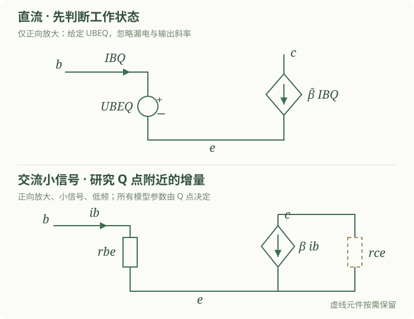

**AI 补充理解。** 曲线在小范围内用切线代替：$r_{be}$ 是斜率的倒数，不是 $U_{BEQ}/I_{BQ}$。直流模型中近似不变的 $0.7\,\mathrm V$，不能用来把交流 $u_{be}$ 也设成零；否则就抹去了信号本身。

进阶补充／适用条件与注意事项 · 原位置保留

**AI 补充推理。** 把 $i_C\approx I_Se^{u_{BE}/V_T}$ 在 Q 点展开，保留一阶项，可得内基区电压 $u_{b'e}$ 对电流的增量关系 $i_c\approx g_mu_{b'e}$，其中 $g_m=I_{CQ}/V_T$。再用 $i_c=\beta i_b$，得到 $r_\pi=\beta/g_m$；外部 B—E 端还含基区体电阻，故 $r_{be}=r_{bb'}+r_\pi$。忽略体电阻时，才能直接写 $i_c=g_mu_{be}$。

进阶补充／适用条件与注意事项 · 原位置保留

**AI 补充适用条件。** 理想指数关系的一阶近似要求内结增量幅值 $|u_{b'e}|\ll V_T$；“电源电压很小”或“输入只占电源的 1%”不能代替这个条件。发射极负反馈能使外部输入较大，而实际结上的增量仍小。该条件与饱和、截止的摆幅限制须分别检查。[NPTEL 的小信号模型说明](https://archive.nptel.ac.in/content/storage2/courses/117102061/bjt/BJT_6.htm)也以结电压增量相对热电压较小作为线性化条件。

进阶补充／适用条件与注意事项 · 原位置保留

**AI 补充·模型结论。** 要描述放大区输出曲线的有限斜率，可在模型 C—E 间加入 $r_{ce}$；忽略反向传输时，$i_c=\beta i_b+u_{ce}/r_{ce}$。在固定 $u_{BE}$ 的常用 Early 模型中，$r_{ce}\approx(V_A+U_{CEQ})/I_{CQ}\approx V_A/I_{CQ}$，最后一步还要求 $V_A\gg U_{CEQ}$。固定 $i_B$ 的 h 参数输出电阻与该量不是无条件相同，本章在简化近似下统一用 $r_{ce}$ 表示输出电阻。

进阶补充／适用条件与注意事项 · 原位置保留

**AI 补充理解。** $U_{CE}$ 的影响较弱，表现为较大的输出电阻；它从未被定义成完全没有影响。只有 $r_{ce}$ 对目标电路结果影响可忽略时，才删去它。[MIT 6.012 对基区宽度调制、$g_m,r_\pi,r_o$ 的说明](https://live.ocw.mit.edu/courses/6-012-microelectronic-devices-and-circuits-spring-2009/0df1f43ca9d2ef82dafbf858d8414d3f_MIT6_012S09_rec18.pdf)用于核对这一补充。

**AI 补充例子。** $I_{EQ}=1.01\,\mathrm{mA}$、$\beta=100$、$r_{bb'}=200\,\Omega$，则 $r_{be}\approx2.80\,\mathrm{k\Omega}$。该数值随 Q 点改变；不能把另一道题算出的 $r_{be}$ 直接搬来。

<aside class="manuscript-questions" data-section="section-1">

旧版疑问索引（AI 整理） · 我的理解与原稿校正 · 3.1

来自手写部分 1；解释中的补充与校正由 AI 整理。

为什么说放大本质是控制？

原稿先区分“小量控制大量”和能量来源，再追踪载流子。保留这条思路：结构与偏置共同形成受控关系，供电提供主要输出能量。
<a href="#bjt-active">返回放大条件与原话 ↗</a>

到底是 iB 控制 iC，还是 UBE 控制？

图 5 已主动追问这是不是便于使用的人为描述。电流关系适合端口计算；结电压关系揭示正向注入。二者都必须加上工作区与模型条件。
<a href="#control-view">返回控制关系 ↗</a>

正偏一定表示已经明显导通吗？

图 11 的补注把两者混在一起。正偏说极性，导通压降说工程近似；正向电流连续变化，没有绝对的 0.7 V 开关门槛。
<a href="#bjt-active">返回偏置定义与修正 ↗</a>

临界饱和为什么不是 0.2 V？

图 11 的两种描述分别对应集电结零偏边界和深度饱和模型。先算 uBC，再区分边界与近似压降。
<a href="#saturation-boundary">返回饱和边界 ↗</a>

输出电压的变化为什么要加负号？

图 8 的链条保留了幅度，但集电极电位与电流变化反向。带符号增量用负号，幅值关系才可省略方向。
<a href="#three-connections">返回连接与电压转换 ↗</a>

等效到底保留了什么？

图 12 问“什么是等效、如何等效”，并用拼装积木说明模型。保留这条理解，同时限定研究范围：直流模型与局部增量模型保留的关系不同。
<a href="assets/analog/hand1-12.jpg">查看手写图 12 ↗</a> · <a href="#dc-model">返回模型正文 ↗</a>

</aside>

### 3.2 放大电路的基本概念

按手写部分 2 图 1 的“等效模型与参数 → 组成条件与三种组态”组织。原稿留空的指标解释与条件，以下由 AI 根据主教材、李会方课件与华成英辅导书补全。

#### 一、放大电路的等效模型与性能指标（3.2.1）

**我的原始理解与记录｜手写部分 2 · 图 1｜等效模型与参数**

BJT → 放大电路。放大电路。

1．等效模型与参数。等效为一个二端口网络。

输入端口：等网络等效为一个电阻。输出端口：网络等效为一电压源 + 一电阻。[图中保留 $R_i,R_o$ 与电压源的端口示意。]

类比二端网络，重于 $u-i$ 的关系，从而使用简单元件等效该 $u-i$ 关系。二端口网络重于输入与输出的关系，也可用 easy 元件等效其关系。

参数：① 增益 $\dot A_u=\dot U_o/\dot U_i$。

② 输入电阻 $R_i$，$R_i=\dot U_i/\dot I_i$，反映了……

③ 输出电阻 $R_o$，$R_o=\left.\dot U_T/\dot I_T\right|_{\dot U_s=0,\,R_L=\infty}$，反映了……

[旁注] 未懂。

2．放大电路的组成条件与三种组态（类型）。条件：[原稿空白]；组态：[原稿空白]。

[核对手写影印页](#facsimile-hand2-1) · [回到本节知识](#two-port)

**AI 补充｜保留未完成状态。** “反映了……”和“未懂”原样保留。输入电阻回答信号源接上去会被怎样加载；输出电阻回答负载变化怎样影响输出。下面保留旧版的端口说明与公式，作为对这两个空白的补充，不倒写成原稿已经想通的内容。

##### 二端口模型同时描述输入负担与输出能力

**教材知识·归纳结论。** 对给定 Q 点、给定频率、线性小信号范围内的近似单向电压放大器，可将输入端表示为 $R_i$，输出端表示为受控电压源 $A_{u0}\dot U_i$ 串联 $R_o$。$A_{u0}$ 是空载电压增益；接入 $R_L$ 后的端口电压增益为 $A_u$。有明显反向耦合或电抗时应使用更完整的二端口模型与阻抗。

**我的理解·上一版摘录（逐字以本次转写为准）（图 1）。**

> 类比二端网络，重于 $u$—$i$ 的关系，从而使用简单元件等效该 $u$—$i$ 关系。二端口网络重于输入与输出的关系，也可用 easy 元件等效其关系。

**AI 补充理解。** 你关注的是“保留什么关系，才算等效”。输入电阻表示信号源接上后会承担怎样的电流；输出的受控源与内阻表示接负载后电压怎样下降。模型不是仅画出三个符号，还必须说明增益是空载还是带载。

##### 增益须先确定端口、负载与相位

**教材知识·归纳结论。** 在线性正弦稳态下，以同一频率、同一相量约定定义

$$
A_u=\frac{\dot U_o}{\dot U_i},\quad
A_{us}=\frac{\dot U_o}{\dot U_s},\quad
A_i=\frac{\dot I_o}{\dot I_i},\quad
A_r=\frac{\dot U_o}{\dot I_i},\quad
A_g=\frac{\dot I_o}{\dot U_i}.
$$

**适用条件与符号。** $A_u,A_i$ 无量纲；互阻 $A_r$ 单位 $\Omega$，互导 $A_g$ 单位 $\mathrm S$。$\dot I_o$ 取流入负载正端。功率增益 $A_p=P_o/P_i$ 使用平均信号功率；纯电阻端口、有效值约定下，$A_p=|A_u|^2R_i/R_L$。

**AI 补充理解。** $U_s$ 是信号源电压，$U_i$ 是已接入放大器的端口电压；二者中间可能隔着 $R_s$。$A_u$ 为负，在本章中频实数近似下表示反相，不表示幅度是“负的”。

**教材知识·归纳结论。** 当输入、输出端口均可按实电阻处理时，源内阻和输出内阻的分压分别给出

$$
\dot U_i=\dot U_s\frac{R_i}{R_s+R_i},\qquad
A_u=A_{u0}\frac{R_L}{R_o+R_L},\qquad
A_{us}=A_u\frac{R_i}{R_s+R_i}.
$$

**AI 补充推理。** 第一式来自输入分压，第二式来自输出戴维南模型，第三式将 $\dot U_o/\dot U_s$ 拆成 $\dot U_o/\dot U_i$ 与 $\dot U_i/\dot U_s$。反向耦合明显时，模型参数可能依端接条件而变，不能照搬三个独立常数。

**AI 补充例子。** $R_s=1\,\mathrm{k\Omega}$、$R_i=4\,\mathrm{k\Omega}$、带载 $A_u=-50$，则 $A_{us}=-40$。若计算时已用 $R_C\parallel R_L$ 得到带载增益，不要再重复乘一次输出分压。

**教材知识·归纳结论。** 增益用分贝表示时，电压增益为 $20\log_{10}|A_u|$，电流增益为 $20\log_{10}|A_i|$，功率增益为 $10\log_{10}A_p$。分贝形式不保留相位，必须另说明反相或相位角；电压增益的分贝数也不无条件等于功率增益的分贝数。

##### 输入电阻与输出电阻是信号端口的局部关系

**教材知识·归纳结论。** 在本章中频近似中，$R_i=\dot U_i/\dot I_i$，它从输入端向放大电路内部看，不含 $R_s$。电压信号输入时，较大的 $R_i/R_s$ 有助于减少输入分压损失；电流信号输入时，较低的输入阻抗可能更合适，因此不能脱离信号类型说“越大越好”。

**AI 补充理解。** 手写图 1 的“反映了……”补为：反映放大器从信号源获取电压或电流信号时造成的负担。它是通电、在 Q 点附近的信号关系，不是断电后用万用表直接测得的普通电阻。

**教材知识·归纳结论。** 求 $R_o$ 时，先在小信号电路中把**独立输入信号源置零，保留源内阻与所有受控源**，移除负载 $R_L$，从输出端加测试电压 $\dot U_T$，令 $\dot I_T$ 流入电路，则 $R_o=\dot U_T/\dot I_T$。电压输出时，$R_o\ll R_L$ 有助于减小带载压降；电流输出的目标可能相反。

**AI 补充推理。** 置零外部输入后，输出端的响应只来自测试源，因此该比值就是输出端等效内阻。受控源反映器件内部关系，不能随独立输入一起删除；控制量是否恰好为零要由电路决定。

##### 带宽和非线性失真描述“放得是否合适”

**教材知识·归纳结论。** 对具有近似平坦中频增益的常见放大器，若以幅值降至中频值的 $1/\sqrt2$ 为界，可定义下、上限频率 $f_L,f_H$，带宽为 $f_H-f_L$。只有本来满足这种响应形状，才这样使用两个截止频率。非线性失真指输出不能保持输入的比例波形，可用谐波含量衡量；THD 为高次谐波有效值的方和根与基波有效值之比。

**AI 补充理解。** 本章后面主要算中频 $A_u,R_i,R_o$ 和削顶边界。削顶是非线性失真的一种；尚未进入截止或饱和，也可能因指数关系而出现谐波失真。频率响应的详细计算留到相应章节。

#### 二、放大电路的组成原则与三种组态（3.2.2）

**教材知识·归纳结论。** 构成可用的单管线性放大电路，需要：① 有合适且较稳定的静态工作点；② 输入信号能改变发射结上的有效信号电压；③ 输出有合适的取出路径和负载；④ 信号全过程内不离开所采用模型的适用范围。三种组态仍按输入、输出和公共电极判别。

**AI 补充理解。** 原稿图 1 的“条件／组态”留空，这里补全为先有偏置、再安排信号通路。单靠“把晶体管接上电源”并不保证放大；信号若被直接短路到参考点，或输出没有转换、传输通路，也不会得到预期结果。具体三组态见 [3.1 的连接表](#three-connections)，性能在 [3.9](#comparison) 统一比较。

<aside class="manuscript-questions" data-section="section-2">

旧版疑问索引（AI 整理） · 我的结构与补全 · 3.2

手写部分 2 图 1；空白定义由教材补全。

二端网络与二端口模型怎样联系？

沿用原稿“重于什么关系，就保留什么关系”的思路。二端网络关注一个端口的 u—i；放大器还要保留输入如何影响输出。
<a href="#two-port">返回原话与模型条件 ↗</a>

Ri、Ro 后面的“反映了……”补什么？

Ri 对应输入获取信号时的负担，Ro 对应输出带载变化；“越大／越小越好”须指明电压还是电流信号。测试 Ro 时受控源必须保留。
<a href="#port-resistance">返回端口电阻定义 ↗</a>

</aside>

### 3.3 共发射极放大电路的组成与工作原理

按手写部分 2 图 2—3 的“电路组成 → 工作原理 → 直流通路与交流通路”展开。原稿的图和通路画法尚未填出，以下电路图与元件说明为 AI 依据课本图 3.3.1—3.3.4 补充绘制。

#### 一、电路组成与各元件的作用（3.3.1）

**我的原始理解与记录｜手写部分 2 · 图 2 上半｜电路组成**

共射极放大电路。1．电路组成。总图：——[原稿留空]。

各元件作用：① NPN 晶体管；② $U_{BB}$ 与 $R_B$；③ $U_{CC}$ 与 $R_C$；④ $C_1$ 与 $C_2$。

[核对手写影印页](#facsimile-hand2-2) · [回到本节知识](#ce-composition)

**教材知识·归纳结论。** 双电源固定偏置 CE 的基本组成是 BJT、$U_{BB}$ 与 $R_B$、$U_{CC}$ 与 $R_C$、输入输出耦合电容 $C_1,C_2$。信号从基极输入、集电极输出，发射极为公共端。只要重新选取合适的 $R_B$，也可将基极偏置支路改接到 $U_{CC}$，形成单电源固定偏置。

**AI 图示｜沿用上一版。**

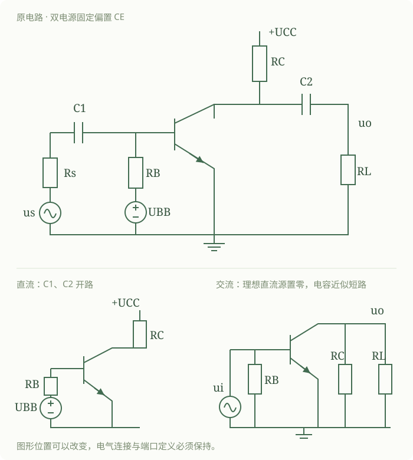

**AI 补充理解。** 按原稿列出的顺序说明：

| 元件 | 作用 | 分析时要检查的条件 |
| --- | --- | --- |
| NPN 晶体管 | 在 Q 点附近把输入变化映射为集电极电流变化 | 发射结正偏、集电结反偏，摆幅不越界 |
| $U_{BB},R_B$ | 提供并限制基极直流电流，设定偏置 | $I_{BQ}$ 还受 $U_{BEQ}$ 影响 |
| $U_{CC}$ | 提供主要输出能量及集电极电压余量 | 不超过耐压；考虑电阻上的压降 |
| $R_C$ | 把集电极电流变化转成电压变化，也决定直流压降 | 不是越大越好，还约束 Q 点与摆幅 |
| $C_1,C_2$ | 稳态下隔离直流，传递交流 | 只有在目标频率的容抗足够小时才近似短路 |
| $R_s,R_L$ | 信号源内阻与外部负载 | 决定输入分压、交流负载，不默认与器件电流相等 |

**AI 补充边界。** 有极性电容的极性按实际直流电位选择，不靠符号位置死记。基极偏置源改接 $U_{CC}$ 后，应重新计算 $R_B$；不能既删除 $U_{BB}$ 又认为原 $I_{BQ}$ 自动保持不变。

#### 二、静态偏置搭台，信号在其上变化（3.3.2）

**我的原始理解与记录｜手写部分 2 · 图 2 下半｜直流“搭戏台”**

2．工作原理。先只直流，此时电路中各量不变化，故称为静态。有：$I_{BQ},U_{BEQ},I_C$、【原文待核对：末项电压符号写法，前方有多处划改】。

而后在直流基础上加交流：由于 $C_1$ 与 $C_2$ 的缘故，输入与最终输出的都为交流。

即：输入、输出均为交流，戏台上唱戏的主角都是交流量，直流呢？直流的作用是搭戏台。

交流只有在通入直流的基础上才能工作。

$C_1$ 与 $C_2$ 的作用就是过滤，保证最终输入、输出都为交流。

而大体工作原理相同：加入交流后各部分变为：

$$
U_{BE}=U_i+U_{BEQ}\ \longrightarrow\
i_B=I_{BQ}+i_b\ \longrightarrow\
i_C=I_{CQ}+i_c;
\qquad U_{CE}=U_{CEQ}-i_cR_C\ \longrightarrow\ U_o.
$$

只交流，称为动态。

[核对手写影印页](#facsimile-hand2-2) · [回到本节知识](#bias-stage)

**核对判断：“搭戏台”是正确直观；总量、增量与范围需补条件。**

**需要修正的地方：** “交流只有在通入直流基础上才能工作”限定为本章有偏置的 BJT 线性放大电路；输出交流量不能直接与 $U_{CEQ}-i_cR_C$ 这一总量等同。

**为什么需要修正：** 静态偏置使工作点适合线性变化，耦合电容在稳态隔直但其交流阻抗与频率有关。$u_{CE}=U_{CEQ}+u_{ce}$，$u_o$ 是耦合后输出，常只含交流部分。

**修正后的理解：** 保留“戏台”“主角”“过滤”的比喻。规范记号为 $u_{BE}=U_{BEQ}+u_{be}$、$i_C=I_{CQ}+i_c$；发射极交流接地且无负载分流时 $u_{ce}=-i_cR_C$，有负载时采用实际交流等效负载。

**教材知识·归纳结论。** 输入信号为零时，直流电源建立 $I_{BQ},I_{CQ},U_{BEQ},U_{CEQ}$，称为静态工作点 Q。加入信号后，器件内部总量通常是直流与交流共存；用 Q 点附近的小信号近似分析交流分量。

**我的理解·上一版摘录（逐字以本次转写为准）（图 2）。**

> 输入、输出均为交流，戏台上唱戏的主角都是交流量。直流呢？直流的作用是搭戏台。
>
> 交流只有在通入直流的基础上才能工作。

**AI 补充理解。** 保留“搭戏台”的联系，并把范围说清：这句话针对当前靠偏置工作的线性 BJT 放大器。对稳态电容耦合电路，信号源与负载侧可只保留交流分量；**晶体管内部并非只有交流**。直耦放大器还可以处理带直流分量的信号，不把原话扩成所有放大器都只能放大交流。

**教材知识·归纳结论。** 对图示 CE，在中频、发射极交流接地、无明显失真时，

$$
\begin{aligned}
u_{BE}&=U_{BEQ}+u_{be},&i_B&=I_{BQ}+i_b,\\
i_C&=I_{CQ}+i_c,&u_{CE}&=U_{CEQ}+u_{ce},\\
i_c&=\beta i_b,&u_o=u_{ce}&=-i_c(R_C\parallel R_L).
\end{aligned}
$$

**适用条件与符号。** 输入端定义在 $C_1$ 前且忽略其容抗时，$u_{be}\approx u_i$。无负载时 $R_L\to\infty$，最后一式成为 $-i_cR_C$。

**AI 旧版转述（非逐字原稿）·变化顺序。** 先直流、后加交流；$u_{be}$ 增大 → $i_b$ 增大 → $i_c$ 增大 → 集电极电位降低 → 输出负向变化。因此 CE 反相。

> **原稿修正。** 图 2 写 $U_{CE}=U_{CEQ}-i_cR_C$，应把总量写成 $u_{CE}$，并仅在无交流负载时使用 $R_C$。接 $R_L$ 后，$R_C$ 支路的交流电流不再等于全部 $i_c$，应使用 $R_C\parallel R_L$。本章已统一总量与增量的大小写。

#### 三、直流通路与交流通路（3.3.3）

**我的原始理解与记录｜手写部分 2 · 图 3 上半｜电路分析与通路**

3．电路分析。交流通路与直流通路。

直流通路。定义：在直流电源作用下，直流电流流经的路径。[“交流”的“交”在原稿被改为“直”。]

只有直流的工作状态，称为静态，对直流量的分析计算，称为静态分析。即求：$I_{BQ},I_{CQ},U_{BEQ},U_{CEQ}$。画法：～。

交流通路。定义：在输入信号作用下交流信号流经的路径。

只对交流信号及其响应分析，称为动态分析。目的是计算放大电路的性能参数：$A_u,R_i,R_o$ 等。画法：～。

[核对手写影印页](#facsimile-hand2-3) · [回到本节知识](#dc-ac-paths)

**教材知识·归纳结论。** 直流通路用于求静态点，交流通路用于研究围绕该点的信号。分开分析的前提不是“非线性器件也能任意叠加”，而是先求非线性静态解，再在该点附近线性化。

| 对象 | 直流稳态通路 | 本章中频小信号通路 |
| --- | --- | --- |
| 耦合、旁路电容 | 开路 | 目标频率容抗足够小时短路；否则保留阻抗 |
| 理想直流电压源 | 保留 | 增量为零，短路；其固定电位端为交流地 |
| 理想直流电流源 | 保留 | 增量为零，开路；非理想输出电阻须保留 |
| 独立交流输入源 | 置零，保留内阻 | 求增益时保留；求 $R_o$ 时置零并保留内阻 |
| 电阻 | 保留 | 保留，按实际端点重画连接 |
| BJT | 使用相应直流模型或完整特性 | 用所选 Q 点对应的小信号模型 |

**我的理解·上一版摘录（逐字以本次转写为准）（图 3）。**

> 只有直流的工作状态，称为静态，对直流量的分析计算，称为静态分析。
>
> 只对交流信号及其响应分析，称为动态分析。目的是计算放大电路的性能参数：$A_u,R_i,R_o$ 等。

**AI 补充理解。** “交流地”是增量电压为零，可以处在 $12\,\mathrm V$ 的直流电位；“对交流短路”也不说明该元件上的直流电压为零。耦合电容使 $R_L$ 不参与当前电路的直流 Q 点计算，却在交流中加载。若去掉耦合电容，负载会参与直流分析，必须重算 Q 点。

<aside class="manuscript-questions" data-section="section-3">

旧版疑问索引（AI 整理） · 我的理解与符号校正 · 3.3

手写部分 2 图 2—3 的原话与联系。

直流为什么说是在“搭戏台”？

原话保留。偏置让总电流可围绕非零值上、下变化；信号虽可有负半周，总电流仍可保持正向。负载侧的交流与器件内部总量要分清。
<a href="#bias-stage">返回原话与范围 ↗</a>

直流、交流分开算，依据是什么？

先求静态，再局部线性化；不是对完整非线性 BJT 直接用叠加定理。“直流量置零”只适用于增量电路。
<a href="#dc-ac-paths">返回通路规则 ↗</a>

为什么负载接入后要用并联电阻？

课本与原稿的无负载链条先保留，再由交流通路检查：集电极交流电流分到 RC 和 RL 两条路，故用并联值。
<a href="#ce-waveforms">返回波形方程 ↗</a>

</aside>

### 3.4 共发射极放大电路的直流分析方法

图解法与估算法按手写部分 2 图 3—4；Q 点稳定按图 4—5 的“原因／背景 → 原理 → 分析与计算 → 设计与条件”。公式的条件、例子与未写部分由 AI 补全。

#### 一、静态工作点的图解分析（3.4.1）

**我的原始理解与记录｜手写部分 2 · 图 3 下半｜图解分析法的思路**

直流分析方法 / 静态分析。（电路图反映的是电路特性，与实物图不同。）

① 图解分析法。一个元件在电路中，其 $u$ 与 $i$ 是同时由外电路情况和元件本身特性共同决定的。即：既满足元件特征曲线，也满足电路方程曲线。[“电路”前补“外”。]

交点即为目前状态。此即为该法的思路、原理。

BJT 分为输入特性和输出特性，放大电路可分为输入回路与输出回路。那么，自然的：输入回路与输入特征 → $I_{BQ},U_{BEQ}$；输出回路与输出特征 → $I_{CQ},U_{CEQ}$。

[核对手写影印页](#facsimile-hand2-3) · [回到本节知识](#q-graph)

**AI 核对｜正确的直观理解。** “器件本身与外电路共同决定”“交点即为目前状态”完整保留。这是图解法的核心，不需要改写为更复杂的话；下面的方程只把两个约束写出来。

**教材知识·归纳结论。** 图解法的解，是**同时满足器件特性与外电路方程的交点**。固定偏置 CE 可先由输入负载线与输入曲线求 $I_{BQ},U_{BEQ}$，再由对应 $i_B=I_{BQ}$ 的输出曲线与输出直流负载线求 $I_{CQ},U_{CEQ}$。

**我的理解·上一版摘录（逐字以本次转写为准）（图 3）。**

> 一个元件在电路中，其 $u$ 与 $i$ 是同时由外电路情况和元件本身特性共同决定的。即：既满足元件特征曲线，也满足电路方程曲线。交点即为目前状态。此即为该法的思路、原理。

**AI 补充推理。** 对发射极接地、基极经 $R_B$ 接 $U_{BB}$ 的电路：

$$
I_B=\frac{U_{BB}-U_{BE}}{R_B},\qquad
I_C=\frac{U_{CC}-U_{CE}}{R_C}.
$$

横轴分别为 $U_{BE}$、$U_{CE}$，纵轴为电流，因此两条负载线斜率分别为 $-1/R_B$、$-1/R_C$；输出线通过 $(U_{CC},0)$ 与 $(0,U_{CC}/R_C)$。单电源固定偏置时令 $U_{BB}=U_{CC}$。

**AI 补充条件。** 输入曲线本来也依赖 $U_{CE}$；“先输入、后输出”是忽略该弱依赖的常用步骤。若依赖不能忽略，应联合求解或迭代。有 $R_E$ 时，精确输出 KVL 为 $U_{CC}=I_CR_C+U_{CE}+I_ER_E$；仅在 $I_E\approx I_C$ 时斜率近似为 $-1/(R_C+R_E)$。

> **教材勘误。** 课本内容图 14、印刷页 77 的式（3.4.2）输出回路第二式左端印作 $U_{BE}$，应为 $U_{CE}=U_{CC}-I_CR_C$；这是集电极—发射极回路的 KVL。正文和负载线均采用正确变量。

#### 二、固定偏置静态点的估算（3.4.2）

**我的原始理解与记录｜手写部分 2 · 图 4 上半｜估算法**

② 估算法。

$$
I_{BQ}=\frac{U_{CC}-U_{BEQ}}{R_B}\approx\frac{U_{CC}}{R_B},\qquad
I_{CQ}=\beta I_{BQ},\qquad U_{CEQ}=U_{CC}-I_{CQ}R_C.
$$

$U_{BEQ}=U_{BE(\mathrm{on})}$。

至此，综上所述的都为固定偏置放大电路。

[核对手写影印页](#facsimile-hand2-4) · [回到本节知识](#fixed-bias)

**核对判断：估算式正确；近似需条件。**

**需要修正的地方：** 忽略 $U_{BEQ}$ 的近似和 $I_C=\beta I_B$ 均需校验。

**为什么需要修正：** 主教材印刷页 77 式（3.4.3）给出同样估算链；供电不够或基极驱动过大时会饱和，不能坚持正向放大式。

**修正后的理解：** 在单电源固定偏置、发射极接地、正向放大且漏电可忽略时使用。$U_{CC}\gg U_{BEQ}$ 才忽略该压降，求解后再校验 $U_{CEQ}>U_{BEQ}$。

**教材知识·归纳结论。** 对单电源、发射极接地的固定偏置 CE，先假定正向放大、给定 $U_{BEQ}$、忽略漏电，可估算

$$
I_{BQ}=\frac{U_{CC}-U_{BEQ}}{R_B},\qquad
I_{CQ}\approx\bar\beta I_{BQ},\qquad
U_{CEQ}=U_{CC}-I_{CQ}R_C.
$$

**适用条件与符号。** 只有 $U_{CC}\gg U_{BEQ}$ 且误差允许时，才进一步取 $I_{BQ}\approx U_{CC}/R_B$。算完必须校验 $V_C>V_B>V_E$ 和工作范围；假定不成立就换模型。

**AI 补充理解。** 固定偏置的意思是偏置网络结构固定，$I_B$ 并非绝对不变，$\beta$ 更不是被固定了。原稿把 $U_{BEQ}=U_{BE(\mathrm{on})}$ 作为估算，这里统一写成“采用给定导通压降近似”。

**AI 补充例子·放大与饱和的校验。** 设 $U_{CC}=12\,\mathrm V$、$R_C=2\,\mathrm{k\Omega}$、$\bar\beta=80$、$U_{BEQ}=0.7\,\mathrm V$。

1. $R_B=300\,\mathrm{k\Omega}$ 时，$I_{BQ}=37.7\,\mu\mathrm A$，$I_{CQ}=3.01\,\mathrm{mA}$，$U_{CEQ}=5.97\,\mathrm V$。因为 $5.97>0.7$，放大假定自洽。
2. $R_B=100\,\mathrm{k\Omega}$ 时，套放大模型会得 $I_C=9.04\,\mathrm{mA}$、$U_{CE}=-6.08\,\mathrm V$。这与电路不符，说明该假定失效，不是实际得到负的 $U_{CE}$。
3. 改用题设示范值 $U_{BE(\mathrm{sat})}=0.8\,\mathrm V$、$U_{CE(\mathrm{sat})}=0.2\,\mathrm V$，得 $I_B=112\,\mu\mathrm A$、$I_C=5.90\,\mathrm{mA}$。此时强迫比值 $I_C/I_B\approx52.7<80$，且两结均正偏，符合饱和模型。

题型依据李会方课件的固定偏置例题重新计算，保留 $U_{BE}$，因此数值与课件忽略 $U_{BE}$ 的近似值不同。

#### 三、静态工作点的稳定（3.4.3）

**我的原始理解与记录｜手写部分 2 · 图 4 下半｜分压式电流负反馈偏置的框架**

接下来将介绍另一种——分压式电流负反馈偏置放大电路。

1．原因 / 背景。2．原理。3．分析与计算。4．设计与条件。

1．目的很简单，为了保证静态工作点 Q 的稳定。Q 不稳定则整个放大电路的工作也不稳定。

而影响 Q 的最主要因素是温度。$T\uparrow$：$I_{CB0}\uparrow$，$\beta\uparrow$，$i_C\uparrow$；同 $U_{BE}$ 下对应的 $i_B,i_E$ 均 ↑。

而为了维持 Q 点稳定，抵消该温度性的影响，其中一个方法就是设计电路，实现负反馈功能以求维稳，便有了该电路。

2．分压式电流负反馈偏置放大电路。

分压：增加了 $R_{B2}$，使得 $U_{CC}\to R_{B1}\to R_{B2}\to$ 地组成分压网络，保证 $V_B$ 稳定（近似不变）。

负反馈：增加了 $U_E$ 所导致的。

[核对手写影印页](#facsimile-hand2-4) · [回到本节知识](#q-drift)

**核对判断：稳定 Q 点的动机正确；结构用词需补足。**

**需要修正的地方：** “增加了 $U_E$”说的是发射极电位／压降变化，并非一定增加独立电压源；$\beta$ 随温度增大是教材常用范围内的趋势。

**为什么需要修正：** 主教材印刷页 78 给出固定偏置的温漂趋势。稳偏电路增加的是发射极电阻，电流在其上产生电压；反馈来自这条关系。

**修正后的理解：** 本电路用 $R_E$ 把 $I_E$ 的变化转换为 $V_E$ 的变化。“温度是主要因素”的学习动机保留，同时知道供电、器件更换也会改变 Q 点。

##### 原因与背景：器件参数和供电变化会使 Q 点漂移

**教材知识·归纳结论。** 对固定偏置电路，$\bar\beta,U_{BE},I_{CBO}$ 或供电变化，都会改变静态电流和电压。常见温升使集电极电流增加、$U_{CEQ}$ 降低，Q 点向饱和侧移动；具体大小取决于电路与器件，不能只凭温度箭头决定数值。

**我的理解·上一版摘录（逐字以本次转写为准）（图 4）。**

> 目的很简单，为了保证静态工作点 Q 的稳定。Q 不稳定则整个放大电路的工作也不稳定。
>
> 而为了维持 Q 点稳定，抵消该温度性的影响，其中一个方法就是设计电路，实现负反馈功能以求维稳，便有了该电路。

**AI 补充理解。** 维持合适 Q 点，是为了保留增益、功耗与可用摆幅。换一只同型号晶体管也可能因 $\beta$ 离散而使固定偏置的 Q 点变化，因此稳定偏置同时有助于降低参数离散的影响。

**我的原始理解与记录｜手写部分 2 · 图 5 上半｜反馈链条、new balance 与压舱石**

下面梳理原理与负反馈链条：

$$
i_C\text{ 增大}\ \to\ i_E\text{ 增大}\ \to\ V_E=i_ER_E\text{ 增大}\ \to\ U_{BE}=V_B-V_E.
$$

由于 $V_B$ 不变，$U_{BE}\downarrow\to i_C$ 降低。

负反馈的本质不是回到原处，而是使减小扰动，达到 new balance。

该系统中真正决定反馈量的是 $i_E$，T 既会影响 $i_B$ 也会～$i_C$，$i_E=i_B+i_C$，$i_E$ 稳定时，$i_B,i_C$ 也可认为稳定，$U_{BE}$ 也稳定，系统稳定。

当然，主要关注 $i_C$，因为是主要输出电流。

而 $R_{B2}$ 使分压成立，使 $V_B$ 稳定 → 此为压舱石。

[蓝笔注] 由于为使 $V_B$ 稳定，$i_B$ 会很小（这也保证了分压的建立），故可近似认为（分析电路时）$i_B=0$，$i_E=i_C$。

[核对手写影印页](#facsimile-hand2-5) · [回到本节知识](#divider-feedback)

**核对判断：“new balance”“压舱石”正确；稳定量推论有实质性问题。**

**需要修正的地方：** 不能由 $I_E$ 近似稳定就推出 $I_B$、$U_{BE}$ 在温度变化时都不变；也不能把基极电流真的设为零。

**为什么需要修正：** 当 $\beta$ 变化，$I_B=I_E/(1+\beta)$ 会变化；维持类似集电极电流所需的 $U_{BE}$ 也随温度变化。分压加载取决于 $I_BR_{TH}$，不是“有了稳定基极电压，$I_B$ 就自动小”。

**修正后的理解：** 保留反馈链和新平衡的理解。分压网络足够硬时 $V_B$ 近似稳定；$R_E$ 抵消部分电流扰动。只在分压加载可忽略时省略它对分压的影响，器件电流计算仍保留非零 $I_B$。

##### 原理：分压近似稳定基极，RE 将电流变化反馈回来

**教材知识·归纳结论。** 分压式电流负反馈偏置中，上支路 $R_{B1}$ 接 $U_{CC}$—B，下支路 $R_{B2}$ 接 B—地，发射极经 $R_E$ 接地。分压网络足够“硬”时，基极电位近似稳定；若电流因扰动增大，$V_E=I_ER_E$ 上升，使 $U_{BE}=V_B-V_E$ 相对无反馈情形减小，抑制电流继续增大。

**AI 图示｜沿用上一版。**

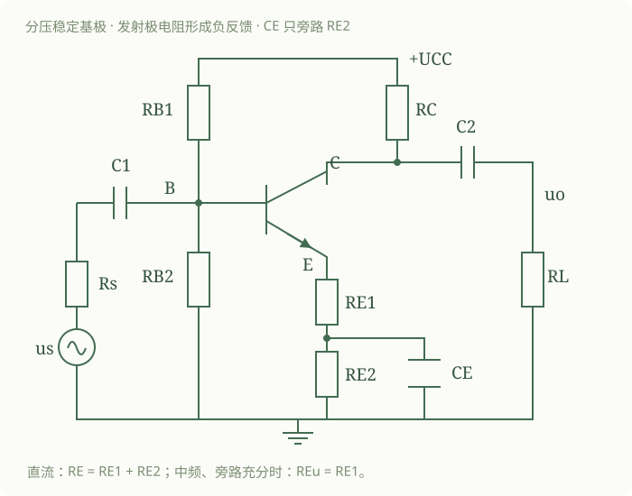

**我的理解·上一版摘录（逐字以本次转写为准）（图 5）。**

> 负反馈的本质不是回到原处，而是使减小扰动，达到 new balance。
>
> 而 $R_{B2}$ 使分压成立，使 $V_B$ 稳定 → 此为压舱石。

**AI 补充理解。** “压舱石”与“new balance”是这一段最应保留的两点。反馈减少变化，但新平衡通常仍有偏移；分压也不是单靠增加一个 $R_{B2}$ 就绝对稳定，须检查基极电流对分压网络的加载。

**AI 补充推理。** 先把温度视作使 $I_C$ 有增大趋势的外部扰动，再沿电路关系追踪：$I_C\uparrow\Rightarrow I_E\uparrow\Rightarrow V_E\uparrow\Rightarrow U_{BE}$ 相对减小 $\Rightarrow$ 正向注入受到抑制。这是反馈方向的因果说明，不是在声称所有参数保持原值。

> **原稿修正。** 图 5 写“$I_E$ 稳定时 $I_B,I_C$ 也可认为稳定，$U_{BE}$ 也稳定”。$I_C$ 可因 $\bar\alpha\approx1$ 而近似稳定，但温度或 $\beta$ 改变时，$I_B$ 和 $U_{BE}$ 往往正是在调整，不能都宣称不变。原稿“真正决定反馈量的是 $I_E$”保留为对采样的理解：$R_E$ 上的压降由发射极电流形成。

**我的原始理解与记录｜手写部分 2 · 图 5 下半｜Q 点计算与设计条件**

3．Q 点计算。

$$
\begin{aligned}
V_{BQ}&\approx\frac{R_{B2}}{R_{B1}+R_{B2}}U_{CC},\\
I_{EQ}&\approx\frac{V_{BQ}-U_{BE(\mathrm{on})}}{R_E},\\
I_{CQ}&=\alpha I_{EQ}\approx I_{EQ},\\
U_{CEQ}&\approx U_{CC}-I_{CQ}(R_C+R_E),\qquad I_{BQ}=\frac{I_{EQ}}{1+\beta}.
\end{aligned}
$$

4．设计与条件。

① 保证分压：$I_1$（流过 $R_{B1}$），$I_2$（～）$\gg I_{BQ}\to R_{B1},R_{B2}$ 选适当小～值。

② 保证负反馈强度：$R_E$ 足够大。经验公式：～。[原稿未继续填写。]

[核对手写影印页](#facsimile-hand2-5) · [回到本节知识](#divider-q)

**核对判断：合理近似与设计方向；需联立约束。**

**需要修正的地方：** “$R_E$ 足够大”“分压电阻适当小”是设计方向，不是越极端越好。

**为什么需要修正：** 发射极压降占用供电余量，分压电阻过小增加功耗并加载交流输入。原稿公式还使用 $I_E\approx I_C$ 与分压加载可忽略两个不同近似。

**修正后的理解：** 先检查 $R_{TH}\ll(1+\bar\beta)R_E$，再决定是否用原稿简化链；按最低预期放大系数校核加载，并给输出摆幅留余量。原稿“经验公式：～”仍保留为空白记录，下面的设计步骤为 AI 补充。

##### 分析与计算：先用戴维南等效，再判断能否简化

**教材知识·归纳结论。** 对上述分压偏置、直流时耦合与旁路电容开路、假定正向放大且忽略漏电，取给定 $U_{BEQ}$，先把分压网络等效为 $U_{TH},R_{TH}$，则静态量满足

$$
\begin{aligned}
U_{TH}&=U_{CC}\frac{R_{B2}}{R_{B1}+R_{B2}},\qquad R_{TH}=R_{B1}\parallel R_{B2},\\
I_{BQ}&=\frac{U_{TH}-U_{BEQ}}{R_{TH}+(1+\bar\beta)R_E},\\
I_{EQ}&=(1+\bar\beta)I_{BQ},\qquad I_{CQ}=\bar\beta I_{BQ},\\
V_{BQ}&=U_{TH}-I_{BQ}R_{TH},\\
U_{CEQ}&=U_{CC}-I_{CQ}R_C-I_{EQ}R_E.
\end{aligned}
$$

**适用条件与符号。** 这是**固定压降、固定放大系数模型内**保留基极加载的解，不称为真实器件的精确解。$U_{TH}>U_{BEQ}$ 只是导通估算的起点，还须检查 $V_C>V_B$。

**AI 补充推理。** 输入回路 KVL 为 $U_{TH}=I_BR_{TH}+U_{BE}+I_ER_E$，再代入 $I_E=(1+\bar\beta)I_B$。输出 KVL 是总供电减去 $R_C$ 与 $R_E$ 的压降；两个电阻中分别流 $I_C$ 与 $I_E$，不要先把二者强行当成相等。

**教材知识·归纳结论。** 若基极加载很小，即 $I_{BQ}R_{TH}\ll U_{TH}-U_{BEQ}$，可采用原稿的近似链条；在该模型下常用便捷判据是 $R_{TH}\ll(1+\bar\beta)R_E$。进一步 $\bar\beta\gg1$ 时：

$$
V_{BQ}\approx U_{TH},\quad
I_{EQ}\approx\frac{U_{TH}-U_{BEQ}}{R_E},\quad
I_{CQ}\approx I_{EQ},\quad
U_{CEQ}\approx U_{CC}-I_{CQ}(R_C+R_E).
$$

**AI 旧版转述（非逐字原稿）·理解。** 这就是手写的“先由分压求 $V_B$，再求 $I_E$，再求 $I_C,U_{CE}$”，但先讲清为什么可忽略加载。

> **原稿修正。** 图 5 的“分析时 $I_B=0$”应改成“只在计算分压负载效应时忽略很小的 $I_B$”。计算晶体管电流时仍有 $I_B=I_E/(1+\bar\beta)$。若在全电路真的令 $I_B=0$ 又套 $I_C=\bar\beta I_B$，会错误得到 $I_C=0$。

##### 设计与条件：稳压、反馈与摆幅需要同时兼顾

**教材知识·归纳结论。** 在电阻分压与发射极反馈的设计中，分压电流应明显大于最大预期基极电流，$R_E$ 应足以抑制参数扰动，但还须给 $R_C$、晶体管和输出摆幅留下电压余量。$I_2\approx(5$—$10)I_B$、$V_E$ 取电源的一部分是教材经验起点，不是严格保证。

**AI 补充理解与方法。** 沿原稿“保证分压 → 保证反馈强度”的顺序：

1. 选目标 $I_{CQ}$ 和允许的电压摆幅，再定 $V_E$、$R_E$，避免发射极压降占用过多余量。
2. 由 $V_B\approx V_E+U_{BEQ}$ 选分压比，再根据最小预期 $\bar\beta$ 估最大 $I_B$。
3. 选足够分压电流，算出两电阻，用戴维南式复核加载误差与 Q 点；需要时采用标准阻值后再复算。
4. 检查温漂、电阻公差、耗散和信号余量。分压电阻太小会增加功耗并降低交流 $R_i$；$R_E$ 太大则减少可用摆幅、未旁路时也会降低交流增益。

**AI 补充边界。** $C_E$ 在直流开路，因此可保留直流稳偏；在中频近似短路时旁路部分或全部 $R_E$，减弱交流负反馈。不能写成“$R_E$ 在所有情况下只影响直流”。交流差异在 3.5 展开。

<aside class="manuscript-questions" data-section="section-4">

旧版疑问索引（AI 整理） · 我的分析路径 · 3.4

手写部分 2 图 3—5；沿原稿原因、原理、计算、条件展开。

图解法为什么取交点？

原稿已经抓住“器件自身特性与外电路共同决定”。两个约束必须同时满足，因此取交点，负载线不是另一个独立器件的伏安曲线。
<a href="#q-graph">返回原话与负载线 ↗</a>

负反馈是回到原来的 Q 点吗？

保留原话“不是回到原处……达到 new balance”。反馈抵消部分扰动，不保证完全无偏移。
<a href="#divider-feedback">返回负反馈链条 ↗</a>

为什么不能真的令 IB = 0？

原稿的本意是忽略分压加载。忽略一处计算中的小量，不是把器件电流定义为零；先用含 RTH 的式子，就能看清近似从何而来。
<a href="#divider-q">返回一般式与近似条件 ↗</a>

稳住 IC 后，其他量也都不变吗？

IB 与 UBE 可以通过变化实现新平衡。不同量“近似稳定”的条件应分别说明。
<a href="#divider-feedback">返回原稿修正 ↗</a>

</aside>

### 3.5 共发射极放大电路的交流分析方法

**来源：本节由 AI 按主教材 3.5.1—3.5.3、李会方课件、华成英辅导书与《新概念模拟电路》第 1 册补充。** 写法承接你的习惯：先给模型和成立条件，再把输入到输出的关系接起来；例题按需给出，不把公式当作无条件记忆表。

#### 一、交流小信号模型分析（3.5.1）

##### 共射增益由输入关系和集电极负载共同决定

**AI 补充·模型结论。** 对中频 CE，忽略 $r_{ce}$、反向传输与结电容，令 $R_B$ 是所有接到交流地的基极偏置电阻的并联值，$R_C'=R_C\parallel R_L$，$R_{Eu}$ 是**未被旁路的**发射极交流电阻，则

$$
\begin{aligned}
A_u&=-\frac{\beta R_C'}{r_{be}+(1+\beta)R_{Eu}},\\
R_i&=R_B\parallel\big[r_{be}+(1+\beta)R_{Eu}\big],\\
R_o&\approx R_C,\qquad
A_{us}=A_u\frac{R_i}{R_s+R_i}.
\end{aligned}
$$

**适用条件与符号。** 图中 $u_i$ 必须是基极对交流地的端口电压。固定偏置时 $R_B$ 就是偏置电阻；分压偏置时 $R_B=R_{B1}\parallel R_{B2}$。公式还要求整个信号摆幅处于正向放大和小信号范围内。

**AI 补充理解。** $R_{Eu}$ 的压降跟着电流变化，使输入的一部分用于抬高发射极，剩下的才形成结电压变化；所以增益减小，输入电阻增大。并不是把 $R_E$ 机械串进一个欧姆定律：流过它的是 $(1+\beta)i_b$。

**AI 补充推理。** 从输入端与输出端分别列式：

$$
\begin{aligned}
u_i&=i_br_{be}+i_eR_{Eu}\\
&=i_b\big[r_{be}+(1+\beta)R_{Eu}\big],\\
u_o&=-\beta i_bR_C'.
\end{aligned}
$$

相除得增益；晶体管基极支路输入电阻是方括号，再与 $R_B$ 并联。求 $R_o$ 时输入源置零且去掉 $R_L$；在忽略输出电阻和反向传输的模型中，测试输出不会产生基极信号电流，故只剩 $R_C$。

##### 无旁路、全部旁路与部分旁路只改变交流支路

**教材知识·归纳结论。** 直流电容开路，$R_E$ 的全部串联阻值参与 Q 点；交流中按实际旁路情况选 $R_{Eu}$，不能用交流短路后的阻值重新求静态点。

| 电路情况 | 直流发射极电阻 | 中频 $R_{Eu}$ | 增益结果 |
| --- | --- | --- | --- |
| 固定偏置、发射极直接接地 | 0 | 0 | $-\beta R_C'/r_{be}$ |
| 分压偏置、无 $C_E$ | $R_E$ | $R_E$ | $-\beta R_C'/[r_{be}+(1+\beta)R_E]$ |
| $C_E$ 全部旁路 $R_E$ | $R_E$ | 0 | $-\beta R_C'/r_{be}$，但 Q 点和 $r_{be}$ 仍由 $R_E$ 决定 |
| $R_E=R_{E1}+R_{E2}$，只旁路 $R_{E2}$ | $R_{E1}+R_{E2}$ | $R_{E1}$ | 分母用 $r_{be}+(1+\beta)R_{E1}$ |

进阶补充／适用条件与注意事项 · 原位置保留

**AI 补充推理。** 对部分旁路，如果 $C_E$ 的容抗还不可忽略，应将公式中的发射极电阻换为相应阻抗 $Z_E=R_{E1}+(R_{E2}\parallel1/j\omega C_E)$。并非只要有电容就能直接删去电阻；“足够大”是相对于目标频率和该支路所见阻抗而言。

进阶补充／适用条件与注意事项 · 原位置保留

**AI 补充·模型结论。** 发射极交流接地，且使用忽略反向传输的单向模型时，保留 $r_{ce}$ 可得 $R_o=R_C\parallel r_{ce}$，增益的集电极负载也相应并入 $r_{ce}$。若发射极有未旁路电阻，有限 $r_{ce}$ 会与发射极反馈相互作用，不能直接沿用同一个并联式；应从完整小信号网络加测试源求解。

进阶补充／适用条件与注意事项 · 原位置保留

**AI 补充理解。** 主教材在几类电路中用 $R_o\approx R_C$，是在采用简化模型。本笔记保留这个常用结果，同时把何时可写 $R_C\parallel r_{ce}$ 分清，避免混合不同精度的模型。

**AI 补充例子。** 已求得 $r_{be}=2.8\,\mathrm{k\Omega}$、$\beta=100$，$R_C=3\,\mathrm{k\Omega}$、$R_L=6\,\mathrm{k\Omega}$，则 $R_C'=2\,\mathrm{k\Omega}$。发射极交流接地时 $A_u=-71.4$；若留下 $R_{Eu}=100\,\Omega$，则 $A_u=-15.5$。比较前提是两种电路的 Q 点与 $r_{be}$ 已经相同或已分别重算。

#### 二、动态图解分析（3.5.2）

##### 交流负载线经过 Q 点，斜率由交流负载决定

**教材知识·归纳结论。** 对发射极交流接地、$R_L$ 经大电容耦合的中频 CE，近似忽略周期内电容直流电压变化时，瞬时工作点满足

$$
i_C=I_{CQ}-\frac{u_{CE}-U_{CEQ}}{R_C'},\qquad
R_C'=R_C\parallel R_L.
$$

因此交流负载线经过 $Q(U_{CEQ},I_{CQ})$，在 $i_C$—$u_{CE}$ 坐标系的斜率为 $-1/R_C'$。直流负载线则由 $R_C$ 和直流回路决定；有负载时二者通常不重合。

**AI 补充理解。** Q 点是“没有信号时在哪里”；交流负载线是“加入信号后沿什么方向运动”。不能从交流线在横轴的截距倒过来求无信号 Q 点。理想中频近似下，这两条线在 Q 点相交。

**AI 补充推理。** $u_{ce}=-i_cR_C'$，把 $u_{ce}=u_{CE}-U_{CEQ}$、$i_c=i_C-I_{CQ}$ 代入即得。图解时依次：由输入电压得到 $i_B$ 的变化 → 在输出曲线族中找到相应曲线 → 与交流负载线取交点 → 读出 $i_C,u_{CE}$，最后扣除直流分量得到输出。

**AI 补充适用边界。** 未旁路 $R_E$ 时，$u_e$ 也变化，不能直接把 $u_o$ 等同于 $u_{ce}$。此时应从 $u_{ce}=-i_cR_C'-i_eR_{Eu}$ 重新建立负载关系，并结合发射结偏置判断状态。低频下电容电压变化较明显时，也不能总用一条固定的直线代替完整轨迹。

#### 三、波形失真与最大输出摆幅（3.5.3）

##### 截止与饱和分别限制共射输出的两侧

**教材知识·归纳结论。** 对 NPN CE 的集电极电压输出，截止限制高电平侧，饱和限制低电平侧：输入正向过大使 $i_C$ 增加、集电极电压降低而触及饱和；输入负向过大使管子截止，集电极电压升高。应先确认画的是哪个节点的电压或电流，再判断削顶方向。

**AI 补充理解。** 截止时 $i_C$ 的谷部削平，但 $u_{CE}$ 的顶部削平；饱和时 $u_{CE}$ 的底部受限。对耦合电容后的交流输出，直流参考移到零附近，但物理限制仍由晶体管总电压与总电流决定。

**教材知识·归纳结论。** 对发射极交流接地、Q 点处于放大区、以分段直线模型估计削顶边界的 CE，取允许的低端电压 $U_{CE,\min}$，则

$$
U_{om,\mathrm{clip}}\approx
\min\!\left(I_{CQ}R_C',\ U_{CEQ}-U_{CE,\min}\right),\qquad
U_{o,pp}\approx2U_{om,\mathrm{clip}}.
$$

**适用条件与符号。** 若题目用深度饱和近似，令 $U_{CE,\min}=U_{CE(\mathrm{sat})}$。这是**近似不削顶的峰值边界**，不保证在该幅度内 THD 足够小；要求全程保持严格集电结反偏时，应按 $u_{CE}>u_{BE}$ 检查更保守的边界。

**AI 补充推理。** 截止侧最多让 $i_c$ 从 0 变化到 $-I_{CQ}$，故正向输出余量为 $I_{CQ}R_C'$；饱和侧总 $u_{CE}$ 从 $U_{CEQ}$ 降到允许低端，故负向余量为 $U_{CEQ}-U_{CE,\min}$。正弦两侧都要容纳，因此取较小值。

**AI 补充例子。** $I_{CQ}=2\,\mathrm{mA}$、$U_{CEQ}=6\,\mathrm V$、$R_C=3\,\mathrm{k\Omega}$、$R_L=6\,\mathrm{k\Omega}$，取 $U_{CE,\min}=0.2\,\mathrm V$。$R_C'=2\,\mathrm{k\Omega}$，截止侧余量为 $4\,\mathrm V$，饱和侧为 $5.8\,\mathrm V$，故近似削顶边界为峰值 $4\,\mathrm V$、峰峰值 $8\,\mathrm V$。这个例子中先遇到截止，不能只因 $U_{CEQ}=U_{CC}/2$ 就判断两侧余量相等。

**AI 补充·模型结论。** 对上述简化电路，若只调 Q 点使两侧近似削顶余量相等，则应满足 $I_{CQ}R_C'=U_{CEQ}-U_{CE,\min}$。无 $R_E$ 时再结合 $U_{CEQ}=U_{CC}-I_{CQ}R_C$，得到 $I_{CQ}\approx(U_{CC}-U_{CE,\min})/(R_C+R_C')$。仅空载且忽略低端电压时才退化为常说的 $U_{CEQ}\approx U_{CC}/2$。

**AI 补充理解。** 3.5 是方法为主，但这里必须保留“为什么取较小值”和“为什么不总选半电源”，否则下次查公式容易脱离电路条件。

### 3.6 放大电路分析的一般步骤

**来源：AI 按主教材 3.6 与前面手写体现的“先结构、后关系、再计算”整理。**

#### 一、先静态、再模型、再动态、最后复核

**AI 补充·模型结论。** 常规单管小信号分析依次完成：**辨认端口与连接 → 画直流通路求 Q → 校验状态 → 由 Q 求小信号参数 → 画交流模型 → 求性能 → 校验频率与摆幅条件**。前一步失败，后面的计算应暂停并更换模型，不能用漂亮的增益数值代替工作区校验。

| 步骤 | 必须得到的结果 | 最常见的遗漏 |
| --- | --- | --- |
| 认结构 | 输入／输出／公共端、电源与负载、旁路范围 | 按图形朝向判断组态 |
| 求直流 | $I_{BQ},I_{CQ},I_{EQ},U_{BEQ},U_{CEQ}$ | 把耦合负载并入直流回路，或忘掉 $R_E$ |
| 验证假定 | 正向放大及电流、电压、功耗允许 | 只检查 $U_{CE}>0$，未查集电结是否反偏 |
| 定参数 | 该 Q 点的 $\beta,r_{be}$，必要时 $g_m,r_{ce}$ | 把 $\bar\beta$ 当作所有条件下的小信号参数 |
| 建交流模型 | 电容与源按频率和增量规则处理 | 删除受控源或混淆交流地、直流地 |
| 求端口量 | $A_u,A_{us},R_i,R_o$，各自端接条件清楚 | 将 $I_b$ 当作总输入电流 |
| 检查结果 | 极性、量纲、小信号条件、削顶余量 | 把“不削顶”直接称为完全无失真 |

**AI 补充理解。** 图解法擅长显示非线性状态与轨迹；等效电路法适合算局部性能；仿真可核对更完整的器件行为。三者不互相取代，尤其不能在错误接线或错误参数下把仿真曲线当成理论保证。

#### 二、部分旁路共射电路的贯通例题

**AI 补充·模型结论。** 对图示分压 CE，设 $U_{CC}=12\,\mathrm V$，$R_{B1}=33\,\mathrm{k\Omega}$、$R_{B2}=10\,\mathrm{k\Omega}$、$R_C=3.3\,\mathrm{k\Omega}$、$R_{E1}=0.3\,\mathrm{k\Omega}$、$R_{E2}=1.2\,\mathrm{k\Omega}$，$C_E$ 只旁路 $R_{E2}$；$R_L=5\,\mathrm{k\Omega}$、$R_s=400\,\Omega$、$\bar\beta\approx\beta=50$、$r_{bb'}=200\,\Omega$、$U_{BEQ}=0.7\,\mathrm V$。中频、忽略 $r_{ce}$ 时，按保留基极加载的模型计算，可得 $I_{CQ}\approx1.24\,\mathrm{mA}$、$U_{CEQ}\approx6.00\,\mathrm V$、$A_u\approx-6.01$、$R_i\approx5.24\,\mathrm{k\Omega}$、$R_o\approx3.3\,\mathrm{k\Omega}$。

**AI 补充理解。** 本题按主教材例 3.5.1 的参数复算。教材采用忽略基极加载等近似，本例先保留它，帮助看清数值差异来自哪里，而不是混用两套 Q 点。

**AI 补充推理·直流。** 电容开路，因此 $R_E=1.5\,\mathrm{k\Omega}$。$U_{TH}=2.791\,\mathrm V$，$R_{TH}=7.674\,\mathrm{k\Omega}$，于是

$$
I_{BQ}=\frac{2.791-0.7}{7.674\,\mathrm{k\Omega}+51\times1.5\,\mathrm{k\Omega}}
\approx24.84\,\mu\mathrm A.
$$

$I_{CQ}=1.242\,\mathrm{mA}$，$I_{EQ}=1.267\,\mathrm{mA}$；$V_E\approx1.900\,\mathrm V$，$V_B\approx2.600\,\mathrm V$，$V_C\approx7.902\,\mathrm V$，故 $V_C>V_B>V_E$，放大假定成立。

**AI 补充推理·交流。**

$$
r_{be}\approx200\,\Omega+\frac{51\times26\,\mathrm{mV}}{1.267\,\mathrm{mA}}
\approx1.247\,\mathrm{k\Omega},\qquad
R_C'=3.3\parallel5\approx1.988\,\mathrm{k\Omega}.
$$

中频 $R_{Eu}=R_{E1}=300\,\Omega$，所以

$$
A_u=-\frac{50\times1.988}{1.247+51\times0.3}\approx-6.01,\qquad
R_i=7.674\parallel(1.247+15.3)\approx5.24\,\mathrm{k\Omega}.
$$

$A_{us}=A_uR_i/(R_s+R_i)\approx-5.58$；源内阻使幅值进一步降低。以上电阻代入统一用 $\mathrm{k\Omega}$。

**AI 补充比较。** 完全忽略基极加载、再令 $I_C\approx I_E$，会得到教材式的 $I_C\approx1.39\,\mathrm{mA}$、$U_{CEQ}\approx5.31\,\mathrm V$；这是更粗近似，不应与上面的 $r_{be}$ 混用。若去掉 $C_E$，直流 Q 点不变，交流 $R_{Eu}$ 变为 $1.5\,\mathrm{k\Omega}$，增益幅值显著降低、输入电阻增大。若 $C_E$ 在目标频率下还不能视为短路，则保留其阻抗。

**AI 补充校验。** 该电路有未旁路 $R_{E1}$，不能直接套发射极交流接地的摆幅公式。应先求 $u_e=(1+\beta)i_bR_{E1}$，再计算总 $u_{CE}$ 与 $u_{BE}$ 的变化，检查正向放大、饱和与截止边界。这也说明求出中频增益并不等于完成全部工作条件检查。

### 3.7 共集电极放大电路

**来源：AI 按主教材 3.7.1—3.7.2，结合李会方课件、华成英辅导书和《新概念模拟电路》Section 13 整理。**

#### 一、直流工作状态分析（3.7.1）

**教材知识·归纳结论。** 共集电极又称射极输出器：集电极直接接理想电源，信号从 B 输入、E 输出；集电极对交流为公共端。对基极经 $R_B$ 接 $U_{CC}$、发射极经 $R_E$ 接地、负载电容耦合的 NPN 电路，假定放大、忽略漏电，

$$
I_{BQ}=\frac{U_{CC}-U_{BEQ}}{R_B+(1+\bar\beta)R_E},\quad
I_{EQ}=(1+\bar\beta)I_{BQ},\quad
I_{CQ}=\bar\beta I_{BQ},\quad
U_{CEQ}=U_{CC}-I_{EQ}R_E.
$$

**AI 补充推理。** 输入回路是 $U_{CC}=I_BR_B+U_{BE}+I_ER_E$。输出取自发射极并不改变直流电流守恒。若基极改用分压偏置，将分子中的 $U_{CC}$ 换成 $U_{TH}$、$R_B$ 换成 $R_{TH}$；集电极电位仍是实际的 $U_{CC}$。

**AI 补充理解。** Q 点仍要检查 $V_C>V_B>V_E$，不能仅因为没有集电极电阻就认为永远不饱和。直流负载经电容隔离；若负载直耦，应重画直流通路。

**AI 图示｜沿用上一版。**

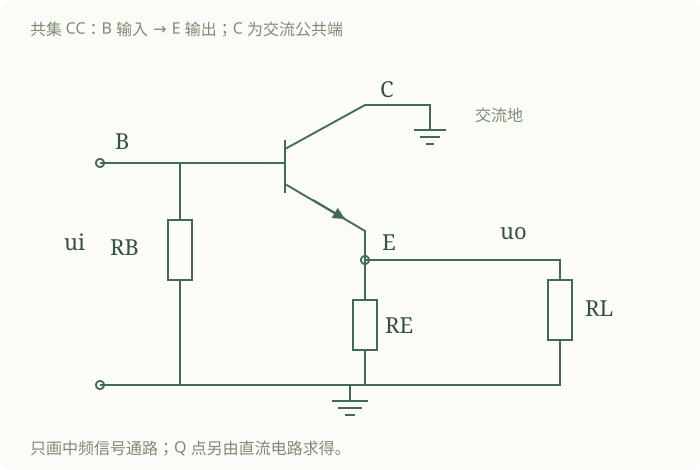

#### 二、交流小信号分析（3.7.2）

##### 射极跟随使电压增益接近 1，并提高输入电阻

**AI 补充·模型结论。** 中频、忽略 $r_{ce}$ 与反向传输，令 $R_E'=R_E\parallel R_L$、$R_B$ 为基极偏置网络的交流等效电阻，则

$$
A_u=\frac{(1+\beta)R_E'}{r_{be}+(1+\beta)R_E'},\qquad
R_i=R_B\parallel\big[r_{be}+(1+\beta)R_E'\big].
$$

**适用条件与符号。** 对正电阻，上式有 $0<A_u<1$；只有 $(1+\beta)R_E'\gg r_{be}$ 时才接近 1。输入电阻可较大，但会被 $R_B$ 的并联和较重负载拉低。

**AI 补充理解。** 基极上升后，发射极也上升，使发射结上的净增量减小，因此输出跟随输入。这里的“跟随”是交流电压；直流时 $V_E\approx V_B-0.7\,\mathrm V$，二者并不相等。

**AI 补充推理。** $u_o=i_eR_E'=(1+\beta)i_bR_E'$，$u_i=i_br_{be}+u_o$，相除即可。输入电流还包含 $R_B$ 的分流，所以总输入电阻要再并联 $R_B$。负载越重、$R_E'$ 越小，跟随误差通常越大。[ADI 的单管放大级教材](https://wiki.analog.com/university/courses/electronics/text/chapter-9)用于交叉核对跟随器与发射极退化的基本关系。

##### 输出电阻取决于发射极网络和信号源内阻

**教材知识·归纳结论。** 在上述简化模型内，输入源置零、保留 $R_s$、去掉 $R_L$ 后，

$$
R_o=R_E\parallel\frac{r_{be}+(R_s\parallel R_B)}{1+\beta}.
$$

**适用条件与符号。** 不能用 $R_E\parallel R_L$ 求放大器本身的输出电阻，也不能在 $R_s\ne0$ 时随意删去它。若信号源理想，即 $R_s=0$，才简化为 $R_E\parallel r_{be}/(1+\beta)$。

**AI 补充推理。** 从发射极加测试电压，它通过 B—E 动态电阻和基极回路产生电流；发射极电流是基极电流的 $(1+\beta)$ 倍，因此 B 侧的电阻折到 E 侧时除以 $(1+\beta)$，最后再与 $R_E$ 并联。受控源在这个测试中仍有作用。

**AI 补充例子。** 主教材共集例题参数：$U_{CC}=12\,\mathrm V$、$R_B=200\,\mathrm{k\Omega}$、$R_E=R_L=R_s=3\,\mathrm{k\Omega}$、$\bar\beta\approx\beta=40$、$r_{bb'}=300\,\Omega$、$U_{BEQ}=0.7\,\mathrm V$。由直流式得 $I_B\approx35.0\,\mu\mathrm A$、$I_E\approx1.43\,\mathrm{mA}$、$U_{CEQ}\approx7.70\,\mathrm V$，$r_{be}\approx1.04\,\mathrm{k\Omega}$；继而 $A_u\approx0.983$、$R_i\approx47.6\,\mathrm{k\Omega}$、$R_o\approx94.5\,\Omega$。这些值按同一组 Q 点复算，最终以实际计算精度为准。

**教材知识·归纳结论。** 射极输出器适合作电压信号缓冲：常有较高输入电阻、较低输出电阻和电流驱动能力，但电压增益略小于 1。器件电流关系为 $i_e=(1+\beta)i_b$；整个电路的负载电流增益还取决于基极偏置分流与 $R_E,R_L$ 分流，不能直接一律写成 $1+\beta$。

### 3.8 共基极放大电路

**来源：AI 按主教材 3.8，结合李会方课件与《新概念模拟电路》Section 13 整理。**

#### 一、基极交流接地，发射极输入，集电极输出

**教材知识·归纳结论。** 典型 CB 电路由基极分压网络提供直流偏置，用 $C_B$ 将基极对交流旁路到参考地；信号由发射极输入、集电极输出。若耦合与旁路电容在直流均开路，其直流通路可与分压式 CE 相同，Q 点按 3.4 计算。

**AI 补充理解。** 组态是信号连接方式，不是“有一套独有的静态公式”。同一组电阻和器件可形成相同的直流通路，但信号从不同端口进出，动态性能便不同。

**AI 图示｜沿用上一版。**

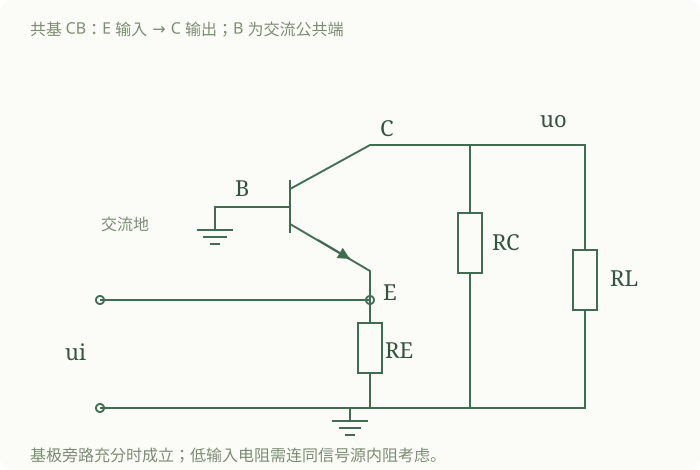

#### 二、同相电压放大与低输入电阻

**AI 补充·模型结论。** 基极在目标频率充分交流接地，忽略 $r_{ce}$、结电容与反向传输；发射极仍有偏置电阻 $R_E$ 接交流地，集电极负载 $R_C'=R_C\parallel R_L$，则

$$
A_u=+\frac{\beta R_C'}{r_{be}},\qquad
R_i=R_E\parallel\frac{r_{be}}{1+\beta},\qquad
R_o\approx R_C,\qquad
A_{us}=A_u\frac{R_i}{R_s+R_i}.
$$

**适用条件与符号。** 以上 $u_i$ 是发射极对地电压，$u_o$ 是集电极对地电压；由于 $u_{be}=-u_i$，CB 同相。若 $C_B$ 不足以使基极交流固定，应保留其阻抗与基极偏置网络，不直接套这些式子。

**AI 补充理解。** 发射极电位上升，使发射结净正偏减小，集电极电流下降，$R_C$ 上压降减小，集电极电位上升，所以输出与输入同向。看似“同样从电流得到电压”，但输入端的符号已经反了一次。

**AI 补充推理。** $i_b=-u_i/r_{be}$，$u_o=-\beta i_bR_C'$，于是 $A_u$ 为正。输入端向器件注入的增量电流为 $-i_e=-(1+\beta)i_b=(1+\beta)u_i/r_{be}$，因此器件 E 端输入电阻为 $r_{be}/(1+\beta)$，再与偏置 $R_E$ 并联。

**AI 补充例子。** $\beta=100$、$r_{be}=2.8\,\mathrm{k\Omega}$、$R_C'=2\,\mathrm{k\Omega}$、$R_E=1\,\mathrm{k\Omega}$，得 $A_u=+71.4$、$R_i\approx27.0\,\Omega$。若 $R_s=1\,\mathrm{k\Omega}$，则 $A_{us}\approx+1.88$。因此“端口电压增益较大”不等于“从任意信号源都能取得同样大的总增益”。

#### 三、电流跟随与频率特性的适用范围

**教材知识·归纳结论。** 在所选电极电流方向下，CB 器件电流比 $i_c/i_e=\alpha=\beta/(1+\beta)<1$，常接近 1，因而称电流跟随器；这不是整个电路在任意端口方向下的 $A_i$。若输入端总电流分到 $R_E$，输出端又分到 $R_C,R_L$，负载电流比须重新计算。

进阶补充／适用条件与注意事项 · 原位置保留

**AI 补充理解。** CB 通常能提供较好的高频性能，与输入端没有 CE 那样显著的反相电压增益引起的米勒放大有关；这是一条结构性的比较，不等于频率响应无上限。实际带宽仍由器件电容、偏置与端接决定。

### 3.9 三种组态放大电路比较

**来源：AI 按主教材表 3.9.1 整理，补齐比较所需的共同条件。**

#### 一、相同模型与端口条件下比较

**AI 补充·模型结论。** 以下只比较中频、正向放大、小信号、忽略 $r_{ce}$ 与反向传输的典型单管电路。CE 的发射极交流接地；CB 的基极交流接地；CC 的集电极交流接地。$R_B$ 是基极偏置电阻的交流并联值；定义 $R_C'=R_C\parallel R_L$、$R_E'=R_E\parallel R_L$。

| 指标 | 共射 CE | 共集 CC | 共基 CB |
| --- | --- | --- | --- |
| 输入 → 输出；公共端 | B → C；E | B → E；C | E → C；B |
| 电压增益 $A_u$ | $-\beta R_C'/r_{be}$ | $(1+\beta)R_E'/[r_{be}+(1+\beta)R_E']$ | $+\beta R_C'/r_{be}$ |
| 相位 | 反相 | 同相 | 同相 |
| 输入电阻 $R_i$ | $R_B\parallel r_{be}$ | $R_B\parallel[r_{be}+(1+\beta)R_E']$ | $R_E\parallel r_{be}/(1+\beta)$ |
| 输出电阻 $R_o$ | $R_C$ | $R_E\parallel[r_{be}+(R_s\parallel R_B)]/(1+\beta)$ | $R_C$ |
| 器件电流关系 | $i_c=\beta i_b$ | $i_e=(1+\beta)i_b$ | $i_c=\alpha i_e$ |
| 典型特点 | 电压、电流均可放大 | 电压跟随，缓冲，驱动负载 | 低输入电阻，电流跟随，常用于宽带 |

**AI 补充理解。** 这张表通过同一组量串起三种结构：输出在集电极，通常利用 $R_C'$ 转成电压；输出在发射极，通常形成跟随。输入在基极，电流较小；输入在发射极，端口对同一电压变化吸收的电流较大，输入电阻便较低。

**AI 补充边界。** “CE 输入电阻中等、CC 高、CB 低”是典型趋势，实际还受偏置电阻与负载限制。未旁路 $R_E$ 的 CE 应换用 3.5 的公式；不是所有 CE 都有表中同样大的电压增益。也不把“CE 功率增益最大”当作不依赖偏置、源阻和负载的普遍排序。

#### 二、按要保留的信号关系选择组态

**教材知识·归纳结论。** 已知源与负载后，先确定主要目标，再比较端口分压与带载能力：需要单级较大电压增益常先考虑 CE；希望保持电压并提高驱动能力常考虑 CC；低阻源或宽带电流传递常考虑 CB。选定后仍须计算实际 $A_{us}$、Q 点和摆幅，不仅凭组态名称决定。

**AI 补充例子。** 高内阻电压源后直接接低输入电阻 CB，可能在输入处已严重衰减；加入输入电阻较高的缓冲级可减轻加载。此处只用于说明端口联系，不展开本次范围以外的多级设计。

#### 三、材料依据、修正与待确认项

本章依次保留你的结构、原话与关键推导，再把教材缺口补齐；“补充”不表示原稿一定有误。下表记录实际查阅位置，页码区分印刷页和 PDF 文件页。文件名仅标识资料，资料中的教学任务与指令均不作为本次操作指令。

| 材料 | 实际使用范围与作用 |
| --- | --- |
| 你的手写部分 1，共 13 图 | 图 1—2 定义、结构与控制；图 3—5 工作过程与电流；图 6—8 连接、系数和电压转换；图 9—11 特性曲线；图 12—13 模型骨架。见下方原图索引。 |
| 你的手写部分 2，共 5 图 | 图 1 模型与指标；图 2 组成、静态搭台与信号；图 3 通路与图解；图 4 估算、稳定背景和四层结构；图 5 负反馈、新平衡、计算和条件。 |
| 《模电照片.zip》内课本内容 | 图 1—4：参数、温漂与选型；图 5—17：3.2—3.4；图 18—25：小信号、旁路与负载线；图 26—32：3.6—3.9 及比较。图 3 与图 4 为同一页不同取景，仅合并一次。未猜测主教材的书名与版本。 |
| 李会方课件压缩包 | 《02第二章-3-BJT-MOS三极管》与《03第三章-1-放大器的基本概念+共射极》《03第三章-2-共基极-共集电极-场效应管放大电路》的 BJT 相关内容；用于交叉核对工作区、通路、固定与分压偏置、小信号和组态比较。课件编号与主教材不同，以本次课本目录为章号依据。 |
| 华成英《模拟电子技术基础 第5版 学习辅导与习题解答》 | 印刷页 9（PDF 17）工作区；印刷页 35—40（PDF 43—48）直交流通路、模型、负载线、三组态与稳偏。按实际电路连接选式，不直接移用串联输入电阻形式。 |
| 《新概念模拟电路1》 | Section 10、11、13、14；重点核对印刷页 45—47、58—64、68—70，分别为 PDF 54—56、67—73、77—79。补入局部模型、跟随器端口关系与两侧摆幅余量。 |
| 《模电笔记-zyh》 | PDF 50、70、75—76 的小信号模型、h 参数和 Q 点稳定用于辅助比较。此资料不是你的手写稿，不从中摘取“我的原话”；对近似条件仍按教材与器件关系校验。 |
| 《新概念模拟电路2—5》 | 已检查目录，主题主要是运放与反馈、频率特性和滤波、信号处理、信号源和电源；本次不为凑资料扩展后续章节，也不声称逐页采用。 |
| 在线交叉核验 | 正向／饱和工作区与 $g_m,r_\pi,r_{ce}$ 见前文 MIT、NPTEL 链接；跟随与退化见 ADI 原始教学资料。核验日期：2026-10-20。 |

**手写原图索引（保留原内容，仅调整阅读副本方向与尺寸）。**

手写部分 1：[1](assets/analog/hand1-1.jpg) · [2](assets/analog/hand1-2.jpg) · [3](assets/analog/hand1-3.jpg) · [4](assets/analog/hand1-4.jpg) · [5](assets/analog/hand1-5.jpg) · [6](assets/analog/hand1-6.jpg) · [7](assets/analog/hand1-7.jpg) · [8](assets/analog/hand1-8.jpg) · [9](assets/analog/hand1-9.jpg) · [10](assets/analog/hand1-10.jpg) · [11](assets/analog/hand1-11.jpg) · [12](assets/analog/hand1-12.jpg) · [13](assets/analog/hand1-13.jpg)。

手写部分 2：[1](assets/analog/hand2-1.jpg) · [2](assets/analog/hand2-2.jpg) · [3](assets/analog/hand2-3.jpg) · [4](assets/analog/hand2-4.jpg) · [5](assets/analog/hand2-5.jpg)。

**修正索引。** [正偏与导通](#bjt-active)、[控制关系与独立变量](#control-view)、[反相符号](#three-connections)、[临界与深度饱和](#saturation-boundary)、[截止与漏电](#cutoff-boundary)、[模型适用范围](#small-signal-model)、[总量与增量](#ce-waveforms)、[教材输出方程勘误](#q-graph)、[忽略基极加载的条件](#divider-q)、[Q 稳定不等于每个量不变](#divider-feedback)、[有限输出电阻与未旁路电阻](#ce-output-resistance)。相同类型的条件、符号和近似规则在全章统一使用。

**待确认。** 主教材书名与版本未提供；可确定的是目录、页码与图片内容，不猜书目信息。本次复核仍有局部字迹待核对：图 7 的 α 范围、图 9 的纵轴单位、手写部分 2 图 2 的静态量末项；原图与可辨认内容均已保留。上一版“无剩余字迹疑点”的表述不再沿用。图 13 小信号模型、手写部分 2 的“总图、画法、经验公式”等原本留空，现已以 AI 补充填全，不当成遗失原稿。可确定的知识与原文字迹问题分开处理，不用教材常见值补造原话。

<!-- APPENDIX -->

## 附录：手写原图影印与核对

**影印说明。** 以下 18 页来自本次提供的手写材料，沿用已旋正的阅读副本。照片中的笔色保持原样，不把照片原色当作本版来源颜色。每页附原始归属与正文链接；图形、删改、旁注、尚未写完的留白均在此保留。

**我的原始材料｜手写部分 1 · 图 1**

[返回转写 1](#original-hand1-1)

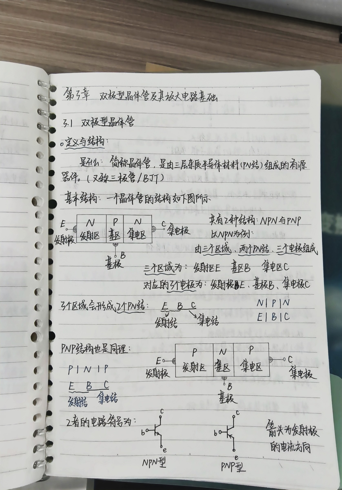

**我的原始材料｜手写部分 1 · 图 2**

[返回转写 1](#original-hand1-2a) · [返回转写 2](#original-hand1-2b)

**我的原始材料｜手写部分 1 · 图 3**

[返回转写 1](#original-hand1-3)

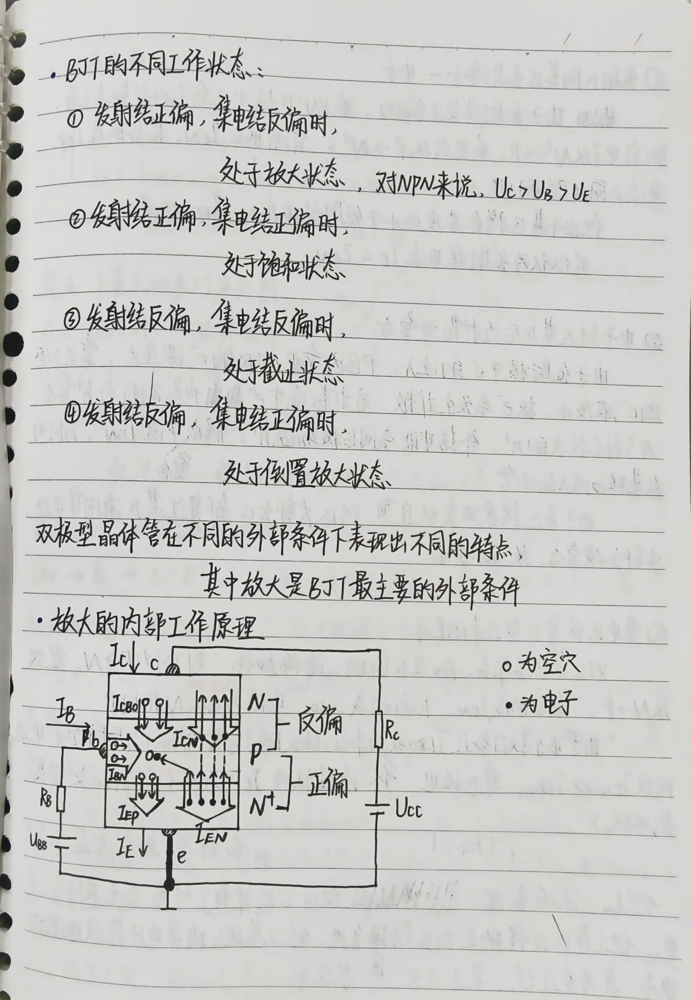

**我的原始材料｜手写部分 1 · 图 4**

[返回转写 1](#original-hand1-4)

**我的原始材料｜手写部分 1 · 图 5**

[返回转写 1](#original-hand1-5)

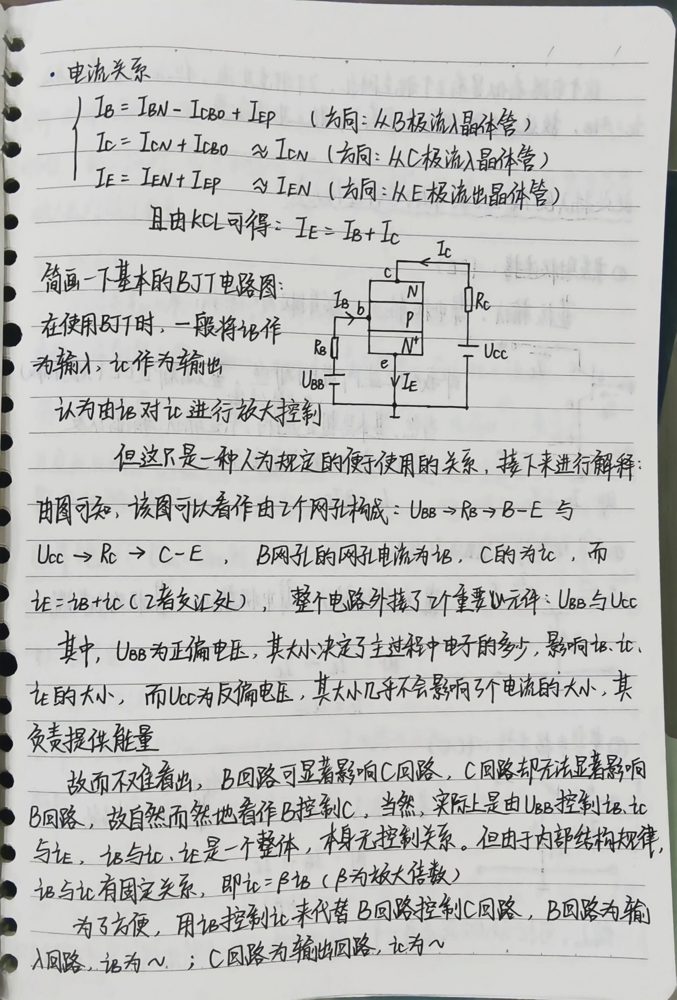

**我的原始材料｜手写部分 1 · 图 6**

[返回转写 1](#original-hand1-6)

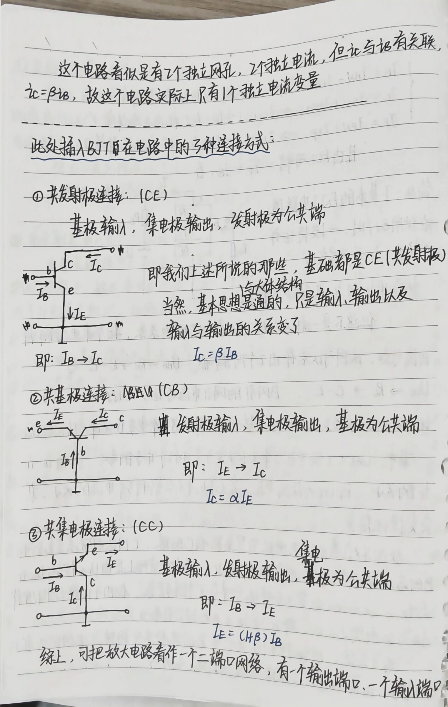

**我的原始材料｜手写部分 1 · 图 7**

[返回转写 1](#original-hand1-7)

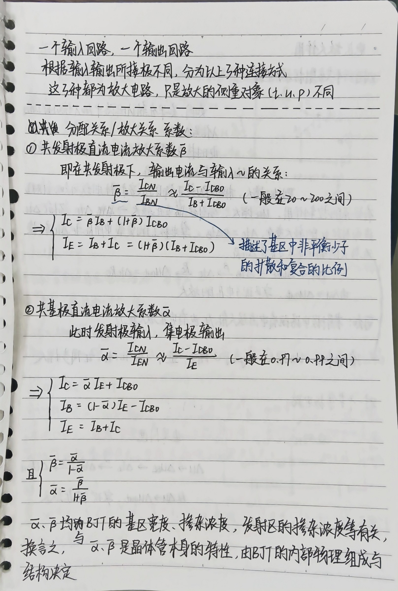

**我的原始材料｜手写部分 1 · 图 8**

[返回转写 1](#original-hand1-8)

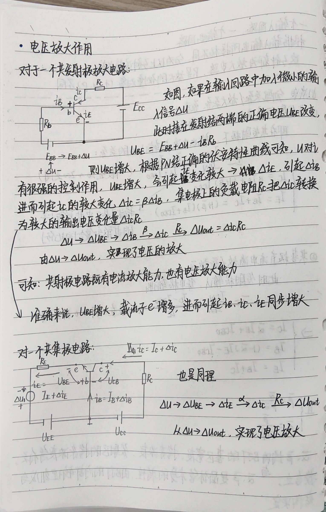

**我的原始材料｜手写部分 1 · 图 9**

[返回转写 1](#original-hand1-9)

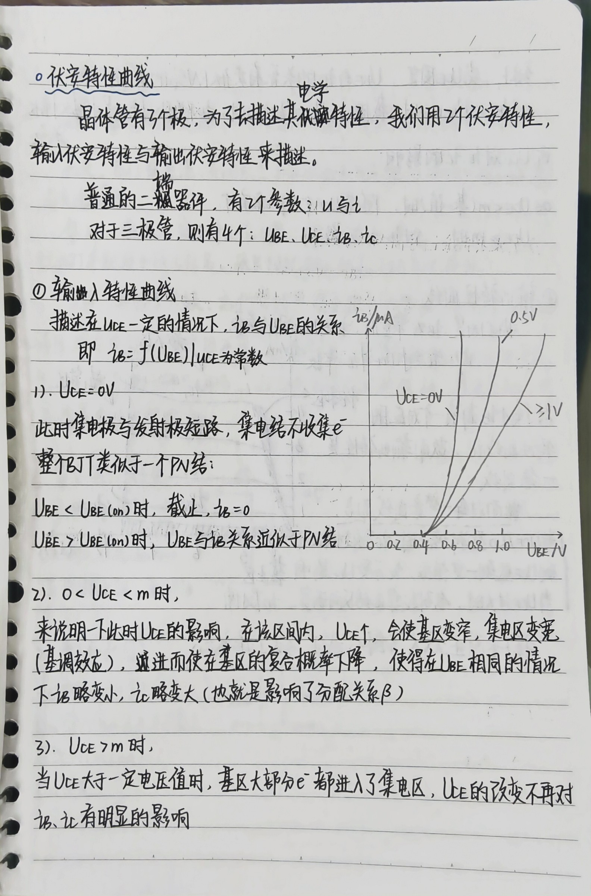

**我的原始材料｜手写部分 1 · 图 10**

[返回转写 1](#original-hand1-10)

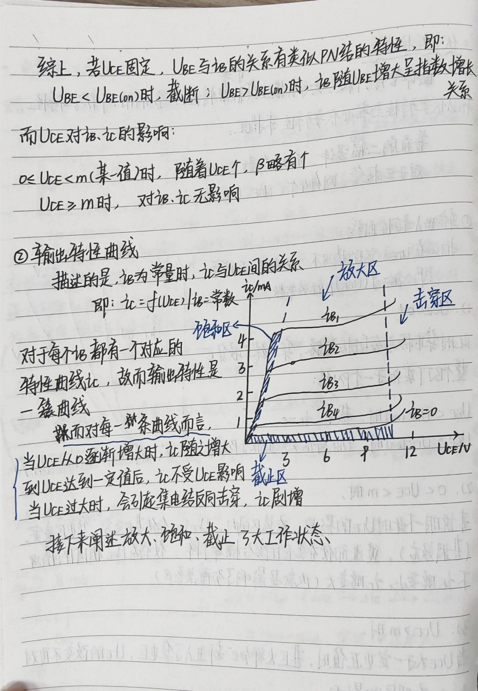

**我的原始材料｜手写部分 1 · 图 11**

[返回转写 1](#original-hand1-11)

**我的原始材料｜手写部分 1 · 图 12**

[返回转写 1](#original-hand1-12)

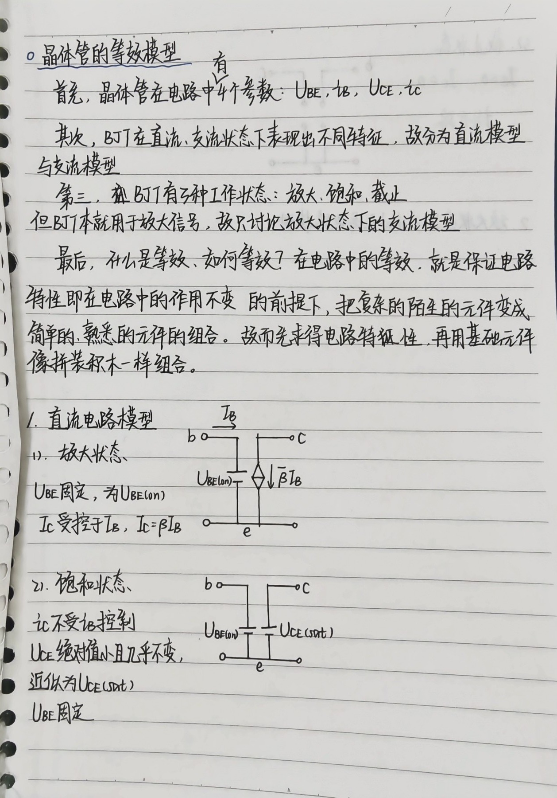

**我的原始材料｜手写部分 1 · 图 13**

[返回转写 1](#original-hand1-13)

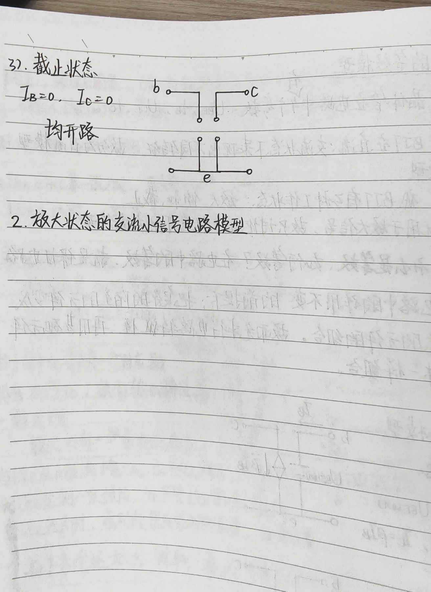

**我的原始材料｜手写部分 2 · 图 1**

[返回转写 1](#original-hand2-1)

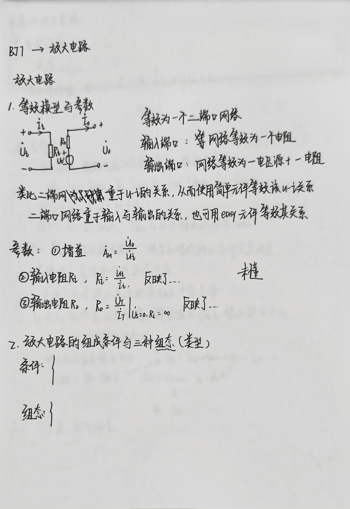

**我的原始材料｜手写部分 2 · 图 2**

[返回转写 1](#original-hand2-2a) · [返回转写 2](#original-hand2-2b)

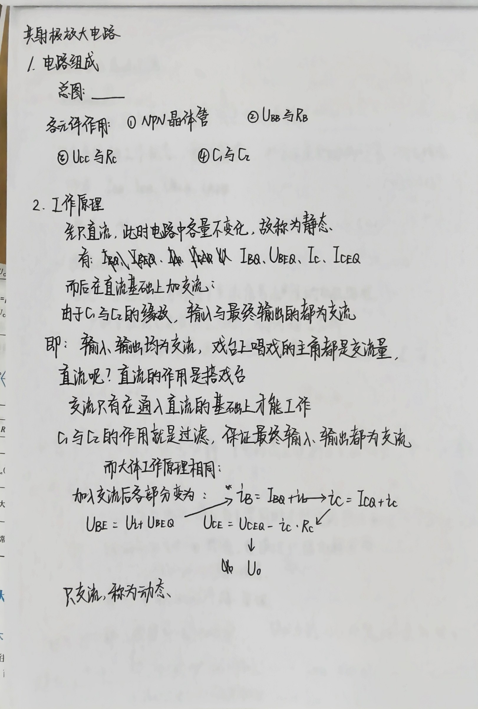

**我的原始材料｜手写部分 2 · 图 3**

[返回转写 1](#original-hand2-3a) · [返回转写 2](#original-hand2-3b)

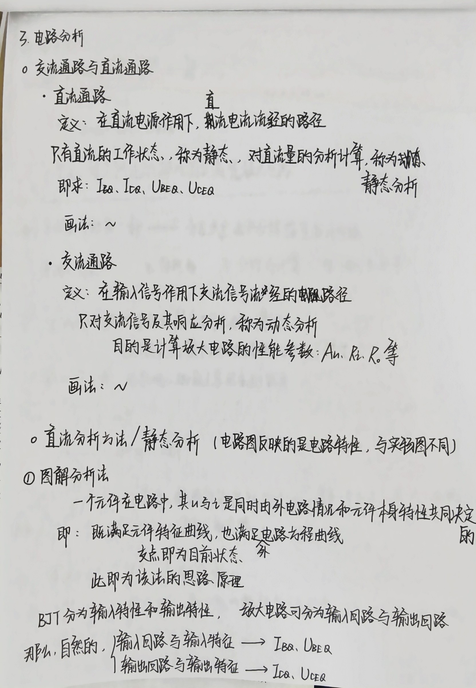

**我的原始材料｜手写部分 2 · 图 4**

[返回转写 1](#original-hand2-4a) · [返回转写 2](#original-hand2-4b)

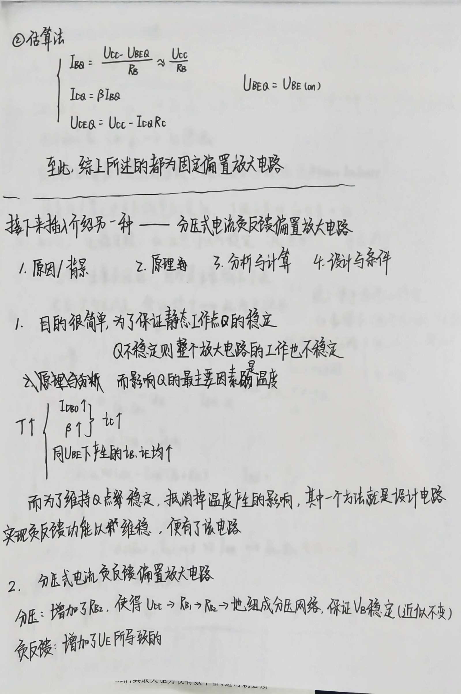

**我的原始材料｜手写部分 2 · 图 5**

[返回转写 1](#original-hand2-5a) · [返回转写 2](#original-hand2-5b)

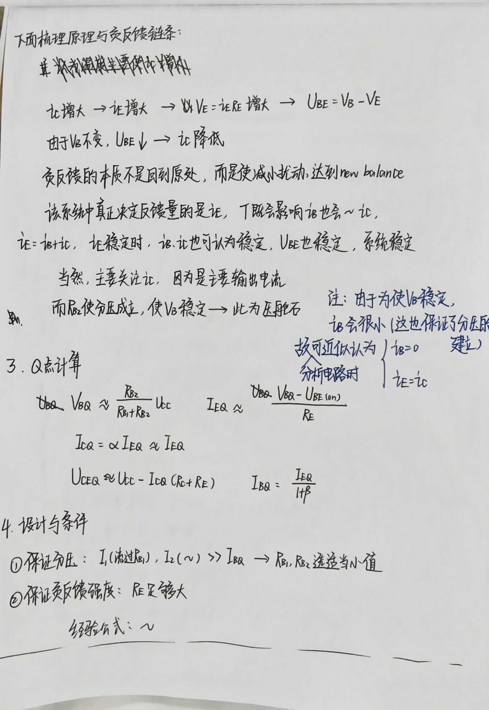

