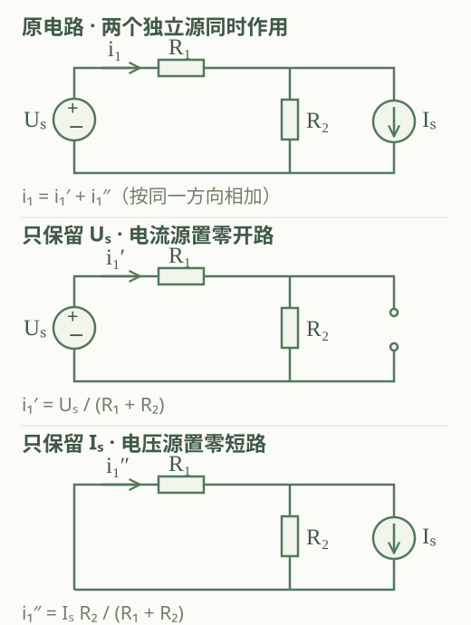
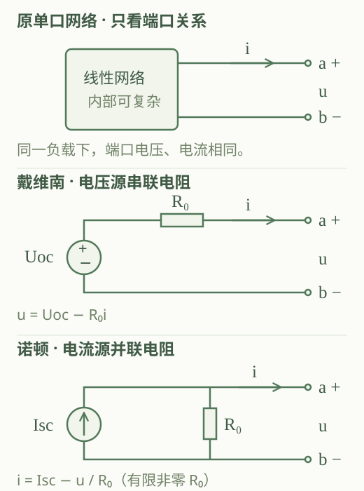
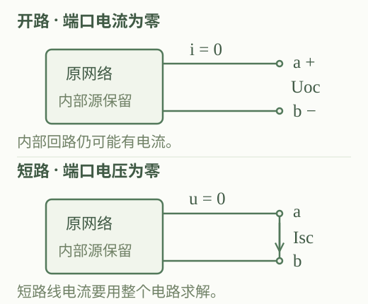
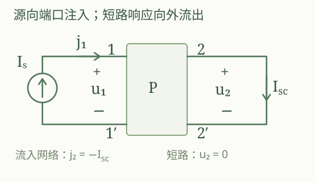
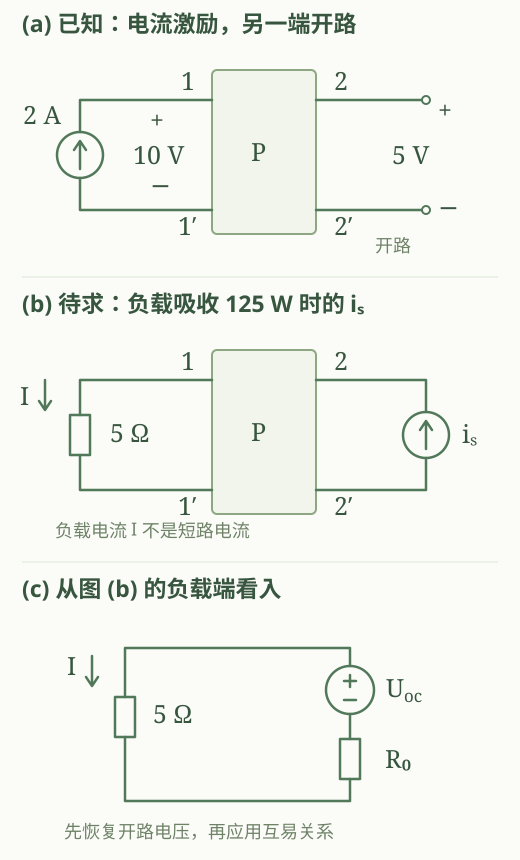

# 电路基础

## 第四章 电路基本定理 · 4.1—4.5

**本章结构：叠加与齐次 → 替代 → 网络与等效电源 → 最大功率传输 → 互易。**

以本次修订后的 10 张图片为准：图 1—2 及图 3 上半部分对应 4.1；图 3 下半部分与图 4 对应 4.2；图 5—7 对应 4.3；图 8 标出待补充的内容及 4.4；图 9、10 分别补入“关于开路电压与短路电流的求法”和“方向问题”。最大功率传输采用修订图中的编号 **4.4**。

4.5 使用随后新增的 3 张图片：图 1 为互易定理大纲，图 2 为节末课件例题，图 3 为该题的个人理解。新增图片不改变前面 10 张材料的对应关系。

“我的理解·手写原话”尽量逐句保留图片中的表述、语气和思考顺序，只整理分段、标点及数学符号排版；“补充理解／补充推理／补充例子”是整理时新增的内容。原话中的不准确表述也保留在引文中，并在紧邻的“原稿修正”中说明，不将校正后的转述冒充原话。以下以集总直流电阻电路为主要讨论对象。4.1 的线性定理、4.3 的等效电源允许线性受控源，分析时必须保留控制关系；4.5 还要求网络具有互易性，不能仅凭线性直接套用。

### 4.1 叠加定理与齐次定理

#### 1. 叠加定理：电压、电流的响应可以分开求再相加

**结论。** 对结构、元件参数和线性受控源控制系数固定、解唯一的线性电阻电路，任一支路的电压或电流，等于各独立源分别作用时在同一支路产生的响应的**代数和**。各分响应必须采用同一个参考方向。若独立激励为 $s_1,\ldots,s_n$，响应为 $x$，则

$$
x=\sum_{j=1}^{n}x_j=\sum_{j=1}^{n}k_js_j.
$$

**我的理解·手写原话。**

> 反映了在线性电路中电源的独立性。

**补充理解。** 这里的“独立贡献”有明确前提：在同一线性模型下，某一分响应不随其他独立源的数值改变。它不表示电源所在位置、负载或元件参数都不影响贡献，也不表示电源之间没有能量交换。原稿对这一点的完整分析，保留在下面的双源例子中。

**补充推理。** 用节点法或支路法列出线性方程，可写成

$$
\mathbf A\mathbf x=\sum_j\mathbf b_js_j.
$$

矩阵 $\mathbf A$ 包含连接关系、元件参数及受控源的控制系数。每个独立源分别作用时，设解为 $\mathbf x_j$，则 $\mathbf A\mathbf x_j=\mathbf b_js_j$。把这些方程相加，得到

$$
\mathbf A\left(\sum_j\mathbf x_j\right)=\sum_j\mathbf b_js_j.
$$

由解的唯一性，全部独立源共同作用的解就是各分解之和。这是叠加成立的数学原因。

##### 单独作用：只把其余独立源置零

**结论。** 计算某一独立源的分响应时，其余独立源置零；电阻、连接端点及受控源控制关系保留。理想电压源置零对应短路，理想电流源置零对应开路。

| 对象 | 单独作用时的处理 | 原因 |
| --- | --- | --- |
| 其他独立电压源 | 用短路线代替 | $u=0$，但电流不必为零 |
| 其他独立电流源 | 用开路代替 | $i=0$，但电压不必为零 |
| 受控源 | 保留，并重算控制量 | 它是电路内部的线性约束 |
| 电阻等其余元件 | 阻值及连接关系不变 | 它们决定各源的传递系数 |

**补充理解。** “置零”是把源的规定值设为零，不是把整条支路连同电阻删除。若实际电源用“理想源＋内阻”建模，置零的只是理想源，内阻仍在。受控源的控制量可能在某个分电路中恰为零；这应由计算得到，不能事先把受控源关掉。

##### 原稿例子：两个电源怎样共同决定同一支路电流

**结论。** 下图取 $U_s$ 上正下负，电流源 $I_s$ 向下，$i_1$ 经 $R_1$ 从左向右；设 $R_1,R_2>0$，则

$$
i_1=\frac{U_s}{R_1+R_2}+\frac{R_2}{R_1+R_2}I_s
=k_1U_s+k_2I_s.
$$

**我的理解·手写原话。**

> 不妨写作：$i_1=k_1u_s+k_2i_s$。
>
> 不难看出，$i_1$ 由 $u_s,i_s$ 组成，严谨些就是，$i_1$ 是一个以 $u_s,i_s$ 为自变量的因变量。
>
> 一来，$i_1$ 的大小由 $u_s$ 与 $i_s$ 决定，也就是由电源决定，每个电源对于该量的形成都有各自的贡献，而这个贡献不受其它电源的影响，这就是电源的独立性。
>
> 二来，$i_1$ 的大小也与电路中的结构与元件相关。$u_s$ 与 $i_s$ 的贡献正是受其影响，$k_1,k_2$ 由电路中的结构与元件所决定，即：$k_1=\frac{1}{R_1+R_2}$，$k_2=\frac{R_2}{R_1+R_2}$。
>
> 电源所处的电路不同，在电路中的位置不同都会影响其贡献。
>
> 综上，电路中的电压、电流响应，受电源、电路结构、元件的影响。
>
> 该定理的思路明确的是电源对其的影响与作用：$i_n/u_n=k_nu_s+k_n'i_s$，（$i_n/u_n=f_n(u_s,i_s)$）。

**补充说明。** 原稿最后用 $i_n/u_n$ 并列表示“某个电流或某个电压响应”，这里不是二者相除；两类响应应分别写各自的线性式，系数及量纲也各有对应。本文主公式统一用 $U_s,I_s$ 表示独立源，原话中的 $u_s,i_s$ 保留原记法。两项相加须采用同一参考方向，不能一律把绝对值相加。

**补充推理。** 只保留 $U_s$ 时，电流源开路，$R_1,R_2$ 串联，所以 $i_1'=U_s/(R_1+R_2)$。只保留 $I_s$ 时，电压源短路，$R_1,R_2$ 并联；向下的电流源从上节点抽取电流，两电阻从下节点向上补入电流。经 $R_1$ 的电流仍符合原来从左向右的方向，分流得 $i_1''=I_sR_2/(R_1+R_2)$。于是 $i_1=i_1'+i_1''$。

也可用节点电压 $v$ 检查符号：

$$
\frac{U_s-v}{R_1}=\frac v{R_2}+I_s,
\qquad i_1=\frac{U_s-v}{R_1}.
$$

消去 $v$，就得到同一结果。若把 $I_s$ 的箭头反向而仍用正值表示其大小，第二项应改为负号。

**补充例子。** 取 $U_s=12\,\mathrm V$，$I_s=1\,\mathrm A$，$R_1=2\,\Omega$，$R_2=4\,\Omega$，则 $i_1'=2\,\mathrm A$，$i_1''=2/3\,\mathrm A$，故 $i_1=8/3\,\mathrm A$。

##### 功率不能直接叠加

**结论。** 叠加定理用于线性电路的电压、电流响应，一般不能把各独立源单独作用时的功率相加作为总功率。应先叠加电压、电流，再求功率。

**补充理解。** 电路是线性的，不代表由响应构成的任意物理量也是线性的。

**补充推理。** 同一电阻中 $i=i_1+i_2$，则

$$
p=Ri^2=R(i_1+i_2)^2
=Ri_1^2+Ri_2^2+2Ri_1i_2.
$$

单独求得的两个功率之和缺少交叉项。上述适用对象与置零规则可对照 [University of Louisville：叠加原理](https://engineering.louisville.edu/raise/EE220/L6.html)。

#### 2. 齐次定理：全部独立激励同倍变化，响应同倍变化

**结论。** 在同一个解唯一的线性电阻电路中，若**全部独立源的数值**同时乘以同一个实数 $\lambda$，元件参数与受控源控制系数不变，则各支路电压、电流也都乘以 $\lambda$：

$$
x(\lambda s_1,\ldots,\lambda s_n)
=\lambda x(s_1,\ldots,s_n).
$$

**我的理解·手写原话。**

> 这个定理经常搭配叠加定理一起食用。
>
> 叠加：$i_1=k_1u_s+k_2i_s$。
>
> 齐次：$Ki_1=K(k_1u_s+k_2i_s)$。

**补充理解。** 叠加描述各激励的贡献怎样组合；齐次描述全部激励按同一比例改变时，响应怎样改变。原稿强调“全部”“同时”，正是为了避免只改一个源却把总响应整体缩放。

**补充推理。** 因 $x=\sum k_js_j$，保持所有 $k_j$ 不变，把每个 $s_j$ 替换成 $\lambda s_j$，可提出公共因子 $\lambda$。受控源的值会随控制量一起变化，不需要、也不应把其控制系数再乘一次 $\lambda$。

**补充例子。** 对前述电路，把 $12\,\mathrm V$ 与 $1\,\mathrm A$ 同时扩大为两倍，则 $i_1$ 从 $8/3\,\mathrm A$ 变为 $16/3\,\mathrm A$。若仅把电压源扩大两倍，结果是 $4+2/3=14/3\,\mathrm A$，并非原响应的两倍。

> **原稿修正：**“齐次定理无法作用在功率上”应准确理解为：功率不按一次比例缩放。若电压和电流都乘以 $\lambda$，则 $p'=u'i'=\lambda^2p$；电阻功率也乘以 $\lambda^2$。

##### 线性意味着可加性与齐次性同时成立

**结论。** 对给定的激励—响应映射 $F$，线性意味着对允许的任意激励 $\mathbf s,\mathbf t$ 和标量 $\alpha,\beta$，均有

$$
F(\alpha\mathbf s+\beta\mathbf t)
=\alpha F(\mathbf s)+\beta F(\mathbf t).
$$

**我的理解·手写原话。**

> 齐次定理反映了线性电路的性质。
>
> 满足齐次定理与叠加定理的电路即为线性电路。
>
> 线性电路 ⇔ 齐次＋叠加。
>
> 或者这样说，齐次、叠加是线性的性质。

**补充限定。** 这里“叠加”指可加性，且两条性质须对整个讨论范围内的激励成立。不能只验证某个工作点、某一条支路或几个数值，就断定整个电路线性。

**补充推理。** 先用可加性拆成 $F(\alpha\mathbf s)+F(\beta\mathbf t)$，再用齐次性提出两个标量，就得到上式。反过来分别取 $\alpha=\beta=1$ 或 $\beta=0$，可得到两条性质。

<aside class="manuscript-questions" data-section="section-1" aria-label="叠加与齐次的原稿疑问">

原稿疑问 · 叠加与齐次

保留原稿的提问，解释由整理时补充。

手写提问：“独立在哪？”

<strong>原话：</strong>“每个电源对于该量的形成都有各自的贡献，而这个贡献不受其它电源的影响，这就是电源的独立性。”

<strong>补充：</strong>这个判断以线性模型及结构、元件固定为前提；其贡献系数仍由电路和负载决定。
<a href="#superposition">回到叠加定理与原话分析 →</a>

手写提问：“何为单独作用？”

<strong>原话：</strong>“即其余独立源失去作用：理想电压源电压为 0，短路；理想电流源电流为 0，开路。”“受控源均要保留且控制关系不变。”

<strong>补充：</strong>置零的是其余独立源，不能把其他元件一并删掉。
<a href="#source-off">回到置零规则 →</a>

</aside>

### 4.2 替代定理

#### 1. 替代保留给定工作状态下的解

**结论。** 若电路在给定激励下有唯一解，某支路的电压 $u_k$ 与电流 $i_k$ 已知，且它与其余电路仅通过该支路的两个端点相互作用，那么可以用电压等于 $u_k$ 的理想电压源，或电流等于 $i_k$ 的理想电流源替代该支路；极性、方向与原来一致，且替代后的电路仍须有唯一解。满足这些条件时，其余电路的电压、电流不变，替代支路的端口电压、电流也保持原值。

**我的理解·手写原话。** 以下保留原话，其中“只保证一个不变”和“只适用于静态”的表述见紧随的校正。

> 替代是在 $u/i$ 唯一的情况下用理压／理流源替代这条支路，其只是保证了 $u,i$ 中一个不变，也只强调了 $u,i$ 中的一个的信息，而忽略了另外一个信息，只反映了该支路的部分电学特性，而非全部。
>
> 故而，替代有局部性，当然也简单，只适用于静态的、不变的情况。

> **原稿修正：**保留原稿用“局部性”理解替代的思路。准确说法是：替代源直接规定其中一个量；在替代条件及唯一性成立时，另一个量由剩余电路决定，也保持原值。失去的是对其他工作状态的通用描述，不是当前状态中的另一个量。“只适用于静态”也过于严格：已知完整波形且满足相应条件时，同样可以替代。

**补充推理。** 把原电路所有支路的电压、电流原封不动地代入替代后的电路：其余元件关系没改，KCL、KVL 仍成立；新电压源满足原来的 $u_k$，或新电流源满足原来的 $i_k$。所以原解仍是新电路的一个解。再由新电路解唯一，可知实际解就是原解。

> **补充条件：**若被替代部分与外部还有受控源控制关系或互感等耦合，不能只保留两个接线端就当作完全替代；必须把相关关系一起纳入分析。替代定理本身不要求线性，也不限于静态；若已知完整的 $u_k(t)$ 或 $i_k(t)$，且动态问题的初始条件及唯一性要求满足，可作相应的时变源替代。本章例子采用直流工作状态。这些条件可对照 [NIT Calicut 提供的《Circuit Theorems》§5.3](https://nitc.ac.in/imgserver/uploads/attachments/electric-layout_8e040550-fa23-4690-89f5-2be9b74837af_0.pdf)。

**补充例子。** $10\,\mathrm V$ 电压源与 $2\,\Omega$、$3\,\Omega$ 电阻串联。原电流为 $2\,\mathrm A$，$3\,\Omega$ 电阻沿电流方向的电压降为 $6\,\mathrm V$。

- 用沿原电流方向呈 $6\,\mathrm V$ 电压降的理想电压源替代 $3\,\Omega$ 电阻：$10-2i-6=0$，仍有 $i=2\,\mathrm A$。
- 用沿原电流方向的 $2\,\mathrm A$ 理想电流源替代它：电流被规定为 $2\,\mathrm A$，其端电压由 KVL 得到 $10-2\times2=6\,\mathrm V$。

两种替代都保留了当前的电压、电流。若把原来的供电电压改成 $20\,\mathrm V$，原电路电流变为 $4\,\mathrm A$；仍保持 $6\,\mathrm V$ 的替代源电路却得到 $7\,\mathrm A$，说明这个固定替代源不再适用。

#### 2. 替代与等效：一个工作点和完整端口关系

**结论。** 替代通常保留给定激励下的一组端口数值；端口等效保留的是指定模型与适用范围内的完整端口 $u$—$i$ 关系。外接负载变化时，只要仍在适用范围内，等效模型与原网络的外部响应相同；固定的替代源通常不具备这个保证。

| 比较点 | 替代 | 端口等效 |
| --- | --- | --- |
| 已知或保留的信息 | 给定工作状态下的 $u_k,i_k$ | 整个端口电压、电流约束关系 |
| 适用范围 | 原工作状态；改变条件通常要重新确定替代源 | 满足模型条件的外接电路变化 |
| 内部电路 | 无须继续使用被替代支路的内部关系 | 内部元件、电流及损耗可以不同 |
| 本章用途 | 保留已知解、辅助理解和推理 | 简化负载分析，形成等效电源 |

**我的理解·手写原话。**

> 与等效对比，等效反映了支路的全部电学特性，也相对复杂一些。
>
> 等效具有全面性，适用于动态的、变化的情况。

> **原稿修正：**“全面性”应限定为**对外的端口特性**，不能扩大为内部一切物理量都相同。原稿用“静态／动态”作对照的意图是区分能否随外部条件改变继续使用；准确的区别是“保留一个已知工作状态”和“保留适用范围内的完整端口关系”。

**补充推理。** 若原网络和新模型给外电路施加同一个端口方程，接上同一负载后，联立的外部方程就相同；在解唯一时，得到的负载电压、电流也相同。只知道一个工作点，则不足以确定整条端口特性曲线。

<aside class="manuscript-questions" data-section="section-2" aria-label="替代定理的原稿理解校正">

理解校正 · 替代与等效

此处为原稿观点的校正记录，不另造个人提问经历。

原话：“其只是保证了 u,i 中一个不变”

<strong>原话：</strong>“也只强调了 u,i 中的一个的信息，而忽略了另外一个信息。”

<strong>校正：</strong>源直接规定一个量，剩余电路确定另一个量。在替代条件及唯一性成立时，二者都保持原来的值；只是不能推广到其他激励或负载。
<a href="#substitution">回到原话与唯一性推理 →</a>

原话：“只适用于静态的、不变的情况”

<strong>原话：</strong>“等效具有全面性，适用于动态的、变化的情况。”

<strong>校正：</strong>更准确的区别是“已知工作状态”和“完整端口关系”。替代也可描述已知波形；等效则只保证模型范围内的端口行为。
<a href="#substitution-vs-equivalence">回到替代与等效的对照 →</a>

</aside>

### 4.3 等效电源定理

#### 1. 网络与等效：先把部分电路看成整体

**结论。** 电路网络是由元件按一定关系连接形成的整体；只通过两个端点与外界相接的网络称为二端网络，在端口流入、流出电流大小相等时可视为单口网络。对于一个独立的单口模型，还要求不存在被遗漏的跨边界控制或其他耦合。端口等效是用更简单的模型保留它对外的 $u$—$i$ 关系。

**我的理解·手写原话。**

> 接下来我要叙述一个电路中很重要的，也是要贯穿始终的一个思想。
>
> 网络的思想很重要，它像一个子装配体，我们将其视为一个单独的零件插入设计树中，再搭配其余零件及子装配体，组成一个新装配体。
>
> 我要说的就是，这个思想就是把一个电路部分视为一个整体，或说是视为一个元件，这便是网络的思想或称为集成／整体化思想。
>
> 这个思想的应用初衷是简化电路分析，那么在电路分析中关注的是什么呢？电路特性，对了，也就是 $U-I$ 特性。你把一堆电路视为一个元件，然后去分析整体或其外部电路，没问题，但我要知道你的 $U-I$ 特性，要得到 $u-i$ 的数学关系。
>
> OK 啊，这就可以正常进行电路分析了，但是数学关系还是不直观，分析时不方便。所以！引出第二个重要思想——等效。
>
> 等效就是在保证 $u-i$ 特性不变的情况下，用一些简单的元件来替换复杂电路部分，实现简化。
>
> 所以，正确打开方式是这样的：
>
> 根据实际情况选定一部分电路网络 → 将其视为一个整体 → 求出其 $u-i$ 关系 → 进行等效 → 完成简化，进行电路分析。
>
> 网络＋等效，我认为是电路中最重要的思想之一。

**补充整理。** 将原稿这条分析顺序排成便于查阅的关系式：

$$
\text{选定电路部分}
\longrightarrow\text{确定端口}
\longrightarrow\text{求端口关系}
\longrightarrow\text{等效并分析外部电路}.
$$

**补充理解。** 求某个负载时，通常把负载之外的网络作为待等效部分。负载不计入该网络的等效电阻。内部可以含多个独立源和线性受控源；不应凭电路画得复杂，就把它当成不能等效。

#### 2. 戴维南定理：电压源串联等效电阻

**结论。** 对端口关系良好定义的线性电阻单口网络，若开路电压 $U_{oc}$ 和有限等效电阻 $R_0$ 存在，则可对外等效为**电压为 $U_{oc}$ 的理想电压源串联 $R_0$**。统一取 $u=V_a-V_b$，$i$ 从网络的 $a$ 端流出，则

$$
u=U_{oc}-R_0i.
$$

$U_{oc}$ 的极性为 $a$ 正、$b$ 负；其数值允许为负。这里 $R_0$ 是把内部独立源置零、保留受控源后，从端口看进去的输入电阻。普通无源电阻网络的 $R_0\ge0$；含受控源时不能预先断定它为正。

**我的理解·手写原话。**

> 为什么如此等效？得出二端网络的 $u-i$ 数学关系即知。

**补充理解。** 开路时没有输出电流，所以端口电压就是 $U_{oc}$；接上负载后，输出电流通过等效内阻，端口电压按 $R_0i$ 改变。等效源和电阻是对端口关系的表达，不一定是原网络里真实存在的那两个元件。

**补充推理·用叠加推出端口方程。** 为描述任意允许的端口工作状态，在端口外接测试电流源，使流入网络 $a$ 端的电流为 $i_t$，所以 $i_t=-i$。把端口电压分成两项：

1. **内部独立源作用，测试电流源置零。** 测试电流源开路，此时端口电压就是 $U_{oc}$。
2. **测试电流源作用，内部独立源置零。** 受控源保留。这个网络没有内部独立激励，线性关系经过原点；按输入电阻定义，其端口电压为 $R_0i_t$。

叠加得到

$$
u=U_{oc}+R_0i_t=U_{oc}-R_0i.
$$

再看理想电压源串联电阻的端口，由 KVL 有 $U_{oc}=R_0i+u$。两者具有同一个端口方程，因此对外等效。这里用的是 4.1 的线性叠加，而不是只比较一个负载下的数值。

**补充例子。** 网络端口满足 $u=12-3i$，采用伏、安单位，则它的戴维南模型为 $12\,\mathrm V$ 电压源串联 $3\,\Omega$。接入 $R_L=3\,\Omega$ 时，联立 $u=3i$ 得 $i=2\,\mathrm A$、$u=6\,\mathrm V$。

#### 3. 诺顿定理：电流源并联等效电阻

**结论。** 对端口关系良好定义的线性电阻单口网络，若短路电流 $I_{sc}$ 和有限端口电导 $G_0$ 存在，则可对外等效为电流源 $I_{sc}$ 与电导 $G_0$ 并联。取 $u=V_a-V_b$、$i$ 从 $a$ 端流出，$I_{sc}$ 沿外部短路线从 $a$ 流向 $b$，则

$$
i=I_{sc}-G_0u.
$$

通常在有限且非零的 $R_0$ 情形，$G_0=1/R_0$，模型就是**电流为 $I_{sc}$ 的理想电流源并联 $R_0$**，即 $i=I_{sc}-u/R_0$。模型内部电流源的箭头从 $b$ 指向 $a$，与外部短路线中的 $I_{sc}$ 构成环流。

**我的理解·手写原话。**

> 同等效电压源定理。

**补充理解。** 电流源送到上节点的电流，一部分经过并联电阻回到下节点，其余流向负载。端口短路时 $u=0$，电阻中的电流为零，输出电流等于整个源电流 $I_{sc}$。

**补充推理·从端口电流出发。** 在端口外加测试电压源，规定 $u=V_a-V_b$，将输出电流分成两项：

1. **内部独立源作用，测试电压源置零。** 端口短路，输出电流为 $I_{sc}$。
2. **测试电压源作用，内部独立源置零。** 外加电压引起流入网络的电流 $G_0u$；换成本文的输出方向，其贡献为 $-G_0u$。

于是 $i=I_{sc}-G_0u$。对诺顿模型的上节点列 KCL，也有

$$
I_{sc}=i+G_0u.
$$

两个端口方程完全相同，这就说明为何电流源与电阻并联能够完成等效。

#### 4. 两种模型的互换及特殊边界

**结论。** 若同一个线性单口同时具有有限的开路电压、短路电流和有限非零的 $R_0$，在本文统一方向下，两种模型具有相同的 $R_0$，且

$$
U_{oc}=I_{sc}R_0,
\qquad I_{sc}=\frac{U_{oc}}{R_0}.
$$

**我的理解·手写原话。**

> 二者联系相当于一个电压源串联电阻等效一个电流源并联一个电阻。
>
> $R_0=R_0$，$U_{oc}=i_{sc}R_0$。二者可相互转换。
>
> $R_0=0$ 的情况下，不可相互转换，此时二端网络只能等效为二者其中之一。

> **原稿修正：**两种模型都存在且 $R_0$ 有限、非零时，可以按上述关系互换。原稿提到的 $R_0=0$ 对应理想电压源的边界；还需补上理想电流源一侧的边界，见下面的特殊端口对照。

**补充理解。** 互换的是完整模型，不能单独把一个理想电压源画成理想电流源。端口之外的效果相同，两个模型内部各元件的电流、功率不必相同。

**补充推理。** 在戴维南方程 $u=U_{oc}-R_0i$ 中，令 $u=0$ 得 $I_{sc}=U_{oc}/R_0$；再移项得到 $i=U_{oc}/R_0-u/R_0$，这就是诺顿方程。令 $i=0$ 又可得到 $U_{oc}=I_{sc}R_0$。

| 特殊端口 | 可用模型 | 不能直接做的事 |
| --- | --- | --- |
| $R_0=0$，$U_{oc}\ne0$ | 理想电压源 | 除以 $R_0$ 求有限诺顿源；理想短路时无有限一致解 |
| $G_0=0$，$I_{sc}\ne0$ | 理想电流源，等效电阻可理解为无穷大 | 构造有限戴维南模型；理想开路时无有限一致解 |
| $U_{oc}=I_{sc}=0$ | 仍可能有非零等效电阻 | 用 $0/0$ 确定 $R_0$，应改用测试源 |

> **补充边界：**不能说任何线性网络都无条件具有两个有限参数模型；须先检查相应开路、短路及端口关系是否存在。

**补充例子。** 前面的 $12\,\mathrm V$ 串联 $3\,\Omega$，可转换成箭头从 $b$ 指向 $a$ 的 $4\,\mathrm A$ 电流源并联 $3\,\Omega$。接 $3\,\Omega$ 负载后，$4\,\mathrm A$ 在两个电阻间各分 $2\,\mathrm A$，端口仍为 $6\,\mathrm V$。

等效源与叠加的课程说明可参看 [MIT 6.002 Lecture 3：Superposition, Thévenin and Norton](https://ocw.mit.edu/courses/6-002-circuits-and-electronics-spring-2007/resources/lecture-3/)。上述测试源分解是本笔记补写的数学推理。

#### 5. 关于开路电压与短路电流的求法

**结论。** 求 $U_{oc}$ 与 $I_{sc}$ 时，均保留原网络内部的独立源和受控源，只改变指定端口的外接条件：开路令**端口电流**为零并求端电压；短路令**端口电压**为零并求短路线电流。两者是两个不同电路状态中的响应。

| 要求的量 | 外部端口条件 | 未知量及常用算法 |
| --- | --- | --- |
| $U_{oc}$ | 移去外接负载；$i=0$ | 求 $V_a-V_b$；可用节点法、网孔法、支路法或叠加 |
| $I_{sc}$ | 移去负载并用理想导线连接 $a,b$；$u=0$ | 求该短路线中从 $a$ 到 $b$ 的电流；常用节点法配合 KCL |

**我的理解·手写原话。** 以下保留“我明白了”这段原话，“无外界影响”的说法见紧随的校正。

> 我明白了。
>
> 开路电压与短路电流是在理想情况或者说无外界影响的情况下，求出的二端网络的电学响应 $u$ 与 $i$。
>
> $U_{oc}$：开路；$i_{sc}$：短路。

> **原稿修正：**保留“二端网络的电学响应”这一理解；“无外界影响”应改为“**规定明确的外接边界条件**”。开路是不接负载，短路却是外接一条零电阻通路，二者不能都理解成与外部无关。$U_{oc}$ 和 $I_{sc}$ 分别属于两个不同工作状态。

**补充推理。** 在 $u=U_{oc}-R_0i$ 上，开路给出截点 $(i,u)=(0,U_{oc})$，短路给出 $(I_{sc},0)$。所以二者能帮助确定端口直线，却不是同一工作状态下的一对电压、电流。

尤其注意：端口开路不代表网络内部所有支路电流为零；端口短路也不代表内部所有元件电压为零。理想导线两端电压为零，但电流须由整个电路求得，不能套用 $i=u/R$ 写成 $0/0$。

**补充例子。** $12\,\mathrm V$ 电源与 $R_1=2\,\Omega$ 串联到端点 $a$，$R_2=4\,\Omega$ 从 $a$ 接到 $b$，电源负端接 $b$；把 $a,b$ 作为外接负载端口。

开路时，$R_1,R_2$ 内部仍构成回路，电流为 $12/(2+4)=2\,\mathrm A$，所以

$$
U_{oc}=2\times4=8\,\mathrm V.
$$

短路时，$R_2$ 被短路旁路，其电流为零；$R_1$ 承受 $12\,\mathrm V$，全部电流经短路线返回，所以

$$
I_{sc}=\frac{12}{2}=6\,\mathrm A,
\qquad R_0=\frac86=\frac43\,\Omega.
$$

将内部电压源置零后直接看入端口，也有 $R_0=2\parallel4=4/3\,\Omega$，相互验证。

> **材料待确认：**图 9、10 边缘的原题电路和部分计算被截断，无法核对原题条件及数值来源。这里保留其概念理解，不将零散算式认定为完整例题；上面的数值题是单独补充的例子。

#### 6. 等效电阻的三种求法

**结论。** $R_0$ 应从指定端口向原网络内部看入，且不包含外接负载。可根据电路条件选择下列方法；只有前两种方法需要先把内部独立源置零，第三种使用原网络的开路、短路响应。

| 方法 | 适用情形与条件 | 操作 |
| --- | --- | --- |
| 置零后等效化简 | 独立源置零后可按已知电阻关系化简 | 电压源短路、电流源开路；受控源保留；从端口求等效电阻 |
| 置零后外加测试源 | 含受控源或难以串并联化简，端口输入关系存在 | 取 $u_t=V_a-V_b$，$i_t$ 流入网络的 $a$ 端，求 $R_0=u_t/i_t$ |
| 开路—短路法 | 同一网络的 $U_{oc},I_{sc}$ 均为有限值，且 $I_{sc}\ne0$，方向采用本文约定 | 保留原源，分别求 $U_{oc}$ 和 $I_{sc}$，再取 $R_0=U_{oc}/I_{sc}$ |

**补充理解。** 去掉独立激励，是为了只观察端口本身的响应斜率。受控源决定这个斜率，所以必须保留。只含电阻及线性受控源、没有独立源的网络，在解唯一且没有外部激励时通常有 $U_{oc}=I_{sc}=0$，但这绝不说明 $R_0=0$。

**补充推理。** 源置零后端口关系经过原点，按关联参考方向有 $u_t=R_0i_t$。测试源给网络一个非零激励，才能测出这个比例。若只取原来的零激励，就只能得到 $(0,0)$，一个点无法确定斜率。测试电压或电流常可取 $1\,\mathrm V$ 或 $1\,\mathrm A$，但须确保所选测试方式有有限且唯一的解。

**补充例子·受控源不能关。** 设端口上并联 $4\,\Omega$ 电阻和一个从 $b$ 指向 $a$ 的受控电流源，源电流为 $g u_t$，其中 $g=1/8\,\mathrm S$。施加 $u_t=1\,\mathrm V$，流入网络的测试电流是

$$
i_t=\frac{u_t}{4\,\Omega}-gu_t
=\frac14-\frac18=\frac18\,\mathrm A,
\qquad R_0=8\,\Omega.
$$

若误把受控源关掉，就会算成 $4\,\Omega$。若 $g>1/4\,\mathrm S$，同一关系还会给出负的输入电阻，说明含受控源时不能想当然地将 $R_0$ 当作正电阻。

#### 7. 方向问题：参考方向自由，方程必须一致

**结论。** 电压极性和电流参考方向可以自由规定；数值正负描述实际方向与参考方向的关系。但一旦选定，就必须在原网络、等效模型、分响应和参数公式中保持一致。固定 $u=V_a-V_b$、$U_{oc}=u|_{i=0}$，并把 $I_{sc}$ 定义为外部短路线中从 $a$ 到 $b$ 的电流时，有

$$
\begin{aligned}
i_{\rm out}\text{ 从 }a\text{ 流出：}\quad
u&=U_{oc}-R_0i_{\rm out},\\
i_{\rm in}\text{ 流入 }a\text{：}\quad
u&=U_{oc}+R_0i_{\rm in},\\
i_{\rm in}&=-i_{\rm out}.
\end{aligned}
$$

**我的理解·手写原话。**

> 理论上规定 $i,u$ 都是自由的，但尽量尽力都将 $i,u$ 标为关联参考方向。

> **原稿修正：**参考方向可自由规定；“尽量标为关联参考方向”可以作为电阻和测试源分析的习惯，不是所有场景都必须满足的要求。电源向外供电时，采用输出电流更直观，方程符号按所选方向确定即可。

**补充理解。** 关联参考方向指电流从所标电压的正端流入元件或网络；这时 $p=ui$ 表示吸收功率。本文等效电源用输出电流 $i_{\rm out}$，它从网络正端流出，对网络是非关联方向，因此网络吸收功率是 $-ui_{\rm out}$；同一电流进入外接负载正端，负载吸收功率是 $ui_{\rm out}$。

**补充推理。** 代入 $i_{\rm in}=-i_{\rm out}$ 即得两种端口方程。若把短路电流也改定义为流入网络的 $I_{sc,\rm in}$，则

$$
I_{sc,\rm in}=-I_{sc},
\qquad R_0=-\frac{U_{oc}}{I_{sc,\rm in}}
\quad (I_{sc,\rm in}\ne0).
$$

外加测试源法却采用流入网络的电流，直接写 $R_0=u_t/i_t$，因为此时内部独立源已置零。两个场景不要混用。

**补充例子。** $U_{oc}=12\,\mathrm V$、$R_0=3\,\Omega$ 时，短路输出电流为 $+4\,\mathrm A$，短路流入电流为 $-4\,\mathrm A$。后一种方向应算 $-12/(-4)=3\,\Omega$。少了前面的负号，会把正常正电阻误判成负电阻。

> **原稿修正：**原图中戴维南示意采用输出电流，诺顿黑箱示意采用流入电流。各自都可使用，但不能照搬同一个带符号的公式。本文示意图和主公式统一采用输出方向，测试源法单独说明流入方向。

<aside class="manuscript-questions" data-section="section-3" aria-label="等效电源的原稿疑问">

原稿疑问 · 等效电源

原话保留在正文，补充解释与校正另外说明。

手写提问：“为什么如此等效？”

<strong>原话：</strong>“得出二端网络的 u-i 数学关系即知。”

<strong>补充：</strong>用叠加把端口响应分成“内部源贡献”和“端口测试源贡献”，得到戴维南或诺顿方程；简单模型满足同一方程，所以对外等效。
<a href="#thevenin">查看电压源推导 →</a> <a href="#norton">查看电流源推导 →</a>

原话：“我明白了”

<strong>原话：</strong>“开路电压与短路电流是在理想情况或者说无外界影响的情况下，求出的二端网络的电学响应 u 与 i。”

<strong>校正：</strong>应明确为端口开路、短路两个不同边界条件，求值时内部电源仍保留。
<a href="#open-short">回到完整原话、校正与例子 →</a>

原话：“理论上规定 i,u 都是自由的”

<strong>原话：</strong>“但尽量尽力都将 i,u 标为关联参考方向。”

<strong>校正：</strong>不必强制统一为关联方向。电阻与测试源法用流入方向很方便；等效电源供电时可用输出方向，变量和方程的符号须保持一致。
<a href="#reference-directions">回到完整原话与方向对照 →</a>

待确认：图片边缘的原题数值

图 9、10 的原题电路不完整，暂不能验证其中零散运算对应的物理量。概念部分已整理，数值演示使用明确标注的补充例子。
<a href="#open-short">回到材料说明 →</a>

</aside>

### 4.4 最大功率传输定理

本节原稿只有标题。以下结论、理解、推理及例子均为补充，限定为本章的直流电阻情形。

#### 1. 匹配条件：负载电阻等于等效内阻

**结论。** 对固定的戴维南电源，设 $U_{oc}\ne0$、$0<R_0<\infty$，只调节纯电阻负载 $R_L>0$，则当且仅当 $R_L=R_0$ 时，负载获得的功率最大，且

$$
R_L=R_0,
\qquad P_{L,\max}=\frac{U_{oc}^2}{4R_0}
=\frac{I_{sc}^2R_0}{4}.
$$

**补充理解。** 负载很小时，电流虽然大，但负载电压小；负载很大时，电压接近开路电压，但电流小。最大负载功率出现在两者折中的位置。这里调的是负载，源网络与其等效参数保持不变。匹配条件可对照 [University of Louisville：Maximum Power Transfer](https://engineering.louisville.edu/raise/EE220/L6.html)。

**补充推理。** 先由等效电源求负载电流，再求功率：

$$
I_L=\frac{U_{oc}}{R_0+R_L},
\qquad P_L=I_L^2R_L
=\frac{U_{oc}^2R_L}{(R_0+R_L)^2}.
$$

因为 $(R_L-R_0)^2\ge0$，所以 $(R_0+R_L)^2\ge4R_0R_L$。在 $R_0,R_L>0$ 时可安全相除，得到 $P_L\le U_{oc}^2/(4R_0)$；等号当且仅当 $R_L=R_0$。这给出了不求导的完整证明。

**补充例子。** $U_{oc}=12\,\mathrm V$、$R_0=3\,\Omega$，则匹配负载为 $3\,\Omega$，此时 $I_L=2\,\mathrm A$、$U_L=6\,\mathrm V$，最大负载功率为 $12\,\mathrm W$。若 $R_L=1\,\Omega$，电流增至 $3\,\mathrm A$，功率却只有 $9\,\mathrm W$；电流最大并不等于负载功率最大。

#### 2. 最大负载功率与效率是不同目标

**结论。** 在“理想电压源串联正内阻”的模型中，以该理想源提供的功率为分母，负载效率为 $\eta=R_L/(R_0+R_L)$；匹配时 $\eta=50\%$。这一效率属于该串联模型，不能仅凭端口等效就断定原复杂网络内部的真实效率也是 $50\%$。

**补充理解。** 端口等效保留负载获得的电压、电流和功率，却不保证原网络内部损耗等于模型中 $I_L^2R_0$。即使对确实由电源和内阻组成的电路，追求最大负载功率与追求最高效率也是两回事。

**补充推理。** 在该串联模型中，理想源供给的功率为 $I_L^2(R_0+R_L)$，负载吸收 $I_L^2R_L$，两者相除即可。当 $R_L=R_0$ 时，负载与内阻各消耗一半功率。

> **补充边界：**若 $U_{oc}=0$ 且 $R_0>0$，所有正负载功率都为零，没有唯一的最优负载；若 $R_0=0$ 且源电压非零，理想模型中 $P_L=U_{oc}^2/R_L$ 随负载趋近零而无界，不存在有限正电阻匹配最大值；若 $R_0<0$，上述定理的条件不成立。交流含电抗的最大平均功率问题需另作分析，不能直接照搬本节电阻条件。

#### 3. 等效电源与功率问题的应用顺序

**应用条件与方法。** 当目标是某个负载的电压、电流或最大功率，先把它与其余网络分开，再选择合适工具。叠加用来计算响应；替代用来保留已知工作状态；等效电源用来保留端口关系；最后才讨论负载匹配。

1. 标出目标端口、$u$ 的极性及 $i$ 的参考方向。
2. 移去负载，求 $U_{oc}$ 或 $I_{sc}$；按条件选方法求 $R_0$。
3. 检查开路、短路与等效参数是否存在，画出一致方向的等效模型。
4. 接回负载，联立端口关系与负载关系；若求最大功率，先确认 $R_0>0$ 且只有 $R_L$ 在变化。

**补充串联理解。** 先用线性把“电源怎样贡献”弄清楚，再用网络思想把“一部分电路怎样对外作用”弄清楚。等效电源将这两条线连接起来，最大功率传输则是它的直接应用。

### 4.5 互易定理

本节按新增图 1 的顺序整理：定义与条件 → 三种形式 → 理解与注意 → 图 2 的例题。原稿留空的定理表述、公式和推理均为补充；图 1、图 3 的理解尽量保留原话，校正另列。

#### 1. 定义与条件：交换激励和响应的位置

**结论。** 在由线性、双向电阻组成，内部不含独立源和受控源的网络中，每次只施加一个独立激励，保持内部连接、参数及端口参考方向不变，并且相关开路、短路电路的解存在且唯一时，交换激励端与响应端，可以得到下述三种互易关系。题目若直接给出“互易网络”，也可在相应边界条件下使用这些关系；仅有“线性”并不足够。

**补充理解。** “互易”关注的是：在规定的接法下，从端口 1 激励、在端口 2 观察，与反过来激励和观察之间有什么联系。它并不要求网络左右对称，也不要求两个端口的输入电阻相等。原稿所说的“线性无源网络”，在本章可具体理解为上述电阻网络；外接的单一激励源当然仍然存在。

**符号与方向。** 固定端口 1—1′、2—2′，电压均为上端对下端的电压，记为 $u_1,u_2$。电流源箭头由下向上，向端口上端注入电流；电压源取上正下负。响应端开路时记 $U_{oc}$，短路时把**外部短路线由上向下**的电流记为 $I_{sc}$。上标 $A,B$ 区分交换前后的两个实验，不表示同时施加两个源。

**补充推理·三种形式的共同依据。** 为统一推导，暂把 $j_1,j_2$ 都定义为**流入网络上端**的端口电流，因此短路响应满足 $j_k=-I_{k,sc}$。同一个互易网络在两个实验中满足

$$
u_1^A j_1^B+u_2^A j_2^B
=u_1^B j_1^A+u_2^B j_2^A.
$$

这个等式可以由节点法说明：电阻网络的节点电导矩阵 $\mathbf G$ 对称；两种激励分别满足 $\mathbf G\mathbf v^A=\mathbf s^A$、$\mathbf G\mathbf v^B=\mathbf s^B$。于是

$$
(\mathbf v^A)^{\mathsf T}\mathbf s^B
=(\mathbf v^A)^{\mathsf T}\mathbf G\mathbf v^B
=(\mathbf v^B)^{\mathsf T}\mathbf G\mathbf v^A
=(\mathbf v^B)^{\mathsf T}\mathbf s^A.
$$

外部电流只从两个端口成对注入、流出，把节点项按端口合并，就得到前面的等式。下面分别代入开路的 $j=0$ 或短路的 $u=0$，即可得到三种形式。标准形式核对参考：[清华大学出版社电路教材样章，§3.5](https://www.tup.com.cn/upload/books/yz/110206-01.pdf)。

#### 2. 三种形式：激励类型与响应条件要一起记

| 形式 | 实验 A：端口 1 激励，端口 2 响应 | 实验 B：端口 2 激励，端口 1 响应 | 相等的比值 |
| --- | --- | --- | --- |
| ① 电压源与短路电流 | 电压源 $U_s^A$；读 $I_{2,sc}^A$ | 电压源 $U_s^B$；读 $I_{1,sc}^B$ | 短路电流 / 源电压 |
| ② 电流源与开路电压 | 电流源 $I_s^A$；读 $U_{2,oc}^A$ | 电流源 $I_s^B$；读 $U_{1,oc}^B$ | 开路电压 / 源电流 |
| ③ 电流源、短路电流与电压源、开路电压 | 电流源 $I_s^A$；读 $I_{2,sc}^A$ | 电压源 $U_s^B$；读 $U_{1,oc}^B$ | 短路电流 / 源电流 = 开路电压 / 源电压 |

##### ① 电压源激励，比较短路电流

**结论。** 在本节条件和统一方向下，实验 A 在端口 1 接电压源、端口 2 短路；实验 B 在端口 2 接电压源、端口 1 短路。两次非零源电压可以不同，但响应与激励之比相等：

$$
\frac{I_{2,sc}^A}{U_s^A}
=\frac{I_{1,sc}^B}{U_s^B}.
$$

**补充理解。** 若移动的是同一个电压源，即 $U_s^A=U_s^B$，交换后测得的短路电流相等。若源电压大小改变，应比较比值，不能直接说两次电流相等。

**补充推理。** 实验 A 中 $u_1^A=U_s^A,u_2^A=0,j_2^A=-I_{2,sc}^A$；实验 B 中 $u_1^B=0,u_2^B=U_s^B,j_1^B=-I_{1,sc}^B$。代入共同依据得到

$$
-U_s^A I_{1,sc}^B=-U_s^B I_{2,sc}^A,
$$

再除以两个非零源电压，即得结论。

##### ② 电流源激励，比较开路电压

**结论。** 在本节条件和统一方向下，实验 A 在端口 1 接电流源、端口 2 开路；实验 B 在端口 2 接电流源、端口 1 开路。两次源电流非零时，有

$$
\frac{U_{2,oc}^A}{I_s^A}
=\frac{U_{1,oc}^B}{I_s^B}.
$$

**补充理解。** 两边都是“每单位激励电流产生多少开路电压”，量纲为电阻。这里的比值是**不同端口之间的传输关系**，不一定等于从某个端口看入的输入电阻。

**补充推理。** 实验 A 中 $j_1^A=I_s^A,j_2^A=0$；实验 B 中 $j_1^B=0,j_2^B=I_s^B$。代入共同依据，只留下

$$
U_{2,oc}^A I_s^B=U_{1,oc}^B I_s^A,
$$

两边分别除以非零激励，即得结论。节末课件例题正是使用这一形式。

##### ③ 电流源与短路电流，交换为电压源与开路电压

**结论。** 在本节条件和统一方向下，实验 A 在端口 1 接电流源、端口 2 短路；实验 B 在端口 2 接电压源、端口 1 开路。两次激励非零时，有

$$
\frac{I_{2,sc}^A}{I_s^A}
=\frac{U_{1,oc}^B}{U_s^B}.
$$

**补充理解。** 这次不仅交换端口，还改变了激励类型和响应端的接法：一个实验比较“电流 / 电流”，另一个比较“电压 / 电压”。两边都是无量纲比值；不能把右边擅自改成另一次“电流 / 电流”。端口 1、2 的编号也可以整体互换，关系仍成立。

**补充推理。** 实验 A 中 $j_1^A=I_s^A,u_2^A=0,j_2^A=-I_{2,sc}^A$；实验 B 中 $j_1^B=0,u_2^B=U_s^B$。代入共同依据得到

$$
0=U_{1,oc}^B I_s^A-U_s^B I_{2,sc}^A,
$$

移项并除以非零激励，即得结论。

#### 3. 理解与注意：先核对网络、边界和方向

**结论。** 使用上述公式前，应逐项核对：网络具有互易性；每个实验只有一个独立激励；内部结构与参数相同；响应端确实满足该形式的开路或短路条件；对应端口的极性与箭头保持一致。带负载的电流、电压一般不能直接代入这些开路、短路响应的位置。

**我的理解与注意·手写原话。** 下列保留大纲中的原话；其中“其它响应不能使用”“其余情况不存在”的适用范围，在引文后说明。

> ① 互易定理中的响应必须是短路电流与开路电压，其它响应不能使用互易定理。
>
> ② 须是单一激励、线性无源网络。
>
> ③ 方向交换问题：交换前标定好各端口的电压与电流方向，交换后端口方向规定不变。
>
> ④ 互易定理下有以上 3 种情况，其余情况譬如：$\frac{i_1}{i_{s2}}=\frac{i_2}{i_{s1}}$ 是不存在的、错误的。
>
> ⑤ 实际应用中，为求得合适的响应（短 $i$、开 $u$），常把等效电流源定理与互易定理一起使用。

> **原稿修正：**“其它响应不能使用互易定理”应限定为：**不能把任意负载响应直接当作这三种形式中的开路、短路响应**。若重新划定网络边界，把固定负载纳入网络，并对交换前后接法重新核验，仍可能得到可用的互易关系。“只有三种”指本节的三种标准接法；其余比值不能当作一般互易公式，但不表示它们在某些特殊网络里绝不可能碰巧相等。

**补充推理。** 前面的证明实际用到了 $u=0$ 或 $j=0$。接着一个有限电阻负载时，这两项通常都不为零，不能把证明中的相应项直接删去。若通过等效电源求出开路电压或短路电流，就恢复了这些公式所需的边界条件。

**补充理解·方向。** 本节的短路响应电流沿外部导线向下，而激励源电流向上；它们分别是输出电流与注入电流。若自行把某个响应箭头反向，其数值要变号，对应公式也要带上负号。不能只凭两个图上箭头看起来同向，就认定公式符号相同。

**结论。** 对同一个一般互易网络，交换两个电流源激励的位置时，两次“短路响应电流 / 源电流”不一定相等；交换两个电压源时，两次“开路响应电压 / 源电压”也不一定相等。互易性不等于任意传输比都对称。

**补充反例。** 一个 T 形电阻网络：左端口经 $2\,\Omega$、右端口经 $6\,\Omega$ 分别接到同一中间节点，该节点再经 $3\,\Omega$ 接公共下端。左侧注入电流、右侧短路时，分流给出 $I_{2,sc}/I_s=3/(3+6)=1/3$；反向激励、左侧短路时，得到 $I_{1,sc}/I_s'=3/(3+2)=3/5$。网络完全由线性电阻构成，却没有这条“电流比互换仍相等”的关系。

**补充应用方法。** 原稿提到的等效电流源即诺顿模型；根据目标量，也可以选用戴维南电压源模型。先把已有的负载信息转换为需要的开路、短路信息，再选择匹配的互易形式。**“先等效”不是每题必做的步骤；当已知量本来就是所需响应时，可以直接应用。**

#### 4. 课件例题：由负载功率求另一端口的激励电流

**题设·图 2 重绘。** $P$ 为互易网络，两个实验中的内部网络相同。图 (a)：端口 1 接向上的 $2\,\mathrm A$ 电流源，测得本端口电压为 $10\,\mathrm V$；端口 2 开路，电压为 $5\,\mathrm V$，两者均上正下负。图 (b)：端口 2 接向上的电流源 $i_s$，端口 1 接 $5\,\Omega$ 电阻，电阻吸收功率为 $125\,\mathrm W$，求 $i_s$。

**结论。** 按课件取图 (b) 中源电流实际向上、负载电流实际向下，结果为 $i_s=20\,\mathrm A$。关键中间量是 $I=5\,\mathrm A$、$R_0=5\,\Omega$、$U_{1,oc}=50\,\mathrm V$。若题图箭头仅代表可正可负的参考方向，且没有另给实际方向，则功率条件严格地只能确定 $|i_s|=20\,\mathrm A$。

**我的理解·手写原话。**

> 注意！求出的响应是开路电压与短路电流！
>
> 为什么要等效？
>
> 因为它需要的是一个短路电流，$I=5\,\mathrm A$ 不是短路电流。

> **原稿修正：**“$I=5\,\mathrm A$ 不是短路电流”这一判断正确；“需要的是一个短路电流”对应下面保留的诺顿路线。课件采用另一条路线：恢复开路电压，再用第二种互易形式。因此不必把这句话改成课件的表述，两条路线分别说明即可。

**补充理解。** $5\,\Omega$ 还接在端口上时，流过它的 $I$ 是**负载电流**，不能直接写进 $I_{sc}$ 的位置。课件选用第二种形式，因此它需要恢复的是端口 1 的**开路电压**。图 (a) 给出的 $5\,\mathrm V$ 已经是端口 2 的开路电压；图 (b) 中的负载端电压尚不是开路电压。等效的作用，是连接“带负载时已知的量”和“互易关系需要的量”。

##### 第一步：由功率得到负载电流

$$
P_L=I^2R_L=125\,\mathrm W,
\qquad |I|=\sqrt{\frac{125}{5}}=5\,\mathrm A.
$$

以下沿课件取 $I=+5\,\mathrm A$，负载端电压于是为 $U_L=IR_L=25\,\mathrm V$。功率本身不能判断电流正负；这个符号约定贯穿后面的 $U_{1,oc}$ 和 $i_s$。

##### 第二步：求从端口 1 看入的等效电阻

把图 (b) 的 $5\,\Omega$ 负载取下；求内阻时，把端口 2 的独立电流源置零，即把它**开路**。此时看到的，正是“端口 2 开路的原网络 $P$”。图 (a) 已经在这个条件下给出了端口 1 的电流、电压，所以

$$
R_0=\left.\frac{u_1}{j_1}\right|_{j_2=0}
=\frac{10\,\mathrm V}{2\,\mathrm A}
=5\,\Omega.
$$

**补充辨析。** 这里的 $5\,\Omega$ 是**端口 2 开路时，从端口 1 看入的电阻**，不是说整个网络在任何端口、任何接法下都等于 $5\,\Omega$。另一个已知比值 $5\,\mathrm V/2\,\mathrm A=2.5\,\Omega$ 是端口间的传输关系，不能拿来当作这个 $R_0$。

##### 第三步：由带载状态恢复开路电压

求开路电压时，图 (b) 的源 $i_s$ 保持作用。由图 (c) 的戴维南模型，接回负载后

$$
U_{1,oc}=I(R_0+R_L)
=5(5+5)=50\,\mathrm V.
$$

其中 $25\,\mathrm V$ 是负载上的电压，另有 $25\,\mathrm V$ 是等效内阻上的压降。开路后端口电流为零、内阻压降为零，端口才呈现完整的 $50\,\mathrm V$。

##### 第四步：用第二种互易形式求源电流

图 (a) 是“端口 1 电流激励 → 端口 2 开路电压”；图 (b) 移去负载后的状态是“端口 2 电流激励 → 端口 1 开路电压”。两者配对：

$$
\frac{5\,\mathrm V}{2\,\mathrm A}
=\frac{50\,\mathrm V}{i_s}
\quad\Longrightarrow\quad
\boxed{i_s=20\,\mathrm A}.
$$

**补充校验。** 互易关系给出 $U_{1,oc}=(2.5\,\Omega)i_s$，接入 $R_0+R_L=10\,\Omega$ 后有 $I=i_s/4$。因此 $i_s=20\,\mathrm A$ 时 $I=5\,\mathrm A$，负载功率为 $5^2\times5=125\,\mathrm W$，与题设一致。若取 $i_s=-20\,\mathrm A$，电流、电压同时反向，功率仍相同。

##### 对照图 3：也可以先求短路电流，但要配对第三种形式

**结论。** 图 3 的短路电流路线同样可行：先由等效电源得到 $I_{1,sc}=10\,\mathrm A$，再将图 (a) 的已知工作状态改写为“$10\,\mathrm V$ 电压源激励、$5\,\mathrm V$ 开路响应”，用第三种形式求得 $i_s=20\,\mathrm A$。不能直接把两次电流激励下的电流比设为相等。

**补充推理。** 从图 (c) 转为诺顿模型，源电流为

$$
I_{1,sc}=\frac{U_{1,oc}}{R_0}
=\frac{50}{5}=10\,\mathrm A.
$$

这与负载电流 $5\,\mathrm A$ 不同：负载与内阻同为 $5\,\Omega$ 时，诺顿源的 $10\,\mathrm A$ 在两者间均分。

还需要一个与它匹配的实验。图 (a) 中已经知道端口 1 的电压为 $10\,\mathrm V$，依据 4.2 的替代定理，在解唯一的前提下，可以用上正下负的 $10\,\mathrm V$ 理想电压源替代原来的 $2\,\mathrm A$ 电流源，保留该工作状态，端口 2 的开路电压仍为 $5\,\mathrm V$。这是**对已知工作状态的替代**，不是说两个理想源对任意负载都等效。

现在配对“端口 2 的电流激励 → 端口 1 的短路电流”和“端口 1 的电压激励 → 端口 2 的开路电压”，使用第三种形式：

$$
\frac{I_{1,sc}}{i_s}
=\frac{U_{2,oc}}{U_s}
\quad\Longrightarrow\quad
\frac{10\,\mathrm A}{i_s}
=\frac{5\,\mathrm V}{10\,\mathrm V}
\quad\Longrightarrow\quad i_s=20\,\mathrm A.
$$

**补充回看。** 对照原话中的“它需要的是一个短路电流”，这条诺顿路线补齐了如何得到、如何使用这个短路电流；课件本身走的是“恢复开路电压 → 第二种互易形式”。本题的 $I=5\,\mathrm A$、$I_{1,sc}=10\,\mathrm A$、$i_s=20\,\mathrm A$ 是三个不同的电流。

<aside class="manuscript-questions" data-section="section-5" aria-label="互易定理的原稿疑问">

原稿疑问 · 互易定理

图 3 的提问、理解保留原话，补充与校正另外说明。

手写提问：“为什么要等效？”

<strong>原话：</strong>“因为它需要的是一个短路电流，I=5A 不是短路电流。”

<strong>补充：</strong>你区分了负载电流和短路电流。课件先恢复开路电压；沿你的思路，也可以先求短路电流，正文保留两条路线。
<a href="#reciprocity-load-state">回到完整原话与解释 →</a>

对照原话：“它需要的是一个短路电流”

<strong>补充：</strong>这对应你的诺顿路线：先求出短路电流 10 A，再把图 (a) 改写为电压激励的同一工作状态，使用第三种形式。课件则用开路电压和第二种形式。
<a href="#reciprocity-norton-route">查看短路电流路线 →</a>

原话：“其它响应不能使用互易定理”

<strong>原话：</strong>“互易定理中的响应必须是短路电流与开路电压，其它响应不能使用互易定理。”

<strong>校正：</strong>这是本节三种标准接法对响应端的要求。不能把任意带载量直接代入；重新划定网络边界后，需要重新核对两个实验。
<a href="#reciprocity-boundaries">查看原话、适用边界与反例 →</a>

</aside>
